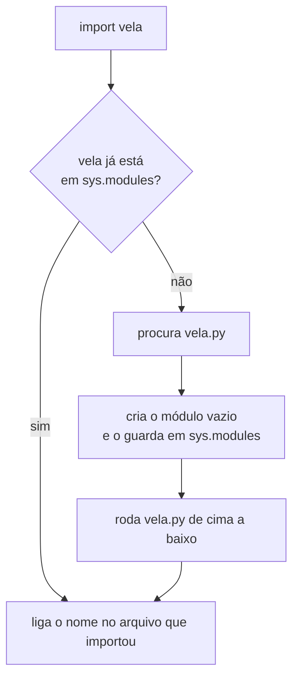

# O módulo e o import

Uma função escrita num arquivo só existe nele. Para usá-la em outro arquivo, o Python tem o
`import`. Todo arquivo `.py` pode ser importado, e um arquivo importado se chama **módulo**. O
nome do módulo é o nome do arquivo sem o `.py`: o arquivo `vela.py` é o módulo `vela`.

## O experimento

Crie dois arquivos na pasta `experimentos`. O primeiro é o módulo, com um `print` solto no topo
para mostrar quando ele roda:

```python title="experimentos/vela.py"
print("vela.py is running")


def light() -> str:
    return "Candle lit"
```

O segundo importa o módulo de três jeitos e usa a função de cada um deles:

```python title="experimentos/importar.py"
import vela
from vela import light
from vela import light as ignite

print(vela.light())
print(light())
print(ignite())
print(type(vela))
print(vela.__name__)
```

```bash
python3 experimentos/importar.py
```

```text
vela.py is running
Candle lit
Candle lit
Candle lit
<class 'module'>
vela
```

## As três formas

| Forma | O que cria no arquivo que importa | Como chamar a função |
|---|---|---|
| `import vela` | o nome `vela`, que aponta para o módulo inteiro | `vela.light()` |
| `from vela import light` | só o nome `light`, que aponta para a função; o nome `vela` **não** é criado | `light()` |
| `from vela import light as ignite` | o nome `ignite`, que aponta para a mesma função | `ignite()` |

- `import vela` dá acesso a tudo o que o módulo define, sempre com o nome do módulo na frente:
  `vela.light()`. Quem lê sabe de onde a função veio;
- `from vela import light` copia um nome do módulo para o arquivo atual. A chamada fica mais
  curta, e o arquivo atual só enxerga o que pediu;
- `as` dá outro nome ao que foi importado. Também vale para módulos: `import vela as candle`. O
  nome novo é um **apelido** (*alias*): a função é a mesma, só o nome muda.

## O objeto módulo

`type(vela)` mostra que `vela` é um valor do tipo `module`: um **objeto módulo**, criado pelo
Python a partir do arquivo. Tudo o que o arquivo define no corpo (funções, variáveis) vira um
**atributo** desse objeto, um nome lido com ponto: `vela.light`. O objeto também ganha atributos
que o Python preenche sozinho, como `__name__`, o nome do módulo.

## O arquivo roda uma vez só

A saída tem um único `vela.py is running`, embora o arquivo tenha três linhas de import. Na
primeira vez que um módulo é importado, o Python:

1. procura o arquivo ([próxima página](./02-onde-o-python-procura.md));
2. cria um objeto módulo, ainda **sem nada** do arquivo, e o guarda em `sys.modules`, um
   dicionário com todos os módulos já carregados, pelo nome;
3. roda o arquivo de cima a baixo. Cada `def` acrescenta uma função ao objeto, e o `print` solto
   imprime na hora;
4. liga o nome pedido (`vela`, `light` ou `ignite`) no arquivo que importou.

Nas vezes seguintes, o Python acha o módulo em `sys.modules` e pula direto para o passo 4: o
arquivo não roda de novo.



A ordem dos passos 2 e 3 importa: o módulo entra em `sys.modules` **antes** de o arquivo rodar.
Enquanto o arquivo roda, o módulo existe, mas está pela metade. A Parte IV mostra o problema que
isso causa quando dois módulos se importam um ao outro
([A explosão](../06-parte-4/03-a-explosao.md)).

Os módulos do projeto não têm `print` solto: só definem funções. Importá-los não imprime nada; a
saída vem dos scripts que chamam as funções.

## A pasta `__pycache__`

Depois de rodar o experimento, aparece a pasta `experimentos/__pycache__`. Ao importar um
arquivo, o Python o traduz para um formato próprio, mais rápido de carregar (o *bytecode*), e
guarda o resultado ali para a próxima vez. É só um cache: pode ser apagada a qualquer momento, o
Python a recria, e ela não faz parte da entrega.
