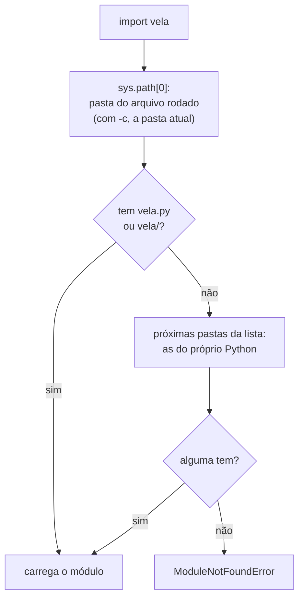

# Onde o Python procura

`import vela` achou o arquivo `experimentos/vela.py` sem que nenhum caminho fosse escrito. O
Python procura os módulos numa lista de pastas, em ordem, e para na primeira que tem o que foi
pedido: um arquivo `vela.py` ou uma pasta `vela/`. Essa lista é o **`sys.path`**, uma variável do
módulo `sys`, que vem com o Python.

## A primeira pasta da lista

O primeiro item da lista muda conforme o jeito de rodar:

- `python3 pasta/arquivo.py`: a pasta **onde está o arquivo rodado**, e não a pasta onde você
  está no terminal;
- `python3 -c '...'`: a pasta onde você está no terminal.

Os outros itens são pastas do próprio Python, com os módulos que vêm com ele e as bibliotecas
instaladas.

Crie `experimentos/onde.py`, que imprime o nome da primeira pasta da lista:

```python title="experimentos/onde.py"
import os
import sys

print(f"first folder searched: {os.path.basename(sys.path[0])}")
```

`sys.path[0]` é o primeiro item, um caminho completo como `/home/ana/the-codex/experimentos`;
`os.path.basename` devolve só o último nome dele. Os módulos `os` e `sys` vêm com o Python e só
aparecem nos experimentos; os arquivos entregues não podem importá-los.

Rode da pasta `the-codex`, e depois de dentro de `experimentos`. `cd experimentos && python3
onde.py` entra na pasta e roda o arquivo; o `&&` liga os dois comandos, e o segundo só roda se o
primeiro deu certo:

```bash
python3 experimentos/onde.py
cd experimentos && python3 onde.py
cd ..
```

```text
first folder searched: experimentos
first folder searched: experimentos
```

As duas respostas são iguais: o arquivo rodado está em `experimentos`, e de onde ele foi chamado
não importa. Foi por isso que `importar.py` achou o `vela.py`, que está na mesma pasta que ele.
O `cd ..` volta para a pasta `the-codex`.

## Quando o módulo não está em nenhuma pasta da lista

Com `-c`, a primeira pasta é a pasta atual. Na `the-codex` não há `vela.py`:

```bash
python3 -c "import vela"
```

```text
Traceback (most recent call last):
  File "<string>", line 1, in <module>
    import vela
ModuleNotFoundError: No module named 'vela'
```

`ModuleNotFoundError` ("módulo não encontrado") é a exceção do `import` que percorre a lista
inteira sem achar nada. De dentro de `experimentos`, o mesmo comando acha o arquivo, e o `print`
do topo do `vela.py` mostra que ele rodou:

```bash
cd experimentos && python3 -c "import vela"
cd ..
```

```text
vela.py is running
```

No Python 3.10, o traceback do `ModuleNotFoundError` não tem a linha `import vela`: para código
vindo do `-c`, ele não mostra a linha de código.



## O que isso quer dizer para o projeto

Os scripts de teste `ft_*.py` ficam na pasta `the-codex`, ao lado do `elements.py` e da pasta
`alchemy/`. Rodar `python3 ft_alembic_0.py` põe `the-codex` no começo do `sys.path`, e por isso
`import elements` e `import alchemy` funcionam. Todo módulo importado durante essa execução,
inclusive os de dentro de `alchemy/`, procura os seus imports na mesma lista, a partir da
`the-codex`. A Parte II mostra a consequência disso para um arquivo que está dentro de uma pasta
([As poções](../04-parte-2/02-as-pocoes.md)).

## Por que o enunciado proíbe mexer no `sys.path`

`sys.path` é uma lista comum, e um programa pode acrescentar pastas a ela antes de importar:
`sys.path.append("alguma/pasta")` torna importável qualquer arquivo daquela pasta. O enunciado
proíbe isso no projeto. Todo import tem de funcionar só pela posição dos arquivos: os scripts na
raiz, o pacote `alchemy/` ao lado deles, e os caminhos de import escritos de acordo com essa
árvore.
