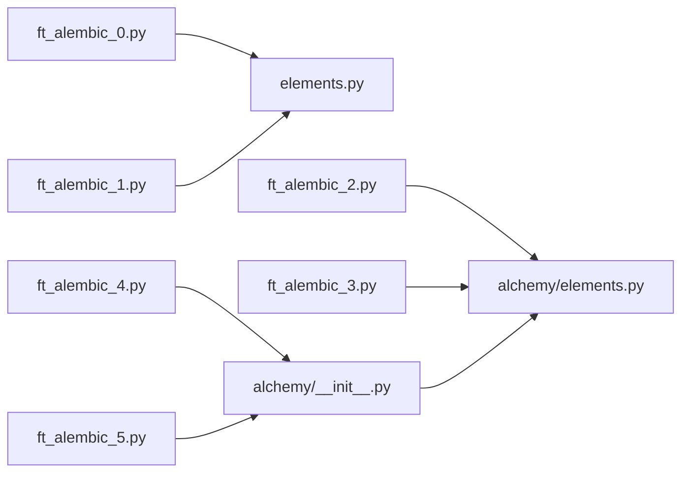

# O problema

Os ingredientes do alquimista estão em dois lugares: dois elementos num arquivo da pasta
principal, e outros dois num arquivo dentro de uma pasta. Os scripts de teste precisam alcançar
os quatro, cada um de um jeito, e um deles precisa mostrar que uma pasta pode **esconder** parte
do que tem dentro.

## O que o enunciado pede

Três arquivos de componentes:

| Arquivo | Conteúdo |
|---|---|
| `elements.py` (na raiz) | `create_fire()`, que devolve `"Fire element created"`, e `create_water()`, que devolve `"Water element created"` |
| `alchemy/elements.py` | `create_earth()`, que devolve `"Earth element created"`, e `create_air()`, que devolve `"Air element created"` |
| `alchemy/__init__.py` | o que for preciso para importar `alchemy` **em parte**: `create_air` fica visível em `alchemy`, e `create_earth` não |

E seis scripts de teste, cada um com um jeito de importar:

| Script | Import pedido | O que faz |
|---|---|---|
| `ft_alembic_0.py` | `import ...` de `elements.py` | cria fogo |
| `ft_alembic_1.py` | `from ... import ...` de `elements.py` | cria água |
| `ft_alembic_2.py` | `import ...` de `alchemy/elements.py` | cria terra |
| `ft_alembic_3.py` | `from ... import ...` de `alchemy/elements.py` | cria ar |
| `ft_alembic_4.py` | `import alchemy` | cria ar e depois tenta criar terra com `alchemy.create_earth()`, o que lança uma exceção |
| `ft_alembic_5.py` | `from alchemy import ...` | cria ar |

O `ft_alembic_4.py` falha de propósito, e o enunciado avisa que o mypy também reclama dele de
propósito. Pode-se capturar a exceção ou não; a saída do enunciado mostra que ela não é
capturada, e o tutorial segue a saída.

O enunciado também avisa que o `__init__.py` pode gerar avisos do flake8 ou do mypy, e pede que
se siga a convenção de costume nesse caso
([A interface do pacote](./05-a-interface-do-pacote.md)).

## A saída esperada

```text
=== Alembic 0 ===
Using: 'import ...' structure to access elements.py
Testing create_fire: Fire element created
```

```text
=== Alembic 1 ===
Using: 'from ... import ...' structure to access elements.py
Testing create_water: Water element created
```

```text
=== Alembic 2 ===
Accessing alchemy/elements.py using 'import ...' structure
Testing create_earth: Earth element created
```

```text
=== Alembic 3 ===
Accessing alchemy/elements.py using 'from ... import ...' structure
Testing create_air: Air element created
```

```text
=== Alembic 4 ===
Accessing the alchemy module using 'import alchemy'
Testing create_air: Air element created
Now show that not all functions can be reached
This will raise an exception!
Testing the hidden create_earth: Traceback (most recent call last):
  File "/tmp/Python/module-06/ft_alembic_4.py", line 12, in <module>
    print(f"{alchemy.create_earth()}")
            ^^^^^^^^^^^^^^^^^^^^
AttributeError: module 'alchemy' has no attribute 'create_earth'. Did you mean: 'create_air'?
```

```text
=== Alembic 5 ===
Accessing the alchemy module using 'from alchemy import ...'
Testing create_air: Air element created
```

O traceback do `ft_alembic_4.py` diz em que arquivo e em que linha o erro aconteceu; o enunciado
rodou o script na pasta `/tmp/Python/module-06`, e o erro está na linha 12 do arquivo. O código
do tutorial põe a chamada na mesma linha 12, para que o traceback saia igual
([O erro proposital](./06-o-erro-proposital.md)).

## As peças desta parte



Cada seta vai de quem importa para quem é importado. O `__init__.py` fica entre os dois últimos
scripts e o `alchemy/elements.py`: é ele que decide o que `import alchemy` entrega.
