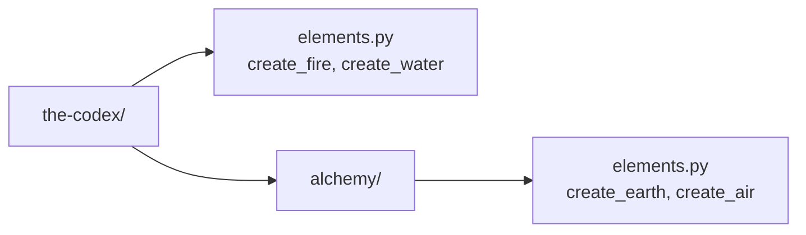

# Os elementos

Os quatro elementos são funções que só devolvem um texto fixo. Dois ficam num arquivo na raiz do
projeto, e dois num arquivo dentro da pasta `alchemy`. Os dois arquivos têm o mesmo nome,
`elements.py`.

## O arquivo da raiz

Crie `elements.py` na pasta `the-codex`:

```python title="elements.py"
def create_fire() -> str:
    return "Fire element created"


def create_water() -> str:
    return "Water element created"
```

## O arquivo dentro da pasta

Crie a pasta `alchemy`:

```bash
mkdir alchemy
```

E, dentro dela, o segundo `elements.py`:

```python title="alchemy/elements.py"
def create_earth() -> str:
    return "Earth element created"


def create_air() -> str:
    return "Air element created"
```

Os textos devolvidos são os das saídas do enunciado, letra por letra. Nenhum dos dois arquivos
importa nada nem imprime nada: só definem funções, que outros arquivos vão chamar.



## Dois arquivos com o mesmo nome

Os dois arquivos se chamam `elements.py`. Um `import elements` acha qual deles? E como pedir o
outro? A [próxima página](./03-o-pacote.md) responde, e mostra o que falta para a pasta `alchemy`
funcionar direito com o Python e com o mypy.
