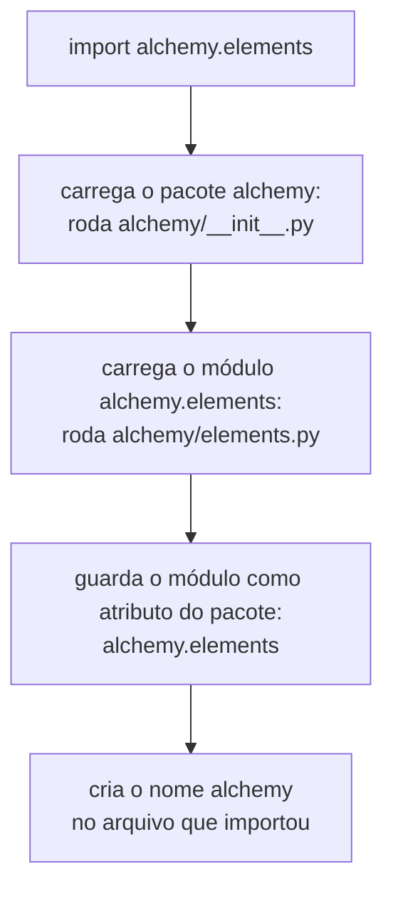

# O pacote

Há dois arquivos `elements.py`. O da raiz é o módulo `elements`, achado na primeira pasta do
`sys.path` ([Onde o Python procura](../02-conceitos/02-onde-o-python-procura.md)). O de dentro
da pasta `alchemy` tem o mesmo nome de arquivo, mas é outro módulo, com outro nome: ele é pedido
pelo caminho, com um ponto no lugar da barra, `alchemy.elements`.

```bash
python3 -c "import elements; print(elements.create_fire())"
python3 -c "import alchemy.elements; print(alchemy.elements.create_earth())"
```

```text
Fire element created
Earth element created
```

Uma pasta que se importa pelo nome, como `alchemy`, é um **pacote** (*package*), e os arquivos
dentro dela são os módulos do pacote. O nome completo de cada um é o caminho a partir da pasta do
`sys.path`, com pontos: `alchemy/elements.py` é `alchemy.elements`. `import elements` nunca chega
ao arquivo de dentro da pasta.

## O que falta: o `__init__.py`

O Python aceitou `import alchemy.elements`, mas o mypy se confunde. O `*.py` do comando abaixo é
trocado pelo terminal pelos nomes de todos os arquivos da pasta atual que terminam em `.py` (por
enquanto, só `elements.py`), e `alchemy` é a pasta inteira:

```bash
.venv/bin/mypy --disallow-untyped-defs *.py alchemy
```

```text
alchemy/elements.py: error: Duplicate module named "elements" (also at "elements.py")
alchemy/elements.py: note: See https://mypy.readthedocs.io/en/stable/running_mypy.html#mapping-file-paths-to-modules for more info
alchemy/elements.py: note: Common resolutions include:
alchemy/elements.py: note:     a) using `--exclude` to avoid checking one of them,
alchemy/elements.py: note:     b) adding `__init__.py` somewhere,
alchemy/elements.py: note:     c) using `--explicit-package-bases` or adjusting `MYPYPATH`
Found 1 error in 1 file (errors prevented further checking)
```

"Módulo duplicado chamado `elements`." Para o mypy, uma pasta só é pacote se tiver um arquivo
chamado `__init__.py`; sem ele, `alchemy/elements.py` vira um módulo solto chamado `elements`, o
mesmo nome do arquivo da raiz. A segunda sugestão da lista é a solução de costume: criar o
`__init__.py`. Por enquanto vazio:

```bash
touch alchemy/__init__.py
.venv/bin/mypy --disallow-untyped-defs *.py alchemy
```

```text
Success: no issues found in 3 source files
```

`touch` cria um arquivo vazio. Com o `__init__.py`, a pasta `alchemy` é um pacote de verdade: o
mypy chama o arquivo de dentro de `alchemy.elements`, e os dois nomes deixam de bater.

O Python aceita uma pasta sem `__init__.py` porque, desde o Python 3.3, ela é tratada como um
tipo especial de pacote, o *namespace package*, feito para juntar pastas espalhadas em lugares
diferentes. Não é o caso deste projeto. O enunciado chama o `__init__.py` de "o portal que
transforma uma pasta simples num pacote", e cada pasta de `alchemy` tem o seu.

## O que o `__init__.py` faz

O `__init__.py` é o módulo do próprio pacote: `import alchemy` roda o `alchemy/__init__.py`, e o
objeto módulo `alchemy` fica com o que esse arquivo definir ou importar. Com o arquivo vazio, o
pacote não oferece nada:

```bash
python3 -c "import alchemy; print(alchemy.elements)"
```

```text
Traceback (most recent call last):
  File "<string>", line 1, in <module>
    import alchemy; print(alchemy.elements)
                          ^^^^^^^^^^^^^^^^
AttributeError: module 'alchemy' has no attribute 'elements'
```

(No Python 3.10, o traceback não tem a linha de código nem a de marcação.)

`AttributeError` ("erro de atributo") é a exceção de um nome lido com ponto que não existe: "o
módulo `alchemy` não tem o atributo `elements`". Importar um pacote **não** carrega os módulos de
dentro dele. Só `import alchemy.elements` carrega:

```bash
python3 -c "import alchemy.elements; print(alchemy.elements.create_air())"
```

```text
Air element created
```

## O que `import alchemy.elements` faz



- o pacote vem antes: importar qualquer coisa de dentro de `alchemy` roda o `alchemy/__init__.py`
  primeiro;
- depois de carregado, o módulo `alchemy.elements` vira um atributo do pacote, e é por isso que
  `alchemy.elements` funciona no segundo comando;
- o nome criado no arquivo que importou é o primeiro da sequência, `alchemy`. Por isso a chamada
  repete o caminho inteiro: `alchemy.elements.create_air()`.
