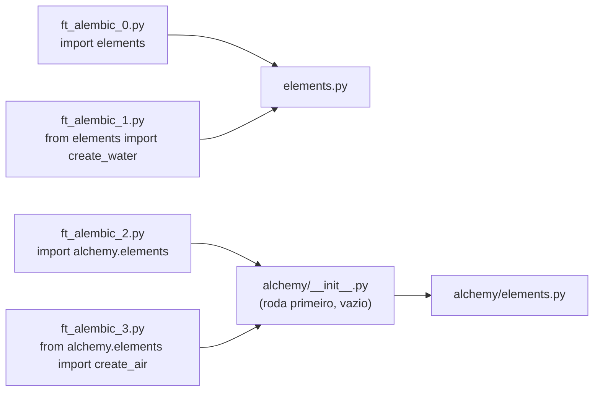

# import e from

Os quatro primeiros scripts alcançam os quatro elementos, cruzando as duas formas do import
([As três formas](../02-conceitos/01-o-modulo-e-o-import.md#as-três-formas)) com os dois
arquivos:

| | `elements.py` (raiz) | `alchemy/elements.py` |
|---|---|---|
| `import ...` | `ft_alembic_0.py` | `ft_alembic_2.py` |
| `from ... import ...` | `ft_alembic_1.py` | `ft_alembic_3.py` |

## O formato dos scripts

Os scripts do projeto têm o mesmo formato: os imports no topo e, depois, os `print` dentro de um
bloco `if __name__ == "__main__":`. O `ft_kaboom_1.py`, da Parte IV, tem um motivo para pôr o
import dentro do bloco ([A explosão](../06-parte-4/03-a-explosao.md#o-script)).

- `__name__` é uma variável que o Python preenche em todo módulo. No arquivo rodado com
  `python3`, ela vale `"__main__"`; num arquivo importado, vale o nome do módulo. O bloco roda só
  quando o arquivo é o programa principal, e não quando outro arquivo o importa;
- o código fica direto no bloco, sem uma função `main`. Assim, quando um script falha, o
  traceback aponta a linha do próprio bloco, com `in <module>`, como nas saídas do enunciado
  ([O erro proposital](./06-o-erro-proposital.md)). Dentro de uma função, o traceback ganharia
  mais um passo, com o nome dela;
- duas linhas em branco separam os imports do bloco, como o PEP 8 pede antes e depois de funções
  e classes. Aqui elas não são obrigatórias para o flake8, mas deixam todos os scripts iguais.

## ft_alembic_0.py: import do arquivo da raiz

```python title="ft_alembic_0.py"
import elements


if __name__ == "__main__":
    print("=== Alembic 0 ===")
    print("Using: 'import ...' structure to access elements.py")
    print(f"Testing create_fire: {elements.create_fire()}")
```

`import elements` cria o nome `elements`, e a função é chamada pelo módulo:
`elements.create_fire()`. A chamada fica dentro das chaves da f-string, e o texto devolvido entra
no lugar dela.

## ft_alembic_1.py: from do arquivo da raiz

```python title="ft_alembic_1.py"
from elements import create_water


if __name__ == "__main__":
    print("=== Alembic 1 ===")
    print("Using: 'from ... import ...' structure to access elements.py")
    print(f"Testing create_water: {create_water()}")
```

`from elements import create_water` traz só a função, chamada sem o nome do módulo.

## ft_alembic_2.py: import do arquivo do pacote

```python title="ft_alembic_2.py"
import alchemy.elements


if __name__ == "__main__":
    print("=== Alembic 2 ===")
    print("Accessing alchemy/elements.py using 'import ...' structure")
    print(f"Testing create_earth: {alchemy.elements.create_earth()}")
```

`import alchemy.elements` cria o nome `alchemy`, e a chamada percorre o caminho inteiro:
pacote, módulo, função ([O que import alchemy.elements faz](./03-o-pacote.md#o-que-import-alchemyelements-faz)).

## ft_alembic_3.py: from do arquivo do pacote

```python title="ft_alembic_3.py"
from alchemy.elements import create_air


if __name__ == "__main__":
    print("=== Alembic 3 ===")
    print("Accessing alchemy/elements.py using "
          "'from ... import ...' structure")
    print(f"Testing create_air: {create_air()}")
```

`from alchemy.elements import create_air` carrega o pacote e o módulo do mesmo jeito, mas cria
só o nome `create_air`. Escrito numa linha só, o `print` da segunda mensagem teria 80
caracteres, um a mais que o limite de 79 do flake8 (aviso `E501 line too long`); o texto foi
dividido em dois pedaços dentro dos parênteses. O Python junta textos escritos lado a lado num
só: `"ab" "cd"` é `"abcd"`.

## Rodar dois deles

```bash
python3 ft_alembic_0.py
python3 ft_alembic_2.py
```

```text
=== Alembic 0 ===
Using: 'import ...' structure to access elements.py
Testing create_fire: Fire element created
=== Alembic 2 ===
Accessing alchemy/elements.py using 'import ...' structure
Testing create_earth: Earth element created
```

A página [Rodar e conferir](./08-rodar-e-conferir.md) compara os seis com o enunciado.


