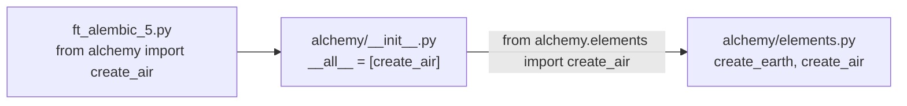

# A interface do pacote

Os dois últimos scripts não falam com `alchemy/elements.py`: falam com o pacote. `ft_alembic_5.py`
pede `from alchemy import create_air`, e `ft_alembic_4.py` usa `alchemy.create_air()`. Com o
`__init__.py` vazio, o pacote não tem esse nome:

```bash
python3 -c "import alchemy; print(alchemy.create_air())"
```

```text
Traceback (most recent call last):
  File "<string>", line 1, in <module>
    import alchemy; print(alchemy.create_air())
                          ^^^^^^^^^^^^^^^^^^
AttributeError: module 'alchemy' has no attribute 'create_air'
```

(Até o Python 3.12, o traceback não tem a linha de código nem a de marcação.)

Os nomes que um módulo ou pacote oferece a quem o importa formam a sua **interface**. A interface
de um pacote é feita no `__init__.py`: tudo o que ele importa ou define vira atributo do pacote.

## O `__init__.py`

Escreva em `alchemy/__init__.py`:

```python title="alchemy/__init__.py"
from alchemy.elements import create_air
```

Quando `import alchemy` roda este arquivo, o `from ... import` carrega `alchemy.elements` e cria o
nome `create_air` **dentro do pacote**. A partir daí, `alchemy.create_air` existe. O
`create_earth` não foi importado, e continua fora da interface: é isso que o enunciado chama de
importar o pacote "em parte".

O caminho escrito é o completo, `alchemy.elements`, mesmo dentro do próprio pacote `alchemy`. A
Parte III mostra uma forma mais curta, o import relativo
([Absoluto e relativo](../05-parte-3/02-absoluto-e-relativo.md)).

## ft_alembic_5.py

```python title="ft_alembic_5.py"
from alchemy import create_air


if __name__ == "__main__":
    print("=== Alembic 5 ===")
    print("Accessing the alchemy module using 'from alchemy import ...'")
    print(f"Testing create_air: {create_air()}")
```

```bash
python3 ft_alembic_5.py
```

```text
=== Alembic 5 ===
Accessing the alchemy module using 'from alchemy import ...'
Testing create_air: Air element created
```

`from alchemy import create_air` pede o nome ao pacote, sem saber em que arquivo de dentro dele a
função está. Se um dia `create_air` mudar de arquivo, só o `__init__.py` muda; o script continua
igual.

## O aviso do flake8

```bash
.venv/bin/flake8 *.py alchemy
```

```text
alchemy/__init__.py:1:1: F401 'alchemy.elements.create_air' imported but unused
```

"`create_air` importado, mas não usado." Num arquivo comum, um import que ninguém usa é lixo, e o
flake8 avisa com o código `F401`. No `__init__.py`, o import **é** o uso: ele existe para pôr o
nome na interface do pacote, e o flake8 não tem como saber disso sozinho.

O mypy, com as opções do projeto, não reclama. Com `--strict`, a opção que liga todas as
conferências extras do mypy, a reclamação aparece no script que usa o nome:

```bash
.venv/bin/mypy --strict *.py alchemy
```

```text
ft_alembic_5.py:1: error: Module "alchemy" does not explicitly export attribute "create_air"  [attr-defined]
Found 1 error in 1 file (checked 8 source files)
```

"O módulo `alchemy` não exporta explicitamente o atributo `create_air`." No modo estrito, um nome
que um módulo importa não faz parte da interface dele, a menos que o módulo diga que faz. São
esses os avisos de que o enunciado fala ("você pode se deparar com erros do flake8 / mypy no seu
`__init__.py`").

## A convenção: `__all__`

A convenção de costume é a variável `__all__`: uma lista com os nomes, em texto, que formam a
interface do módulo. Acrescente-a ao `alchemy/__init__.py`, que fica assim:

```python title="alchemy/__init__.py"
from alchemy.elements import create_air

__all__ = ["create_air"]
```

```bash
.venv/bin/flake8 *.py alchemy
.venv/bin/mypy --strict *.py alchemy
```

```text
Success: no issues found in 8 source files
```

O flake8 não imprime nada, e o mypy, mesmo no modo estrito, não acha problema. `__all__` diz às
duas ferramentas que `create_air` está ali para ser exportado. Para o próprio Python, `__all__`
define o que `from alchemy import *` traz (o `*` quer dizer "todos os nomes da interface").

Há outra convenção, a do apelido igual ao nome: `from alchemy.elements import create_air as
create_air`. Ela satisfaz o mypy no modo estrito, mas o flake8 continua acusando o mesmo `F401`.
Só `__all__` resolve as duas ferramentas, e é a que o tutorial usa.


