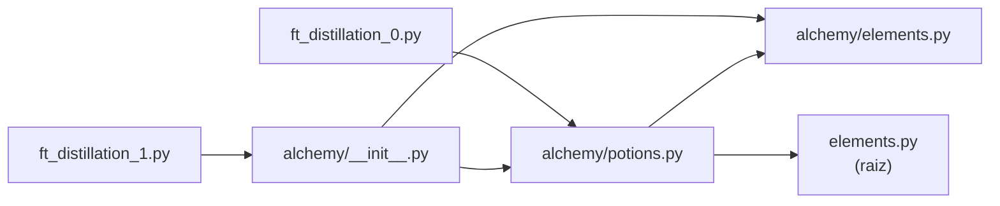

# O problema

Até aqui, só os scripts da raiz importavam alguma coisa. Na Parte II, um arquivo **dentro** do
pacote precisa dos quatro elementos: dois estão no vizinho dele, `alchemy/elements.py`, e dois
estão fora do pacote, no `elements.py` da raiz. O enunciado chama isso de import aninhado: um
arquivo distante chamando código de outro arquivo distante.

## O que o enunciado pede

Um arquivo novo, `alchemy/potions.py`, com duas poções:

| Função | Devolve |
|---|---|
| `healing_potion()` | `Healing potion brewed with '<terra>' and '<ar>'`, com o texto devolvido por `create_earth()` e por `create_air()` no lugar de cada elemento |
| `strength_potion()` | `Strength potion brewed with '<fogo>' and '<água>'`, com o texto de `create_fire()` e de `create_water()` |

E "Tudo o mais que for útil para acessar os quatro elementos fundamentais": os imports.

No enunciado, as descrições das duas poções não fecham a última aspa simples
(`'[created air element]"` e `'[created water element]"`); a saída de exemplo fecha, e o tutorial
segue a saída.

Dois scripts conferem as poções:

| Script | Import pedido | O que faz |
|---|---|---|
| `ft_distillation_0.py` | `from ... import ...` de `alchemy/potions.py` | prepara as duas poções |
| `ft_distillation_1.py` | `import alchemy` | prepara a poção de força e a poção `heal()`, um **apelido** (*alias*) de pacote para a poção de cura, criado no `__init__.py` |

## A saída esperada

```text
=== Distillation 0 ===
Direct access to alchemy/potions.py
Testing strength_potion: Strength potion brewed with 'Fire element created' and 'Water element created'
Testing healing_potion: Healing potion brewed with 'Earth element created' and 'Air element created'
```

```text
=== Distillation 1 ===
Using: 'import alchemy' structure to access potions
Testing strength_potion: Strength potion brewed with 'Fire element created' and 'Water element created'
Testing heal alias: Healing potion brewed with 'Earth element created' and 'Air element created'
```

As duas saídas imprimem a poção de força antes da de cura.

## As peças desta parte



A seta nova que importa é a de `alchemy/potions.py` para o `elements.py` da raiz: um arquivo de
dentro do pacote usando um arquivo de fora dele.
