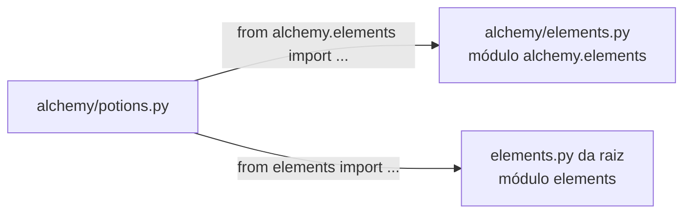

# As poções

`alchemy/potions.py` fica dentro do pacote e precisa de funções de dois arquivos: o vizinho,
`alchemy/elements.py`, e o `elements.py` da raiz, fora do pacote.

```python title="alchemy/potions.py"
from alchemy.elements import create_air, create_earth
from elements import create_fire, create_water


def healing_potion() -> str:
    return (f"Healing potion brewed with '{create_earth()}' "
            f"and '{create_air()}'")


def strength_potion() -> str:
    return (f"Strength potion brewed with '{create_fire()}' "
            f"and '{create_water()}'")
```

- cada poção chama as duas funções de elemento dentro de uma f-string, entre aspas simples, como
  na saída do enunciado;
- numa linha só, cada `return` passaria de 79 caracteres. Os parênteses em volta permitem
  quebrar a linha, e as duas f-strings escritas lado a lado viram um texto só, como os textos
  comuns ([ft_alembic_3.py](../03-parte-1/04-import-e-from.md#ft_alembic_3py-from-do-arquivo-do-pacote)).

## Qual `elements`?

As duas linhas de import têm `elements` no caminho, e as duas funcionam porque o Python procura
os módulos pelo `sys.path`, e não pela pasta do arquivo que importa:

- `from alchemy.elements import ...` pede o módulo `alchemy.elements`: o arquivo
  `alchemy/elements.py`, achado a partir da pasta `the-codex`;
- `from elements import ...` pede o módulo `elements`. O Python procura na primeira pasta do
  `sys.path`, a `the-codex` (a pasta do script que está rodando), e acha o `elements.py` da
  **raiz**. O vizinho `alchemy/elements.py`, que está na mesma pasta que `potions.py`, não é
  `elements`: o nome dele é `alchemy.elements`.

O Python guarda em cada função o nome do módulo onde ela foi escrita, no atributo `__module__`.
As funções que `potions.py` importou mostram de onde vieram:

```bash
python3 -c "from alchemy.potions import create_fire, create_earth; print(create_fire.__module__, create_earth.__module__)"
```

```text
elements alchemy.elements
```

`from alchemy.potions import create_fire` funciona porque `create_fire` virou um nome dentro de
`alchemy.potions` com o import; o comando só usa isso para conferir a origem de cada função.

E uma poção pronta:

```bash
python3 -c "import alchemy.potions; print(alchemy.potions.strength_potion())"
```

```text
Strength potion brewed with 'Fire element created' and 'Water element created'
```



## Rodar `potions.py` direto não funciona

O `potions.py` foi feito para ser importado a partir da raiz. Rodado como programa, a primeira
pasta do `sys.path` passa a ser a pasta dele, `alchemy`:

```bash
python3 alchemy/potions.py
```

```text
Traceback (most recent call last):
  File "/home/ana/the-codex/alchemy/potions.py", line 1, in <module>
    from alchemy.elements import create_air, create_earth
ModuleNotFoundError: No module named 'alchemy'
```

Dentro da pasta `alchemy` não existe outra pasta `alchemy`, e o import falha. (No lugar de
`/home/ana/the-codex` aparece o caminho da sua pasta.) Se a primeira linha passasse, a segunda
acharia o arquivo errado: na pasta `alchemy`, `elements` é o `alchemy/elements.py`, que não tem
`create_fire`. É por isso que os pontos de entrada do projeto são os scripts da raiz, e os
arquivos do pacote só são usados através do `import`.
