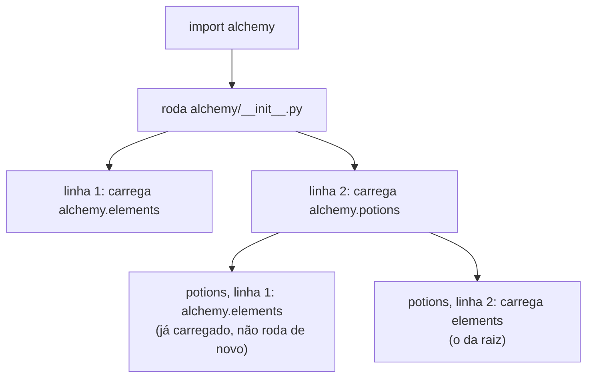

# O apelido heal

O `ft_distillation_1.py` só importa `alchemy` e chama duas poções pelo pacote:
`alchemy.strength_potion()` e `alchemy.heal()`. A primeira tem o nome original; a segunda é a
poção de cura com outro nome, `heal` ("curar"). As duas precisam entrar na interface do pacote,
o `alchemy/__init__.py`, e o nome `heal` é criado ali, com `as`
([As três formas](../02-conceitos/01-o-modulo-e-o-import.md#as-três-formas)).

```python title="alchemy/__init__.py"
from alchemy.elements import create_air
from alchemy.potions import healing_potion as heal, strength_potion

__all__ = ["create_air", "heal", "strength_potion"]
```

- `from alchemy.potions import healing_potion as heal, strength_potion` traz dois nomes de uma vez,
  separados por vírgula. O primeiro entra no pacote com o nome `heal`; o segundo, com o nome
  original;
- `__all__` ganha os dois nomes novos, como a interface que o pacote oferece. O nome que vai na
  lista é `"heal"`, o que existe no pacote; `healing_potion` não existe nele;
- `create_air` continua, e `create_earth` continua de fora: o `ft_alembic_4.py` segue falhando
  como antes.

```bash
python3 -c "import alchemy; print(alchemy.heal())"
python3 -c "import alchemy; print(alchemy.healing_potion())"
```

```text
Healing potion brewed with 'Earth element created' and 'Air element created'
Traceback (most recent call last):
  File "<string>", line 1, in <module>
    import alchemy; print(alchemy.healing_potion())
                          ^^^^^^^^^^^^^^^^^^^^^^
AttributeError: module 'alchemy' has no attribute 'healing_potion'. Did you mean '.potions.healing_potion' instead of '.healing_potion'?
```

`heal` e `healing_potion` são a mesma função, mas o pacote só oferece o apelido. Dentro de
`alchemy/potions.py`, o nome continua `healing_potion`, e o `ft_distillation_0.py` o importa de
lá com esse nome. O Python 3.15 procura o nome também dentro dos módulos do pacote e sugere o
caminho onde ele existe: "você quis dizer `.potions.healing_potion`?". Do Python 3.10 ao 3.14, a
última linha termina em `'healing_potion'`, sem sugestão; até o 3.12, o traceback também não tem a
linha de código nem a de marcação.

## O que `import alchemy` carrega agora



Importar o pacote agora carrega quatro módulos: `alchemy`, `alchemy.elements`, `alchemy.potions`
e o `elements` da raiz. O `alchemy.elements` é pedido duas vezes e roda uma só
([O arquivo roda uma vez só](../02-conceitos/01-o-modulo-e-o-import.md#o-arquivo-roda-uma-vez-só)).
