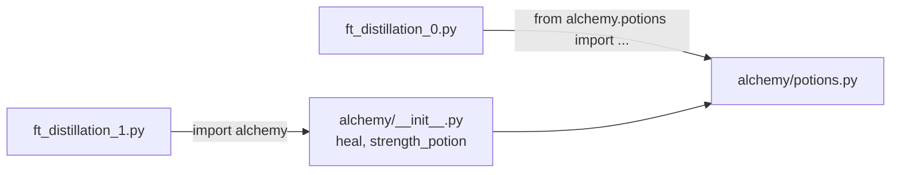

# Os scripts

Os dois scripts da Parte II chegam às mesmas poções por caminhos diferentes: o primeiro vai
direto ao arquivo `alchemy/potions.py`, e o segundo passa pela interface do pacote.

## ft_distillation_0.py: direto no arquivo

```python title="ft_distillation_0.py"
from alchemy.potions import healing_potion, strength_potion


if __name__ == "__main__":
    print("=== Distillation 0 ===")
    print("Direct access to alchemy/potions.py")
    print(f"Testing strength_potion: {strength_potion()}")
    print(f"Testing healing_potion: {healing_potion()}")
```

`from alchemy.potions import ...` traz as duas funções com os nomes originais. Mesmo indo
"direto" ao arquivo, o Python roda o `alchemy/__init__.py` antes, porque `alchemy.potions` fica
dentro do pacote ([O que import alchemy.elements faz](../03-parte-1/03-o-pacote.md#o-que-import-alchemyelements-faz)).

## ft_distillation_1.py: pela interface do pacote

```python title="ft_distillation_1.py"
import alchemy


if __name__ == "__main__":
    print("=== Distillation 1 ===")
    print("Using: 'import alchemy' structure to access potions")
    print(f"Testing strength_potion: {alchemy.strength_potion()}")
    print(f"Testing heal alias: {alchemy.heal()}")
```

`import alchemy` só enxerga o que o `__init__.py` oferece: `alchemy.strength_potion` e o apelido
`alchemy.heal`.

```bash
python3 ft_distillation_1.py
```

```text
=== Distillation 1 ===
Using: 'import alchemy' structure to access potions
Testing strength_potion: Strength potion brewed with 'Fire element created' and 'Water element created'
Testing heal alias: Healing potion brewed with 'Earth element created' and 'Air element created'
```


