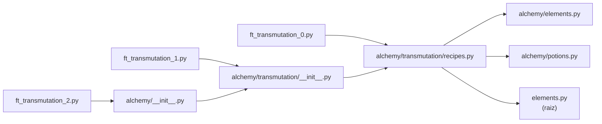

# O problema

A Parte III cria um pacote dentro do pacote: a pasta `alchemy/transmutation/`, com uma receita
que usa um elemento do pacote, um elemento da raiz e uma poção. Até aqui, todo import escrevia o
caminho completo a partir da raiz (`alchemy.elements`). Há um segundo jeito, que parte do arquivo
onde o import está escrito, e a Parte III pede os dois.

## O que o enunciado pede

Um arquivo `alchemy/transmutation/recipes.py` com:

- a função `lead_to_gold()` ("chumbo em ouro"), que devolve
  `Recipe transmuting Lead to Gold: brew '<ar>' and '<poção de força>' mixed with '<fogo>'`, com o
  texto de `create_air()`, de `strength_potion()` e de `create_fire()` no lugar de cada item;
- pelo menos **um import absoluto e um import relativo**
  ([Absoluto e relativo](./02-absoluto-e-relativo.md)).

E três scripts, todos com a forma `import ...`:

| Script | O que importa | Mensagem |
|---|---|---|
| `ft_transmutation_0.py` | o arquivo `alchemy/transmutation/recipes.py` direto | `Using file alchemy/transmutation/recipes.py directly` |
| `ft_transmutation_1.py` | o pacote `transmutation` direto | `Import transmutation module directly` |
| `ft_transmutation_2.py` | só o pacote `alchemy` | `Import alchemy module only` |

O enunciado avisa que talvez seja preciso criar ou atualizar arquivos extras. São dois: o
`alchemy/transmutation/__init__.py`, que transforma a pasta nova em pacote, e o
`alchemy/__init__.py`, que precisa levar à receita quem só importa `alchemy`
([O subpacote](./04-o-subpacote.md)).

## A saída esperada

As três saídas terminam com a mesma linha, longa:

```text
=== Transmutation 0 ===
Using file alchemy/transmutation/recipes.py directly
Testing lead to gold: Recipe transmuting Lead to Gold: brew 'Air element created' and 'Strength potion brewed with 'Fire element created' and 'Water element created'' mixed with 'Fire element created'
```

```text
=== Transmutation 1 ===
Import transmutation module directly
Testing lead to gold: Recipe transmuting Lead to Gold: brew 'Air element created' and 'Strength potion brewed with 'Fire element created' and 'Water element created'' mixed with 'Fire element created'
```

```text
=== Transmutation 2 ===
Import alchemy module only
Testing lead to gold: Recipe transmuting Lead to Gold: brew 'Air element created' and 'Strength potion brewed with 'Fire element created' and 'Water element created'' mixed with 'Fire element created'
```

O texto da poção de força tem as suas próprias aspas simples, e por isso aparecem duas aspas
seguidas no fim dela: `'Water element created''`. No PDF do enunciado, a linha longa aparece
quebrada em duas por falta de espaço na página; é uma linha só.

## A pergunta

O enunciado deixa uma pergunta em aberto: "Quando um alquimista deve usar caminhos absolutos e
quando deve usar caminhos relativos?". A resposta está em
[Perguntas de revisão](../07-fechamento/03-perguntas-de-revisao.md#quando-usar-import-absoluto-e-quando-usar-relativo).

## As peças desta parte


