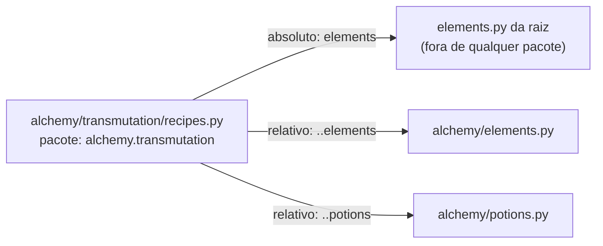

# Absoluto e relativo

A receita fica em `alchemy/transmutation/recipes.py` e precisa de três funções:
`create_air` (de `alchemy/elements.py`), `strength_potion` (de `alchemy/potions.py`) e
`create_fire` (do `elements.py` da raiz). Há dois jeitos de escrever o caminho até cada uma.

## Import absoluto

O **import absoluto** escreve o nome completo do módulo, a partir de uma pasta do `sys.path`. É o
que o projeto usou até aqui:

```python
from alchemy.potions import strength_potion
```

O caminho é o mesmo em qualquer arquivo do projeto, esteja ele na raiz, em `alchemy/` ou em
`alchemy/transmutation/`: `alchemy.potions` é sempre `alchemy/potions.py`.

## Import relativo

O **import relativo** começa com pontos, e o caminho parte do pacote onde está o arquivo que
importa:

- `.` é o pacote do próprio arquivo;
- `..` é o pacote um nível acima;
- cada ponto a mais sobe mais um nível.

Para `alchemy/transmutation/recipes.py`, o pacote é `alchemy.transmutation`:

| Escrito em `recipes.py` | Quer dizer | Arquivo |
|---|---|---|
| `from ..potions import ...` | `alchemy.potions` | `alchemy/potions.py` |
| `from ..elements import ...` | `alchemy.elements` | `alchemy/elements.py` |

O `alchemy/transmutation/__init__.py` pertence ao mesmo pacote: escrito nele,
`from .recipes import ...` quer dizer `alchemy.transmutation.recipes`.

O Python faz essa conta com o atributo `__package__` do módulo, que guarda o nome do pacote a que
ele pertence. `recipes.py` tem `__package__` igual a `"alchemy.transmutation"`: um ponto é esse
pacote, e o segundo ponto tira o último nome, chegando a `alchemy`.

Três limites do import relativo:

- só existe na forma `from ... import ...`. `import .potions` é erro de sintaxe
  (`SyntaxError: invalid syntax`): o `import` sozinho exige o nome completo;
- não sai do pacote mais externo. O `elements.py` da raiz não está em pacote nenhum, e só pode
  ser importado com o nome absoluto, `elements`. Com pontos demais, como `from ...elements` em
  `recipes.py`, o Python para com
  `ImportError: attempted relative import beyond top-level package` ("import relativo além do
  pacote mais externo");
- só funciona num arquivo que foi importado como parte de um pacote. Um script da raiz, ou um
  arquivo do pacote rodado direto com `python3`, não tem pacote, e o import relativo falha
  ([O subpacote](./04-o-subpacote.md#rodar-um-arquivo-do-pacote-direto)).

## Os dois lado a lado



O mesmo arquivo pode usar os dois jeitos, um em cada linha, e a receita da
[próxima página](./03-recipes.md) faz isso: o enunciado pede pelo menos um de cada.

## O critério do tutorial

A partir daqui, o projeto segue uma regra só, escolha do tutorial:

- **dentro do pacote `alchemy`**, um arquivo importa outro arquivo do pacote com import
  **relativo**. O caminho fica preso à estrutura de dentro do pacote, e não ao nome dele;
- **o que está fora do pacote** (o `elements.py` da raiz) e **tudo o que se importa a partir dos
  scripts** `ft_*.py` usam import **absoluto**: o relativo não sai do pacote mais externo nem
  funciona num script rodado direto.

Os dois arquivos do pacote escritos nas Partes I e II, o `alchemy/__init__.py` e o
`alchemy/potions.py`, importam o vizinho `alchemy.elements` com o nome absoluto, porque o import
relativo ainda não tinha aparecido. A [página do subpacote](./04-o-subpacote.md) os passa para o
critério. O motivo da regra está em
[As perguntas do enunciado](../07-fechamento/03-as-perguntas-do-enunciado.md#quando-usar-import-absoluto-e-quando-usar-relativo).
