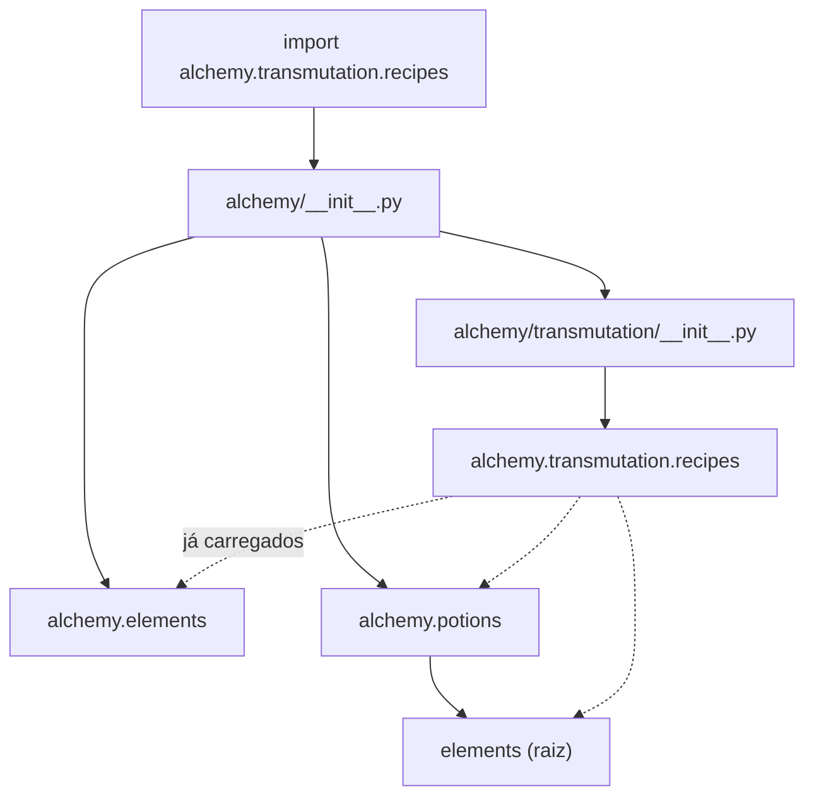

# O subpacote

Dois scripts não vão direto ao `recipes.py`: o `ft_transmutation_1.py` importa o pacote
`transmutation`, e o `ft_transmutation_2.py`, só o `alchemy`. Cada um precisa que o
`__init__.py` do pacote que ele importa ofereça a receita.

## O `__init__.py` de `transmutation`

```python title="alchemy/transmutation/__init__.py"
from .recipes import lead_to_gold

__all__ = ["lead_to_gold"]
```

O ponto quer dizer "o pacote deste arquivo", `alchemy.transmutation`, e `.recipes` é o
`alchemy/transmutation/recipes.py` ([Import relativo](./02-absoluto-e-relativo.md#import-relativo)).
Com isso, `lead_to_gold` entra na interface de `alchemy.transmutation`, e o `__all__` evita o
aviso `F401` do flake8 ([A convenção](../03-parte-1/05-a-interface-do-pacote.md#a-convenção-__all__)).

`transmutation` é um **subpacote**: um pacote dentro de outro. O nome completo dele é
`alchemy.transmutation`; sozinho, `transmutation` não é um nome que o Python ache, porque a pasta
não está numa pasta do `sys.path`, e sim dentro de `alchemy`. Por isso o `ft_transmutation_1.py`
importa `alchemy.transmutation` (escolha do tutorial para "importar o módulo `transmutation`
diretamente", já que acrescentar a pasta `alchemy` ao `sys.path` é proibido).

## O `__init__.py` de `alchemy`

Para quem importa só `alchemy`, o caminho até a receita passa pelo `alchemy/__init__.py`. Ele
ganha a linha da receita e, pelo [critério do tutorial](./02-absoluto-e-relativo.md#o-critério-do-tutorial),
os imports dos vizinhos passam a ser relativos:

```python title="alchemy/__init__.py"
from .elements import create_air
from .potions import healing_potion as heal, strength_potion
from .transmutation import lead_to_gold

__all__ = ["create_air", "heal", "strength_potion", "lead_to_gold"]
```

A linha nova carrega o subpacote (que carrega o `recipes.py`) e põe `lead_to_gold` na interface
de `alchemy`. O `ft_transmutation_2.py` chama `alchemy.lead_to_gold()`. Escolha do tutorial: o
nome da receita fica direto no pacote, como as poções da Parte II. A linha também faz o
subpacote virar atributo de `alchemy`, e `alchemy.transmutation.lead_to_gold()` funcionaria do
mesmo jeito.

Escrito no `alchemy/__init__.py`, o ponto quer dizer o próprio pacote `alchemy`: `.elements` é o
mesmo `alchemy.elements` de antes, e nada muda para quem importa o pacote.

## O `potions.py` no critério

O `alchemy/potions.py` também importa um vizinho do pacote, e passa a usar o relativo para ele. O
`elements.py` da raiz continua absoluto:

```python title="alchemy/potions.py"
from elements import create_fire, create_water
from .elements import create_air, create_earth


def healing_potion() -> str:
    return (f"Healing potion brewed with '{create_earth()}' "
            f"and '{create_air()}'")


def strength_potion() -> str:
    return (f"Strength potion brewed with '{create_fire()}' "
            f"and '{create_water()}'")
```

As duas linhas de import trocaram de lugar: o absoluto vem antes, como na receita. O corpo do
arquivo não muda.

## Quem é quem

```bash
python3 -c "from alchemy.transmutation import recipes; print(recipes.__name__, recipes.__package__)"
```

```text
alchemy.transmutation.recipes alchemy.transmutation
```

O módulo se chama `alchemy.transmutation.recipes`, e o pacote dele, que os pontos do import
relativo usam como ponto de partida, é `alchemy.transmutation`.

## Rodar um arquivo do pacote direto

Rodado com `python3`, um arquivo é o programa principal, e não um módulo de pacote: o
`__package__` dele vale `None` (nenhum pacote), e o import relativo não tem de onde partir.

```bash
python3 alchemy/transmutation/__init__.py
```

```text
Traceback (most recent call last):
  File "/home/ana/the-codex/alchemy/transmutation/__init__.py", line 1, in <module>
    from .recipes import lead_to_gold
ImportError: attempted relative import with no known parent package
```

"Import relativo tentado sem pacote pai conhecido." (No lugar de `/home/ana/the-codex` aparece o
caminho da sua pasta.) Os arquivos do pacote são usados pelo `import`, a partir dos scripts da
raiz, nunca rodados direto; o `potions.py` da Parte II já tinha mostrado isso com o import
absoluto ([Rodar potions.py direto](../04-parte-2/02-as-pocoes.md#rodar-potionspy-direto-não-funciona)).

## O que um import "direto no arquivo" carrega

O `ft_transmutation_0.py` importa `alchemy.transmutation.recipes`, o arquivo da receita. Mesmo
assim, o Python carrega todos os pacotes do caminho antes, e cada `__init__.py` carrega o que
importa. `sys.modules` mostra o resultado (o `sys` só aparece neste teste no terminal):

```bash
python3 -c "import alchemy.transmutation.recipes, sys; print(sorted(m for m in sys.modules if m.startswith('alchemy') or m == 'elements'))"
```

```text
['alchemy', 'alchemy.elements', 'alchemy.potions', 'alchemy.transmutation', 'alchemy.transmutation.recipes', 'elements']
```

Seis módulos: os três pacotes e módulos do caminho, mais tudo o que o `alchemy/__init__.py`
importou. Cada um rodou uma vez só, mesmo pedido por vários arquivos.



As setas tracejadas são imports que acham o módulo já em `sys.modules`.
