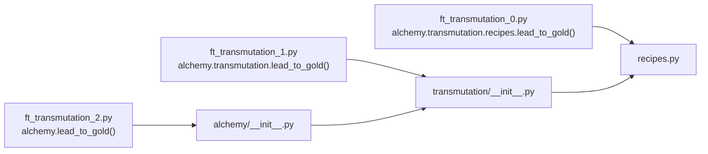

# Os scripts

Os três scripts usam a forma `import ...` e chegam à mesma receita, cada um parando num nível
diferente do caminho `alchemy.transmutation.recipes`.

## ft_transmutation_0.py: o arquivo

```python title="ft_transmutation_0.py"
import alchemy.transmutation.recipes


if __name__ == "__main__":
    print("=== Transmutation 0 ===")
    print("Using file alchemy/transmutation/recipes.py directly")
    print("Testing lead to gold: "
          f"{alchemy.transmutation.recipes.lead_to_gold()}")
```

O import tem o nome completo do módulo da receita, e a chamada repete o caminho inteiro. A linha
do `print` foi dividida em duas para caber nos 79 caracteres.

## ft_transmutation_1.py: o subpacote

```python title="ft_transmutation_1.py"
import alchemy.transmutation


if __name__ == "__main__":
    print("=== Transmutation 1 ===")
    print("Import transmutation module directly")
    print(f"Testing lead to gold: {alchemy.transmutation.lead_to_gold()}")
```

O import para no subpacote, e `lead_to_gold` vem da interface dele, o
`alchemy/transmutation/__init__.py`.

## ft_transmutation_2.py: só o pacote

```python title="ft_transmutation_2.py"
import alchemy


if __name__ == "__main__":
    print("=== Transmutation 2 ===")
    print("Import alchemy module only")
    print(f"Testing lead to gold: {alchemy.lead_to_gold()}")
```

O import só pede `alchemy`, e `lead_to_gold` vem da interface do `alchemy/__init__.py`.

```bash
python3 ft_transmutation_2.py
```

```text
=== Transmutation 2 ===
Import alchemy module only
Testing lead to gold: Recipe transmuting Lead to Gold: brew 'Air element created' and 'Strength potion brewed with 'Fire element created' and 'Water element created'' mixed with 'Fire element created'
```



Os três chamam a mesma função: os dois `__init__.py` só criam nomes novos que apontam para ela.
