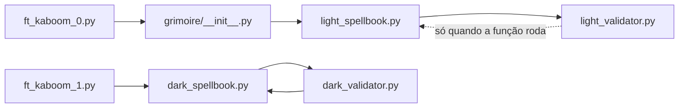

# O problema

Dois módulos às vezes precisam um do outro: um livro de feitiços usa o validador para decidir se
registra um feitiço, e o validador usa o livro para saber quais ingredientes são permitidos.
Quando cada um importa o outro no topo do arquivo, o import falha: é a **dependência circular**
(ou import circular). A Parte IV constrói esse par duas vezes, numa versão que evita o problema
(a magia da luz) e noutra que explode com ele (a magia das trevas).

## O que o enunciado pede

Uma pasta nova, `alchemy/grimoire/` (o grimório), com dois arquivos da luz:

| Arquivo | Função | O que faz |
|---|---|---|
| `light_spellbook.py` | `light_spell_allowed_ingredients()` | devolve a lista dos ingredientes permitidos: `"earth"`, `"air"`, `"fire"` e `"water"` |
| `light_spellbook.py` | `light_spell_record(spell_name: str, ingredients: str)` | devolve um texto dizendo se o feitiço foi registrado ou rejeitado; quem decide é a função de validação |
| `light_validator.py` | `validate_ingredients(ingredients: str)` | devolve os ingredientes seguidos de `VALID` ou `INVALID`. São válidos se incluírem pelo menos um dos ingredientes permitidos pelo livro, sem diferenciar maiúsculas de minúsculas |

E uma cópia das trevas: `dark_spellbook.py` e `dark_validator.py`, com os nomes das funções
trocados e outros ingredientes permitidos: `"bats"` (morcegos), `"frogs"` (sapos), `"arsenic"`
(arsênico) e `"eyeball"` (globo ocular).

Os dois scripts:

| Script | O que faz |
|---|---|
| `ft_kaboom_0.py` | acessa o pacote `grimoire` e registra um feitiço da luz, sem erro. Há vários jeitos de evitar a dependência circular; o enunciado pede que se escolha um e que se saiba explicar os outros |
| `ft_kaboom_1.py` | acessa "em segredo" o `dark_spellbook.py` direto e tenta registrar um feitiço das trevas. Isso precisa falhar com uma exceção, capturada ou não: o laboratório explodiu |

## A saída esperada

```text
=== Kaboom 0 ===
Using grimoire module directly
Testing record light spell: Spell recorded: Fantasy (Earth, wind and fire - VALID)
```

```text
=== Kaboom 1 ===
Access to alchemy/grimoire/dark_spellbook.py directly
Test import now - THIS WILL RAISE AN UNCAUGHT EXCEPTION
Traceback (most recent call last):
  File "/tmp/Python/module-06/ft_kaboom_1.py", line 7, in <module>
    from alchemy.grimoire.dark_spellbook import dark_spell_record
  File "/tmp/Python/module-06/alchemy/grimoire/dark_spellbook.py", line 2, in <module>
    from .dark_validator import validate_ingredients
  File "/tmp/Python/module-06/alchemy/grimoire/dark_validator.py", line 2, in <module>
    from .dark_spellbook import dark_spell_allowed_ingredients
ImportError: cannot import name 'dark_spell_allowed_ingredients' from partially initialized module 'alchemy.grimoire.dark_spellbook' (most likely due to a circular import) (/tmp/Python/module-06/alchemy/grimoire/dark_spellbook.py)
```

O que a saída fixa, além do texto:

- o feitiço da luz se chama `Fantasy`, com os ingredientes `Earth, wind and fire`, e o resultado
  junta o nome, os ingredientes e a palavra `VALID`;
- o traceback do `ft_kaboom_1.py` mostra o caminho do erro: a linha 7 do script importa o
  `dark_spellbook.py`; a linha 2 dele importa o `dark_validator.py`; a linha 2 deste importa de
  volta o `dark_spellbook.py`, e aí o import falha. O tutorial põe cada import na mesma linha do
  enunciado;
- a função de validação das trevas continua se chamando `validate_ingredients`: é o nome que
  aparece no traceback. Os nomes trocados são os das funções do livro, que passam de `light_` para
  `dark_`;
- a exceção do `ft_kaboom_1.py` não é capturada, e o script termina no traceback. O feitiço das
  trevas nunca chega a ser registrado.

O enunciado não mostra a mensagem de um feitiço rejeitado. Escolha do tutorial, no mesmo formato:
`Spell rejected: <nome> (<ingredientes> - INVALID)`.

## A regra das funções que devolvem texto

O enunciado diz que todas as funções do projeto devolvem textos, mas pede que
`light_spell_allowed_ingredients()` devolva uma lista. Vale o pedido específico: a função devolve
uma `list[str]`, e as outras devolvem `str`.

## As peças desta parte



Os dois pares têm o mesmo ciclo de dependências: cada arquivo precisa do outro. A diferença está
no **momento** do import, e a seta tracejada da luz é o assunto da página
[Quebrar o ciclo](./04-quebrar-o-ciclo.md).
