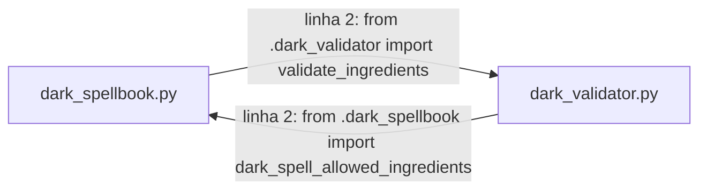

# O grimório das trevas

O enunciado descreve primeiro a luz e manda copiá-la para as trevas. O tutorial começa pelas
trevas, porque elas são a versão direta: cada arquivo importa o outro no topo, do jeito que se
escreveria sem pensar no ciclo. A luz é a mesma coisa com o ciclo quebrado
([O grimório da luz](./05-o-grimorio-da-luz.md)).

Crie a pasta e o `__init__.py` dela, por enquanto vazio:

```bash
mkdir alchemy/grimoire
touch alchemy/grimoire/__init__.py
```

## O livro de feitiços

```python title="alchemy/grimoire/dark_spellbook.py"
# Circular on purpose: dark_validator.py imports this module back.
from .dark_validator import validate_ingredients


def dark_spell_allowed_ingredients() -> list[str]:
    return ["bats", "frogs", "arsenic", "eyeball"]


def dark_spell_record(spell_name: str, ingredients: str) -> str:
    validation = validate_ingredients(ingredients)
    if validation.endswith(" - VALID"):
        return f"Spell recorded: {spell_name} ({validation})"
    return f"Spell rejected: {spell_name} ({validation})"
```

- `dark_spell_allowed_ingredients` devolve a lista dos quatro ingredientes das trevas. O tipo do
  retorno, `list[str]`, quer dizer "uma lista de textos";
- `dark_spell_record` pede ao validador o texto com o veredito e monta a resposta com o nome do
  feitiço e esse texto entre parênteses: `Spell recorded: Fantasy (Earth, wind and fire - VALID)`
  no formato do enunciado;
- a decisão vem do texto devolvido pelo validador, como o enunciado pede: termina com
  `" - VALID"`? Então o feitiço é registrado. A conferência inclui o espaço e o traço porque
  `"INVALID"` também termina com `"VALID"`: `"x - INVALID".endswith("VALID")` dá `True`, e só
  `" - VALID"` separa os dois casos;
- o import é **relativo** (`.dark_validator`, o vizinho no mesmo pacote) e fica na linha 2, a
  mesma do traceback do enunciado. A linha 1 é um comentário que avisa quem lê que o ciclo é de
  propósito, e é ele que empurra o import para a linha 2; sem o comentário, o traceback diria
  `line 1`. O validador tem um comentário igual, pelo mesmo motivo.

## O validador

```python title="alchemy/grimoire/dark_validator.py"
# Circular on purpose: dark_spellbook.py imports this module too.
from .dark_spellbook import dark_spell_allowed_ingredients


def validate_ingredients(ingredients: str) -> str:
    text = ingredients.lower()
    for allowed in dark_spell_allowed_ingredients():
        if allowed in text:
            return f"{ingredients} - VALID"
    return f"{ingredients} - INVALID"
```

- `ingredients.lower()` passa os ingredientes para minúsculas, e a comparação deixa de
  diferenciar `Bats` de `bats`, como o enunciado pede. O texto devolvido usa os ingredientes como
  foram recebidos, sem as minúsculas;
- o `for` percorre os permitidos, e `allowed in text` pergunta se o ingrediente aparece dentro do
  texto. No primeiro que aparece, a função devolve `VALID` e para; se o laço termina sem achar
  nenhum, devolve `INVALID`;
- o import, também na linha 2, traz do livro a função dos ingredientes permitidos.

Procurar o ingrediente como um pedaço do texto é escolha do tutorial: é o jeito mais simples, e
`"Earth, wind and fire"` contém `"earth"` e `"fire"`. A conta aceita também um ingrediente dentro
de outra palavra (`"fire"` em `"firewood"`); separar o texto em palavras evitaria isso, à custa
de tratar as vírgulas.

## O ciclo



Cada arquivo precisa de uma função do outro, e cada um a importa no topo. A
[próxima página](./03-a-explosao.md) mostra o que acontece quando alguém importa um deles.
