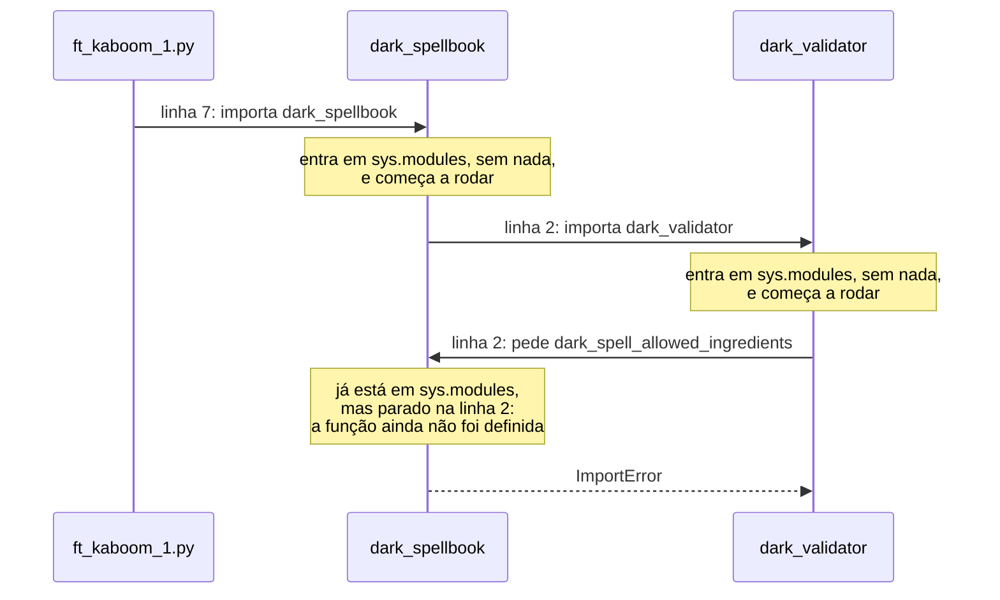

# A explosão

O `ft_kaboom_1.py` importa o livro das trevas direto pelo arquivo e tenta registrar um feitiço. O
import falha antes de o feitiço ser registrado, e o traceback mostra por quê.

## O script

```python title="ft_kaboom_1.py"
if __name__ == "__main__":
    print("=== Kaboom 1 ===")
    print("Access to alchemy/grimoire/dark_spellbook.py directly")
    print("Test import now - THIS WILL RAISE AN UNCAUGHT EXCEPTION")
    # Imported only here, after the prints: the circular import inside
    # dark_spellbook.py raises ImportError before anything below runs.
    from alchemy.grimoire.dark_spellbook import dark_spell_record
    print("Testing record dark spell: "
          f"{dark_spell_record('Curse', 'Bats and frogs')}")
```

- o import fica **dentro** do bloco, depois dos três `print`: a saída do enunciado mostra as três
  linhas antes do traceback, e com o import no topo do arquivo o erro viria antes delas. O
  comentário explica isso a quem lê, e deixa o import na linha 7, a do traceback do enunciado;
- o flake8 acusa um import no meio do corpo do arquivo (aviso `E402 module level import not at
  top of file`), mas não um import dentro de um bloco `if`, como este;
- o último `print` tenta registrar um feitiço das trevas, `Curse` ("maldição") com
  `Bats and frogs`. Ele nunca roda.

## Rodar

```bash
python3 ft_kaboom_1.py
```

```text
=== Kaboom 1 ===
Access to alchemy/grimoire/dark_spellbook.py directly
Test import now - THIS WILL RAISE AN UNCAUGHT EXCEPTION
Traceback (most recent call last):
  File "/home/ana/the-codex/ft_kaboom_1.py", line 7, in <module>
    from alchemy.grimoire.dark_spellbook import dark_spell_record
  File "/home/ana/the-codex/alchemy/grimoire/dark_spellbook.py", line 2, in <module>
    from .dark_validator import validate_ingredients
  File "/home/ana/the-codex/alchemy/grimoire/dark_validator.py", line 2, in <module>
    from .dark_spellbook import dark_spell_allowed_ingredients
ImportError: cannot import name 'dark_spell_allowed_ingredients' from partially initialized module 'alchemy.grimoire.dark_spellbook' (most likely due to a circular import) (/home/ana/the-codex/alchemy/grimoire/dark_spellbook.py)
```

No lugar de `/home/ana/the-codex` aparece o caminho da sua pasta. A saída é a mesma em todas as
versões, do Python 3.10 ao 3.15.

## Lendo o traceback

Cada par de linhas é um import que começou e não terminou, do mais antigo para o mais recente:

1. a linha 7 do script começa a importar `alchemy.grimoire.dark_spellbook`;
2. a linha 2 do `dark_spellbook.py` começa a importar o `dark_validator`;
3. a linha 2 do `dark_validator.py` tenta pegar `dark_spell_allowed_ingredients` do
   `dark_spellbook`, e falha.

A última linha: `ImportError`, "não dá para importar o nome `dark_spell_allowed_ingredients` do
módulo **parcialmente inicializado** `alchemy.grimoire.dark_spellbook` (provavelmente por causa
de um import circular)". O caminho no fim é o do arquivo do módulo.

## Por que o módulo está pela metade

O Python guarda cada módulo em `sys.modules` **antes** de rodar o arquivo dele
([O arquivo roda uma vez só](../02-conceitos/01-o-modulo-e-o-import.md#o-arquivo-roda-uma-vez-só)).
Passo a passo:



Quando o validador pede o livro, o Python não roda o livro de novo: ele já está em `sys.modules`.
Só que o livro parou na linha 2, esperando o validador, e o `def` de
`dark_spell_allowed_ingredients` fica mais abaixo, na linha 5, ainda não executada. O nome não
existe, e o `from ... import` falha. Sem esse cuidado do Python, os dois arquivos se importariam
um ao outro para sempre: a explosão do enunciado.

## Pelo outro lado

Quem é encontrado pela metade é sempre o módulo que começou primeiro. Importando o validador
direto, os papéis se invertem:

```bash
python3 -c "from alchemy.grimoire.dark_validator import validate_ingredients"
```

```text
Traceback (most recent call last):
  File "<string>", line 1, in <module>
    from alchemy.grimoire.dark_validator import validate_ingredients
  File "/home/ana/the-codex/alchemy/grimoire/dark_validator.py", line 2, in <module>
    from .dark_spellbook import dark_spell_allowed_ingredients
  File "/home/ana/the-codex/alchemy/grimoire/dark_spellbook.py", line 2, in <module>
    from .dark_validator import validate_ingredients
ImportError: cannot import name 'validate_ingredients' from partially initialized module 'alchemy.grimoire.dark_validator' (most likely due to a circular import) (/home/ana/the-codex/alchemy/grimoire/dark_validator.py)
```

Agora o validador começou primeiro, e é ele que está pela metade quando o livro o pede. (Até o
Python 3.12, a linha de código vinda do `-c` não aparece.) Qualquer que seja a porta de entrada,
o par das trevas explode.

## O flake8 e o mypy não percebem

```bash
.venv/bin/flake8 alchemy/grimoire ft_kaboom_1.py
.venv/bin/mypy --disallow-untyped-defs alchemy/grimoire ft_kaboom_1.py
```

```text
Success: no issues found in 4 source files
```

As duas ferramentas leem o código sem rodá-lo, e o código está correto: cada nome importado
existe no outro arquivo. O problema só aparece na **ordem** em que os arquivos rodam, e essa
ordem só existe quando o programa roda.
