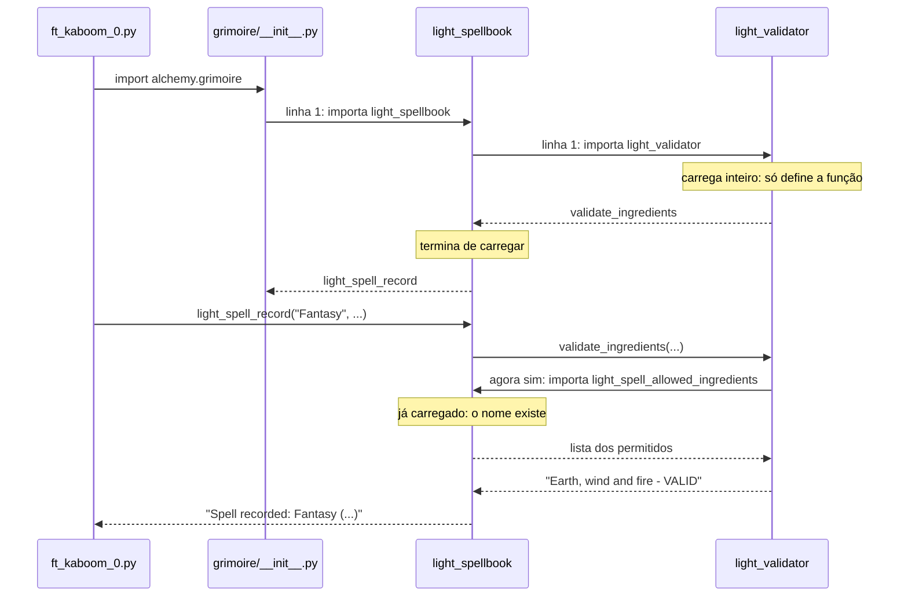

# O grimório da luz

A luz tem o mesmo livro e o mesmo validador das trevas, com os nomes `light_`, os ingredientes
da luz e o ciclo quebrado pelo import dentro da função
([Quebrar o ciclo](./04-quebrar-o-ciclo.md#1-importar-dentro-da-função)).

## O livro de feitiços

```python title="alchemy/grimoire/light_spellbook.py"
from .light_validator import validate_ingredients


def light_spell_allowed_ingredients() -> list[str]:
    return ["earth", "air", "fire", "water"]


def light_spell_record(spell_name: str, ingredients: str) -> str:
    validation = validate_ingredients(ingredients)
    if validation.endswith(" - VALID"):
        return f"Spell recorded: {spell_name} ({validation})"
    return f"Spell rejected: {spell_name} ({validation})"
```

É o `dark_spellbook.py` com outros nomes e outros ingredientes. O import do validador continua no
topo: o livro pode pedir o validador ao carregar, porque o validador não pede nada de volta
enquanto carrega. Sem ciclo, o comentário da linha 1 das trevas não tem o que avisar, e o import
fica na linha 1.

## O validador

```python title="alchemy/grimoire/light_validator.py"
def validate_ingredients(ingredients: str) -> str:
    # Imported at call time: light_spellbook.py imports this module while it
    # loads, so importing it back at the top of this file would be circular.
    from .light_spellbook import light_spell_allowed_ingredients

    text = ingredients.lower()
    for allowed in light_spell_allowed_ingredients():
        if allowed in text:
            return f"{ingredients} - VALID"
    return f"{ingredients} - INVALID"
```

- o import está dentro da função, e só roda quando `validate_ingredients` é chamada. O arquivo,
  ao carregar, só define a função;
- o comentário explica por que o import não está no topo, onde normalmente ficam os imports;
- a linha em branco depois do import separa a preparação do trabalho da função; o resto é igual
  ao validador das trevas.

## O `__init__.py` do grimório

O `ft_kaboom_0.py` acessa o pacote `grimoire` e registra um feitiço; o `__init__.py` oferece a
função de registro da luz:

```python title="alchemy/grimoire/__init__.py"
from .light_spellbook import light_spell_record

__all__ = ["light_spell_record"]
```

O `__init__.py` **não** importa nada das trevas. Todo import de algo de dentro de `grimoire` roda
este arquivo antes; se ele importasse o `dark_spellbook`, até o `ft_kaboom_0.py` explodiria, e o
traceback do `ft_kaboom_1.py` ganharia mais um passo, o do `__init__.py`. O livro das trevas
fica fora da interface do pacote, e só quem o pede pelo caminho completo chega a ele: é o acesso
"secreto" do `ft_kaboom_1.py`.

## ft_kaboom_0.py

```python title="ft_kaboom_0.py"
import alchemy.grimoire


if __name__ == "__main__":
    print("=== Kaboom 0 ===")
    print("Using grimoire module directly")
    record = alchemy.grimoire.light_spell_record("Fantasy",
                                                 "Earth, wind and fire")
    print(f"Testing record light spell: {record}")
```

`import alchemy.grimoire` acessa o pacote do grimório, e a função vem da interface dele. O
resultado vai para a variável `record` antes do `print`: a chamada com os dois argumentos não cabe
numa linha de 79 caracteres dentro da f-string. A segunda linha da chamada começa embaixo do
primeiro argumento, logo depois do parêntese que abre a chamada: um dos formatos de continuação
de linha que o PEP 8 aceita.

```bash
python3 ft_kaboom_0.py
```

```text
=== Kaboom 0 ===
Using grimoire module directly
Testing record light spell: Spell recorded: Fantasy (Earth, wind and fire - VALID)
```

## O caminho do registro



O validador e o livro continuam precisando um do outro, mas o pedido do validador acontece
depois que os dois terminaram de carregar.
