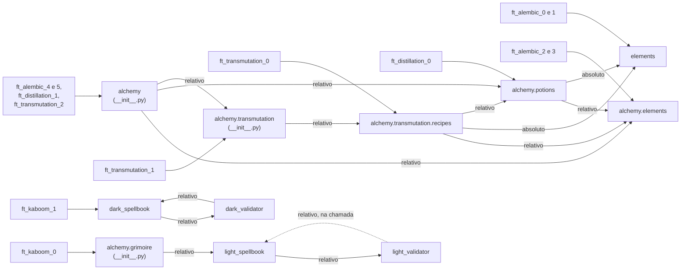

# Conferir tudo

Rode tudo a partir da pasta `the-codex`.

## Os arquivos

```bash
find . -name "*.py" -not -path "./.venv/*" -not -path "./experimentos/*" | LC_ALL=C sort
```

```text
./alchemy/__init__.py
./alchemy/elements.py
./alchemy/grimoire/__init__.py
./alchemy/grimoire/dark_spellbook.py
./alchemy/grimoire/dark_validator.py
./alchemy/grimoire/light_spellbook.py
./alchemy/grimoire/light_validator.py
./alchemy/potions.py
./alchemy/transmutation/__init__.py
./alchemy/transmutation/recipes.py
./elements.py
./ft_alembic_0.py
./ft_alembic_1.py
./ft_alembic_2.py
./ft_alembic_3.py
./ft_alembic_4.py
./ft_alembic_5.py
./ft_distillation_0.py
./ft_distillation_1.py
./ft_kaboom_0.py
./ft_kaboom_1.py
./ft_transmutation_0.py
./ft_transmutation_1.py
./ft_transmutation_2.py
```

- `find .` percorre a pasta atual e todas as de dentro; `-name "*.py"` fica só com os arquivos que
  terminam em `.py`; cada `-not -path` deixa de fora uma pasta (o `*` quer dizer "qualquer coisa
  depois");
- `| sort` põe a lista em ordem. `LC_ALL=C` faz o `sort` comparar os caracteres pelo código de
  cada um, e a ordem sai igual em qualquer sistema; sem ele, alguns Linux ignoram o `_` ao
  ordenar, e `__init__.py` iria para depois de `elements.py`.

São os 24 arquivos da árvore do enunciado, com os nomes exatos. Um nome errado (uma letra
trocada, um `.py` faltando, um `__init__.py` esquecido) quebra os imports que dependem dele.

## Estilo e tipos

```bash
.venv/bin/flake8 *.py alchemy
.venv/bin/mypy --disallow-untyped-defs *.py alchemy
```

```text
ft_alembic_4.py:12: error: Module has no attribute "create_earth"; maybe "create_air"?  [attr-defined]
Found 1 error in 1 file (checked 24 source files)
```

O flake8 não imprime nada. O mypy confere os 24 arquivos e acusa só a linha proposital da Parte I
([O erro do mypy](../03-parte-1/06-o-erro-proposital.md#o-erro-do-mypy)).

Os experimentos também passam nas duas ferramentas:

```bash
.venv/bin/flake8 experimentos
.venv/bin/mypy --disallow-untyped-defs experimentos
```

```text
Success: no issues found in 8 source files
```

## As saídas

Rode de novo os `diff` da página "Rodar e conferir" de cada parte:
[I](../03-parte-1/08-rodar-e-conferir.md), [II](../04-parte-2/06-rodar-e-conferir.md),
[III](../05-parte-3/07-rodar-e-conferir.md) e [IV](../06-parte-4/07-rodar-e-conferir.md). Todos
ficam calados, com uma exceção conhecida: o do `ft_alembic_4.py` mostra as linhas que saem
diferentes do enunciado, a dos `^` e, no 3.15, a da sugestão `Did you mean`
([A saída com o traceback](../03-parte-1/08-rodar-e-conferir.md#a-saída-com-o-traceback)).

## Os códigos de saída

```bash
for f in ft_*.py; do
    python3 "$f" > /dev/null 2>&1
    echo "$f: $?"
done
```

```text
ft_alembic_0.py: 0
ft_alembic_1.py: 0
ft_alembic_2.py: 0
ft_alembic_3.py: 0
ft_alembic_4.py: 1
ft_alembic_5.py: 0
ft_distillation_0.py: 0
ft_distillation_1.py: 0
ft_kaboom_0.py: 0
ft_kaboom_1.py: 1
ft_transmutation_0.py: 0
ft_transmutation_1.py: 0
ft_transmutation_2.py: 0
```

- `> /dev/null 2>&1` descarta a saída e o traceback, que já foram conferidos pelos `diff`.
  `/dev/null` é um arquivo especial que joga fora tudo o que recebe;
- `$?` é o código de saída do último comando, e o `echo` o mostra ao lado do nome.

Onze scripts terminam com `0`. Os dois que terminam com `1` são os das exceções que o enunciado
pede: `ft_alembic_4.py` e `ft_kaboom_1.py`.

## Só imports do projeto

```bash
grep -n -E "^ *(from|import) " *.py alchemy/*.py alchemy/*/*.py | LC_ALL=C sort
```

```text
alchemy/__init__.py:1:from .elements import create_air
alchemy/__init__.py:2:from .potions import healing_potion as heal, strength_potion
alchemy/__init__.py:3:from .transmutation import lead_to_gold
alchemy/grimoire/__init__.py:1:from .light_spellbook import light_spell_record
alchemy/grimoire/dark_spellbook.py:2:from .dark_validator import validate_ingredients
alchemy/grimoire/dark_validator.py:2:from .dark_spellbook import dark_spell_allowed_ingredients
alchemy/grimoire/light_spellbook.py:1:from .light_validator import validate_ingredients
alchemy/grimoire/light_validator.py:4:    from .light_spellbook import light_spell_allowed_ingredients
alchemy/potions.py:1:from elements import create_fire, create_water
alchemy/potions.py:2:from .elements import create_air, create_earth
alchemy/transmutation/__init__.py:1:from .recipes import lead_to_gold
alchemy/transmutation/recipes.py:1:from elements import create_fire
alchemy/transmutation/recipes.py:2:from ..elements import create_air
alchemy/transmutation/recipes.py:3:from ..potions import strength_potion
ft_alembic_0.py:1:import elements
ft_alembic_1.py:1:from elements import create_water
ft_alembic_2.py:1:import alchemy.elements
ft_alembic_3.py:1:from alchemy.elements import create_air
ft_alembic_4.py:1:import alchemy
ft_alembic_5.py:1:from alchemy import create_air
ft_distillation_0.py:1:from alchemy.potions import healing_potion, strength_potion
ft_distillation_1.py:1:import alchemy
ft_kaboom_0.py:1:import alchemy.grimoire
ft_kaboom_1.py:7:    from alchemy.grimoire.dark_spellbook import dark_spell_record
ft_transmutation_0.py:1:import alchemy.transmutation.recipes
ft_transmutation_1.py:1:import alchemy.transmutation
ft_transmutation_2.py:1:import alchemy
```

O `grep` procura linhas num conjunto de arquivos e mostra cada uma com o arquivo e o número da
linha (`-n`). O padrão `^ *(from|import) ` (com `-E`) quer dizer "começo da linha, espaços
opcionais, e depois `from` ou `import` seguido de espaço": só as linhas de import, e não os textos
dos `print` que contêm a palavra *import*. O `sort` põe as linhas na mesma ordem em qualquer
sistema. Todos os módulos importados são do projeto: `elements`, `alchemy` e os de dentro dele,
e os relativos, que começam com ponto. A lista também mostra o
[critério do tutorial](../05-parte-3/02-absoluto-e-relativo.md#o-critério-do-tutorial): dentro
de `alchemy/`, todo import de um arquivo do pacote é relativo, e os absolutos são o `elements`
da raiz e os imports dos scripts.

```bash
grep -n -E "sys|eval|exec" *.py alchemy/*.py alchemy/*/*.py
```

O `grep` não imprime nada: nenhum arquivo entregue fala em `sys` (e portanto não mexe no
`sys.path`), em `eval` ou em `exec`.

## O mapa final

Quem importa quem, na árvore inteira (os scripts aparecem agrupados por parte, e todos os imports
deles são absolutos):



Só há dois ciclos no mapa. O da luz tem uma seta tracejada, um import que só roda quando a função
é chamada, e funciona. O das trevas tem as duas setas no topo dos arquivos, e explode.
