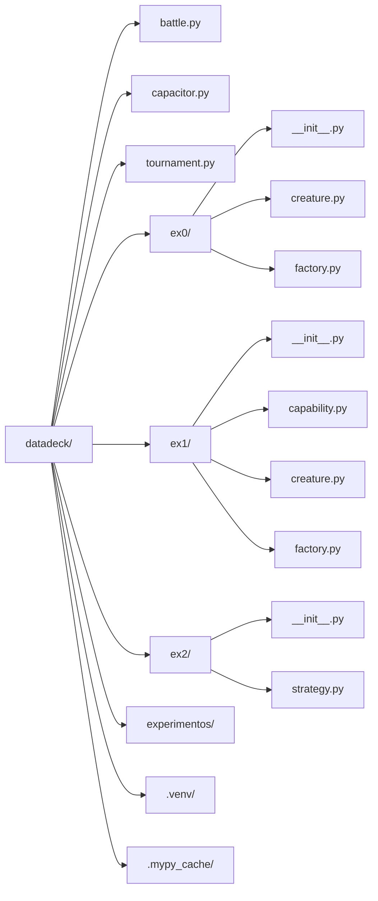

# A pasta do projeto

O enunciado pede cada exercício numa pasta própria, `ex0/`, `ex1/` e `ex2/`, e os programas de
teste na **raiz** do repositório: a pasta principal, que contém as três. Crie a pasta do projeto,
entre nela e crie as pastas dos exercícios:

```bash
mkdir datadeck
cd datadeck
mkdir ex0 ex1 ex2
```

`mkdir` cria uma pasta (ou várias, com os nomes em sequência). O nome `datadeck` é só uma
sugestão; o que o enunciado fixa são as pastas `ex0` a `ex2` e os nomes dos arquivos. **Todos os
comandos do tutorial são rodados a partir desta pasta**, a `datadeck`: ela é a raiz do projeto.

Crie também uma pasta `experimentos`, para os programas pequenos que a parte
[Pacotes, classes abstratas e herança múltipla](../02-conceitos/01-modulos-e-pacotes.md) usa para
mostrar cada ideia. Eles não fazem parte da entrega:

```bash
mkdir experimentos
```

Ao fim do projeto, a pasta fica assim:



O enunciado não fixa quantos arquivos cada pacote tem nem os nomes deles, além do `__init__.py`.
A divisão acima é escolha do tutorial: num arquivo as criaturas, em outro as fábricas, e no
`ex1` um terceiro para as capacidades.

A pasta `.venv/` é criada na [próxima página](./03-o-ambiente-virtual.md), e a `.mypy_cache/` é
criada pelo mypy na primeira vez que ele roda, para guardar resultados e conferir mais rápido da
próxima vez. Quando um programa importa um pacote, o Python também cria, dentro da pasta do
pacote, uma pasta `__pycache__/`, com uma versão pré-processada de cada arquivo, que torna a
próxima execução mais rápida. Nenhuma dessas três pastas é entregue, nem a `experimentos/`.
