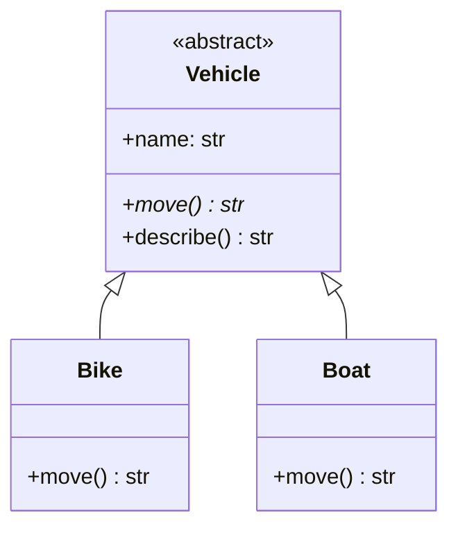

# Classe abstrata e super

Toda criatura do projeto tem um nome, um tipo, um jeito de se descrever e um ataque. O nome, o
tipo e a descrição funcionam igual para todas; o ataque é diferente em cada uma, e não existe
"criatura genérica" que ataque. Uma **classe abstrata** descreve exatamente isso.

## Classe abstrata

Uma classe abstrata é uma classe que serve só de molde: não pode ser instanciada (não se cria
objeto dela) e lista os métodos que toda classe filha é obrigada a escrever. Esses métodos
obrigatórios se chamam **métodos abstratos**. Os outros métodos, com corpo de verdade, são
**concretos**, e as filhas os herdam prontos. Uma classe que pode ser instanciada, por ter
escrito todos os métodos abstratos, é uma **classe concreta**.

O Python faz isso com o módulo `abc` (de *Abstract Base Classes*, "classes base abstratas"), um
dos dois `import` que o enunciado permite (o outro é o `typing`). Dele vêm duas peças:

- `ABC`: a classe da qual uma classe herda para virar abstrata;
- `@abstractmethod`: a marca que se põe em cima de um método para torná-lo abstrato.

Uma linha que começa com `@` em cima de um `def` é um **decorador**: ela modifica o método logo
abaixo. `@abstractmethod` registra o método como "obrigatório nas filhas".

## super(): o construtor da mãe

Quando a classe mãe tem um `__init__` que guarda atributos, a filha que escreve o seu próprio
`__init__` precisa chamar o da mãe, senão os atributos não são criados. `super()` dá acesso aos
métodos da classe mãe: `super().__init__("Bike")` roda o `__init__` da mãe com o argumento
`"Bike"`, sobre o mesmo objeto (o `self` vai sozinho).

## O experimento

Crie `experimentos/abstrata.py`, com um veículo abstrato e dois concretos:

```python title="experimentos/abstrata.py"
from abc import ABC, abstractmethod


class Vehicle(ABC):
    def __init__(self, name: str) -> None:
        self.name = name

    @abstractmethod
    def move(self) -> str:
        pass

    def describe(self) -> str:
        return f"{self.name} is a vehicle"


class Bike(Vehicle):
    def __init__(self) -> None:
        super().__init__("Bike")

    def move(self) -> str:
        return f"{self.name} pedals"


class Boat(Vehicle):
    def __init__(self) -> None:
        super().__init__("Boat")

    def move(self) -> str:
        return f"{self.name} sails"


def main() -> None:
    vehicles: list[Vehicle] = [Bike(), Boat()]
    for vehicle in vehicles:
        print(vehicle.describe())
        print(vehicle.move())


if __name__ == "__main__":
    main()
```

- `class Vehicle(ABC)` faz `Vehicle` herdar de `ABC`;
- o `__init__` de `Vehicle` guarda o nome, que vale para todo veículo;
- `move` é abstrato. O corpo é só `pass`, a instrução que não faz nada: quem roda é sempre a
  versão da filha;
- `describe` é concreto: as filhas o herdam como está, e ele usa o `self.name` guardado pela mãe;
- cada filha tem um `__init__` sem parâmetros, que chama o da mãe com o seu próprio nome. Quem
  cria uma `Bike` escreve só `Bike()`: o nome é decidido pela classe;
- `vehicles: list[Vehicle]` é uma lista de veículos. Uma `Bike` **é um** `Vehicle` (herda dele)
  e por isso entra na lista;
- `if __name__ == "__main__":` roda o `main` só quando o arquivo é executado com `python3`, e não
  quando outro código o importa: `__name__` é uma variável que o Python preenche com
  `"__main__"` no arquivo rodado, e com o nome do módulo nos importados.

```bash
python3 experimentos/abstrata.py
```

```text
Bike is a vehicle
Bike pedals
Boat is a vehicle
Boat sails
```

## Polimorfismo

O laço do `main` só conhece `Vehicle`: chama `describe()` e `move()` em cada item, sem nenhum
`if` sobre a classe, e cada objeto responde do seu jeito. Isso é **polimorfismo** ("muitas
formas"): o mesmo código, escrito para a classe mãe, funciona com qualquer filha. Quem decide
qual `move` roda é a classe do objeto, e não o código que chama.

## A classe abstrata não é instanciada

Graças ao `if __name__ == "__main__":`, o arquivo pode ser importado sem imprimir nada. O comando
abaixo importa `Vehicle` e tenta criar um objeto dele (o `PYTHONPATH`, de
[Módulos e pacotes](./01-modulos-e-pacotes.md#onde-o-python-procura), deixa o `import` achar o
arquivo; o `-B` impede o Python de gravar a pasta `__pycache__` dentro de `experimentos/`; o `;`
separa dois comandos Python na mesma linha):

```bash
PYTHONPATH=experimentos python3 -B -c 'from abstrata import Vehicle; Vehicle("Car")'
```

A última linha da saída é:

```text
TypeError: Can't instantiate abstract class Vehicle without an implementation for abstract method 'move'
```

("não dá para instanciar a classe abstrata `Vehicle` sem uma implementação do método abstrato
`move`"). No Python 3.10 e no 3.11, a mensagem é mais curta, com o mesmo sentido:
`Can't instantiate abstract class Vehicle with abstract method move`. Uma filha que não escreve
`move` também fica abstrata e dá o mesmo erro. O erro aparece na hora de **criar** o objeto, e
não quando o método seria chamado: uma classe incompleta é descoberta logo.

O mypy acusa o mesmo erro sem rodar nada. Ele também confere código passado com `-c`, e a
variável `MYPYPATH` faz para ele o que o `PYTHONPATH` faz para o Python:

```bash
MYPYPATH=experimentos .venv/bin/mypy -c 'from abstrata import Vehicle; Vehicle("Car")'
```

```text
<string>:1: error: Cannot instantiate abstract class "Vehicle" with abstract attribute "move"  [abstract]
Found 1 error in 1 file (checked 1 source file)
```

`<string>` é o nome que o mypy dá ao código passado com `-c`.

## No diagrama



Cada caixa é uma classe, com os atributos e os métodos; o `+` marca o que é usado de fora da
classe. A seta de ponta vazada aponta da filha para a mãe; `<<abstract>>` marca a classe que não pode
ser instanciada, e o `*` marca o método abstrato. O exercício 0 começa com uma classe no mesmo
formato, `Creature` ([A classe Creature](../03-ex0/03-a-classe-creature.md)).
