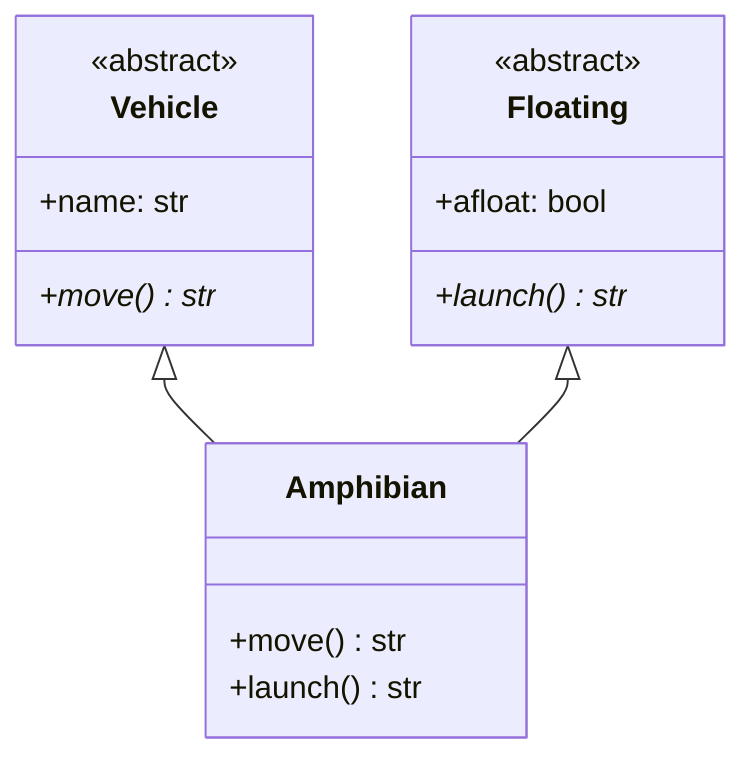

# Herança múltipla

No exercício 1, uma criatura que sabe se transformar é, ao mesmo tempo, uma `Creature` e algo
"capaz de se transformar". A capacidade fica numa classe separada, que não herda de `Creature`,
porque um dia pode servir para outras coisas. A criatura precisa herdar das duas.

## Duas classes mães

Uma classe pode herdar de mais de uma classe: as mães vão entre os parênteses, separadas por
vírgula. A filha ganha os métodos e atributos de todas. Isso é **herança múltipla**.

## O experimento

Um veículo anfíbio anda na terra e entra na água. "Flutuar" é uma capacidade que não é só de
veículos (um pato também flutua), então fica numa classe própria, `Floating`, com um atributo
`afloat` ("na água") que guarda o estado. Crie `experimentos/multipla.py`:

```python title="experimentos/multipla.py"
from abc import ABC, abstractmethod


class Vehicle(ABC):
    def __init__(self, name: str) -> None:
        self.name = name

    @abstractmethod
    def move(self) -> str:
        pass


class Floating(ABC):
    def __init__(self) -> None:
        self.afloat = False

    @abstractmethod
    def launch(self) -> str:
        pass


class Amphibian(Vehicle, Floating):
    def __init__(self) -> None:
        super().__init__("Amphibian")

    def move(self) -> str:
        if self.afloat:
            return f"{self.name} sails"
        return f"{self.name} drives"

    def launch(self) -> str:
        self.afloat = True
        return f"{self.name} enters the water"


print(Amphibian.__mro__)
amphibian = Amphibian()
print(isinstance(amphibian, Vehicle), isinstance(amphibian, Floating))
print(amphibian.move())
print(amphibian.launch())
print(amphibian.move())
```

- `class Amphibian(Vehicle, Floating)` herda das duas classes abstratas e escreve os dois
  métodos abstratos, `move` (de `Vehicle`) e `launch` (de `Floating`);
- o `move` do anfíbio depende do atributo `afloat`: o estado guardado por `Floating` muda o jeito
  de andar;
- `launch` muda o estado: depois dele, o anfíbio está na água.

```bash
python3 experimentos/multipla.py
```

A saída começa com:

```text
(<class '__main__.Amphibian'>, <class '__main__.Vehicle'>, <class '__main__.Floating'>, <class 'abc.ABC'>, <class 'object'>)
True True
```

E a última linha é:

```text
AttributeError: 'Amphibian' object has no attribute 'afloat'
```

O programa quebrou no primeiro `amphibian.move()`: o objeto não tem o atributo `afloat`.

## A ordem de busca

A primeira linha da saída é a **ordem de busca de métodos** da classe, a `__mro__` (*method
resolution order*). Quando um método é chamado, o Python o procura nas classes nessa ordem e usa
o primeiro que achar: `Amphibian`, depois `Vehicle`, depois `Floating`, depois `ABC` e, no fim,
`object`, a classe da qual toda classe do Python herda. As mães entram na ordem em que foram
escritas nos parênteses. `__main__` é o nome do módulo do arquivo rodado.

`super()` não quer dizer "todas as mães": quer dizer "a **próxima** classe da `__mro__`". Em
`Amphibian`, a próxima é `Vehicle`, e `super().__init__("Amphibian")` rodou só o `__init__` de
`Vehicle`. O `__init__` de `Floating`, que cria o `afloat`, nunca rodou.

A segunda linha mostra que o objeto **é** das duas classes: `isinstance` responde `True` para
`Vehicle` e para `Floating`.

## Chamar cada construtor pelo nome

Com duas mães que têm `__init__`, a filha chama cada uma pelo nome da classe, passando o próprio
objeto como primeiro argumento. Troque o `__init__` de `Amphibian`:

```python title="experimentos/multipla.py"
from abc import ABC, abstractmethod


class Vehicle(ABC):
    def __init__(self, name: str) -> None:
        self.name = name

    @abstractmethod
    def move(self) -> str:
        pass


class Floating(ABC):
    def __init__(self) -> None:
        self.afloat = False

    @abstractmethod
    def launch(self) -> str:
        pass


class Amphibian(Vehicle, Floating):
    def __init__(self) -> None:
        Vehicle.__init__(self, "Amphibian")
        Floating.__init__(self)

    def move(self) -> str:
        if self.afloat:
            return f"{self.name} sails"
        return f"{self.name} drives"

    def launch(self) -> str:
        self.afloat = True
        return f"{self.name} enters the water"


print(Amphibian.__mro__)
amphibian = Amphibian()
print(isinstance(amphibian, Vehicle), isinstance(amphibian, Floating))
print(amphibian.move())
print(amphibian.launch())
print(amphibian.move())
```

`Vehicle.__init__(self, "Amphibian")` é o `__init__` da classe `Vehicle` chamado como uma função
comum: por isso o `self` vai escrito. `Floating.__init__(self)` faz o mesmo com a outra mãe.

```bash
python3 experimentos/multipla.py
```

```text
(<class '__main__.Amphibian'>, <class '__main__.Vehicle'>, <class '__main__.Floating'>, <class 'abc.ABC'>, <class 'object'>)
True True
Amphibian drives
Amphibian enters the water
Amphibian sails
```

Agora o anfíbio começa na terra (`afloat` é `False`), entra na água com `launch` e passa a
navegar: o estado guardado pelo atributo durou entre as chamadas.

O Python tem outro jeito de fazer as duas mães rodarem com um único `super().__init__()`: cada
`__init__` da cadeia também chama `super().__init__()`. Esse jeito exige que **todas** as classes
envolvidas sejam escritas pensando nisso; chamar cada mãe pelo nome funciona sem mexer nelas.

## Quando só uma mãe tem `__init__`

Se a segunda mãe não tem `__init__` próprio, `super().__init__(...)` basta: ele chega ao
`__init__` da primeira mãe, e a segunda não tem nada a criar. É o caso das criaturas que curam,
no exercício 1 ([As criaturas que curam](../04-ex1/03-as-criaturas-que-curam.md)).


