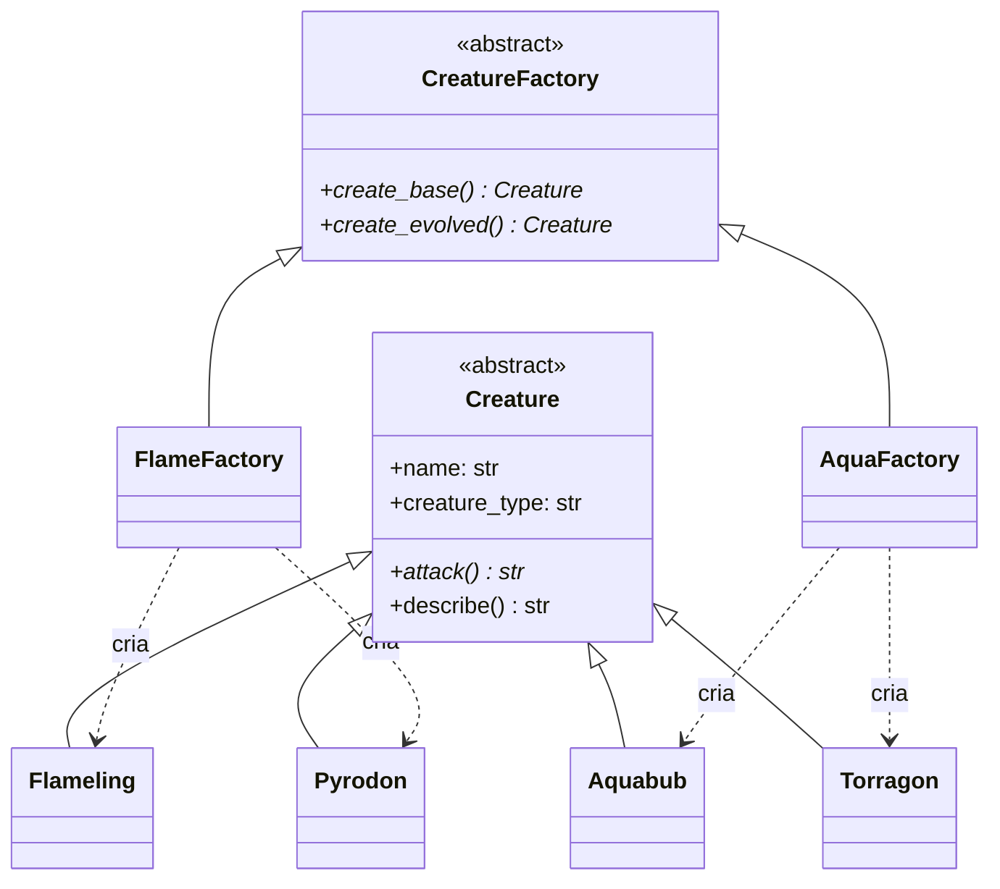

# O padrão fábrica abstrata

## Sem fábrica

O jeito direto de testar a família do fogo seria criar as criaturas pelo nome da classe:

```python
base = Flameling()
evolved = Pyrodon()
```

Esse código conhece as duas classes concretas e sabe que elas formam uma família. Para testar a
família da água, seria preciso outro trecho com `Aquabub()` e `Torragon()`; para cada família
nova, mais um. Todo código que cria criaturas fica preso aos nomes delas.

## Uma fábrica por família

Uma **fábrica** é um objeto cujo trabalho é criar outros objetos. A **fábrica abstrata** é uma
classe abstrata que diz **o que** toda fábrica sabe criar, sem dizer **como**:

- `create_base()`: a criatura base da família;
- `create_evolved()`: a criatura evoluída da mesma família.

Cada família tem uma **fábrica concreta**, filha da abstrata, que responde com as suas
criaturas: a `FlameFactory` devolve `Flameling` e `Pyrodon`; a `AquaFactory`, `Aquabub` e
`Torragon`. Uma fábrica sempre entrega criaturas da mesma família: não há como receber um
`Flameling` e um `Torragon` da mesma fábrica.

Quem usa as fábricas, como a função `test_factory` do `battle.py`, só conhece as duas classes
abstratas. O começo dela:

```python
def test_factory(factory: CreatureFactory) -> None:
    print("Testing factory")
    base = factory.create_base()
    evolved = factory.create_evolved()
```

`factory` pode ser a fábrica do fogo, a da água ou uma que ainda não existe: o código é o mesmo.
`base` e `evolved` são `Creature`, e o que se faz com elas (`describe`, `attack`) está declarado
na classe abstrata `Creature`. Isso é o polimorfismo de
[Classe abstrata e super](../02-conceitos/02-classe-abstrata-e-super.md#polimorfismo) aplicado
duas vezes: nas fábricas e nas criaturas.

## O desenho



As setas de ponta vazada ligam cada filha à mãe; as setas tracejadas, rotuladas "cria", mostram
qual fábrica cria qual criatura. Só as fábricas concretas apontam para as criaturas concretas: o
resto do programa fica do lado das classes abstratas.

## O que se ganha

- **Uma família nova é só código novo.** Duas criaturas e uma fábrica; as funções de teste do
  `battle.py` não mudam, e só o `main` ganha uma linha para criar a fábrica nova
  ([Como acrescentar uma família nova?](../06-fechamento/03-perguntas-de-revisao.md#como-acrescentar-uma-família-nova));
- **As famílias não se misturam.** Quem pede a base e a evoluída à mesma fábrica recebe duas
  criaturas da mesma família;
- **As classes concretas podem ficar escondidas.** Quem usa o pacote só precisa das fábricas, e o
  pacote só as expõe ([O `__init__.py` do pacote](./06-o-init-do-pacote.md)).

## Os arquivos do pacote

O pacote tem três arquivos, escolha do tutorial: `ex0/creature.py` (a classe `Creature` e as
quatro criaturas), `ex0/factory.py` (as fábricas) e `ex0/__init__.py` (o que o pacote expõe). O
`battle.py` fica na raiz ([Os arquivos completos](./08-os-arquivos-completos.md)).
