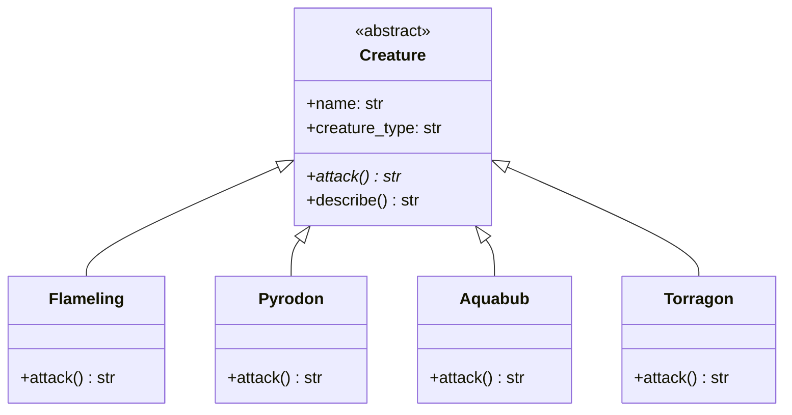

# As quatro criaturas

Cada criatura concreta precisa de duas coisas: o seu nome e tipo, e o seu ataque. Acrescente as
quatro classes no fim de `ex0/creature.py`, depois de `Creature`:

```python
class Flameling(Creature):
    def __init__(self) -> None:
        super().__init__("Flameling", "Fire")

    def attack(self) -> str:
        return f"{self.name} uses Ember!"


class Pyrodon(Creature):
    def __init__(self) -> None:
        super().__init__("Pyrodon", "Fire/Flying")

    def attack(self) -> str:
        return f"{self.name} uses Flamethrower!"


class Aquabub(Creature):
    def __init__(self) -> None:
        super().__init__("Aquabub", "Water")

    def attack(self) -> str:
        return f"{self.name} uses Water Gun!"


class Torragon(Creature):
    def __init__(self) -> None:
        super().__init__("Torragon", "Water")

    def attack(self) -> str:
        return f"{self.name} uses Hydro Pump!"
```

## O construtor sem parâmetros

Cada criatura sabe o próprio nome e tipo. O `__init__` delas não recebe nada e chama o de
`Creature` com os valores fixos: `super().__init__("Flameling", "Fire")`. Quem cria a criatura
escreve só `Flameling()`, sem chance de errar o nome ou o tipo. Os nomes, os tipos e os ataques
são os da [saída do enunciado](./01-o-problema.md#a-saída-esperada).

## O ataque

O `attack` de cada uma sobrescreve o método abstrato de `Creature` e devolve a frase do ataque,
com o nome tirado de `self.name`: `Flameling uses Ember!`. Com o `attack` escrito, a classe deixa
de ser abstrata e pode ser instanciada.

## Por que as quatro ficam no mesmo arquivo

As quatro classes são pequenas e só fazem sentido junto de `Creature`. Juntá-las num arquivo é
escolha do tutorial; um arquivo por família (`flame.py`, `aqua.py`) também cumpre o enunciado.


