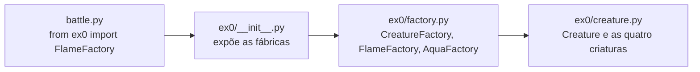

# O `__init__.py` do pacote

O enunciado exige um `__init__.py` em cada pasta de exercício e proíbe o pacote `ex0` de expor as
criaturas concretas: ele expõe **só as fábricas**. O `__init__.py` decide o que o pacote oferece
a quem escreve `from ex0 import ...` ([Pacote](../02-conceitos/01-modulos-e-pacotes.md#pacote)).

Crie `ex0/__init__.py`:

```python
from .factory import AquaFactory, CreatureFactory, FlameFactory

__all__ = ["CreatureFactory", "FlameFactory", "AquaFactory"]
```

- a primeira linha importa as três fábricas do módulo `factory` do pacote; com isso, os três
  nomes passam a ser atributos do pacote `ex0`;
- `__all__` lista os nomes públicos do pacote. Sem ela, o flake8 acusaria os três nomes como
  importados e não usados ([O aviso do flake8 no `__init__.py`](../02-conceitos/01-modulos-e-pacotes.md#o-aviso-do-flake8-no-__init__py)).

`CreatureFactory` entra na lista porque também é uma fábrica: a abstrata. Quem escreve uma função
que aceita qualquer fábrica, como o `battle.py`, precisa do nome dela para o type hint.

## O que fica de fora

Nenhuma criatura entra no `__init__.py`: `from ex0 import Flameling` falha. A classe abstrata
`Creature` também fica de fora, porque o enunciado diz que o pacote expõe somente fábricas. Quem
usa o pacote recebe criaturas das fábricas, e o tipo delas o mypy descobre sozinho pelo retorno
de `create_base` e `create_evolved`.

O Python não esconde módulos: o módulo `ex0.creature` continua existindo, e um `import` que o
cite pelo nome completo chega às classes de dentro dele, como em
[O que aconteceu](../02-conceitos/01-modulos-e-pacotes.md#o-que-aconteceu) com o `shapes`. Expor
é o que o pacote oferece pelo próprio nome. O código do próprio projeto que precisa da classe
abstrata `Creature`, para herdar dela (as criaturas do `ex1`) ou para anotar um parâmetro (o
`capacitor.py` e as estratégias do `ex2`), a importa direto do módulo `ex0.creature`; as
fábricas, todos importam do pacote, com `from ex0 import ...`.

## O caminho de um import



`from ex0 import FlameFactory` roda o `__init__.py`, que importa `factory.py`, que importa
`creature.py`. As criaturas são carregadas, porque as fábricas precisam delas, mas o `battle.py`
só recebe os nomes que o `__init__.py` oferece.
