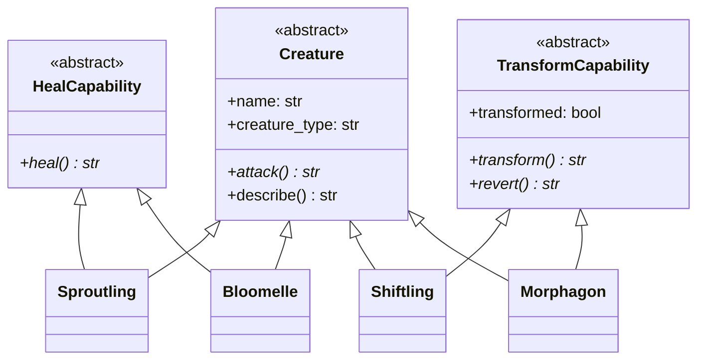

# As capacidades

Uma capacidade descreve uma habilidade, sem saber quem a terá. Ela não herda de `Creature` e não
usa nada de `Creature`: declara os métodos que quem tiver a habilidade precisa escrever e,
quando preciso, o estado da habilidade. Uma
classe assim, feita para ser herdada **junto** com outra classe principal e acrescentar uma
habilidade a ela, costuma ser chamada de **mixin** ("ingrediente que se mistura").

Crie o arquivo `ex1/capability.py`:

```python
from abc import ABC, abstractmethod


class HealCapability(ABC):
    @abstractmethod
    def heal(self) -> str:
        pass


class TransformCapability(ABC):
    def __init__(self) -> None:
        self.transformed = False

    @abstractmethod
    def transform(self) -> str:
        pass

    @abstractmethod
    def revert(self) -> str:
        pass
```

## HealCapability

Uma classe abstrata com um único método abstrato, `heal`, que devolve o texto da cura. Não guarda
estado: curar não muda nada na criatura.

## TransformCapability

Uma classe abstrata com dois métodos abstratos, `transform` e `revert`, e um atributo criado no
`__init__`: `self.transformed`, que começa `False` ("não transformada"). O enunciado diz que "um
atributo é usado para tornar o estado persistente": o valor fica guardado no objeto entre uma chamada e
outra, e é por ele que o `attack` sabe se a criatura está transformada. O nome `transformed` é
escolha do tutorial.

O atributo fica na capacidade, e não em cada criatura, porque é parte da habilidade: toda
criatura que se transforma precisa dele, e a capacidade garante que ele exista. Para isso, quem
herda de `TransformCapability` precisa rodar o `__init__` dela
([Herança múltipla](../02-conceitos/03-heranca-multipla.md#chamar-cada-construtor-pelo-nome)).

## Por que não herdar de Creature

O enunciado proíbe que as capacidades herdem de `Creature`, porque um dia elas podem servir para
outras coisas que não são criaturas. Se `HealCapability` herdasse de `Creature`, só criaturas
poderiam curar, e toda classe que cura teria nome, tipo e `attack`. Separadas, as duas classes
se combinam por herança múltipla: a criatura que cura herda de `Creature` (o que ela **é**) e de
`HealCapability` (o que ela **sabe fazer a mais**).



`Creature` vem do `ex0`; as duas capacidades e as quatro criaturas novas ficam no `ex1`.
