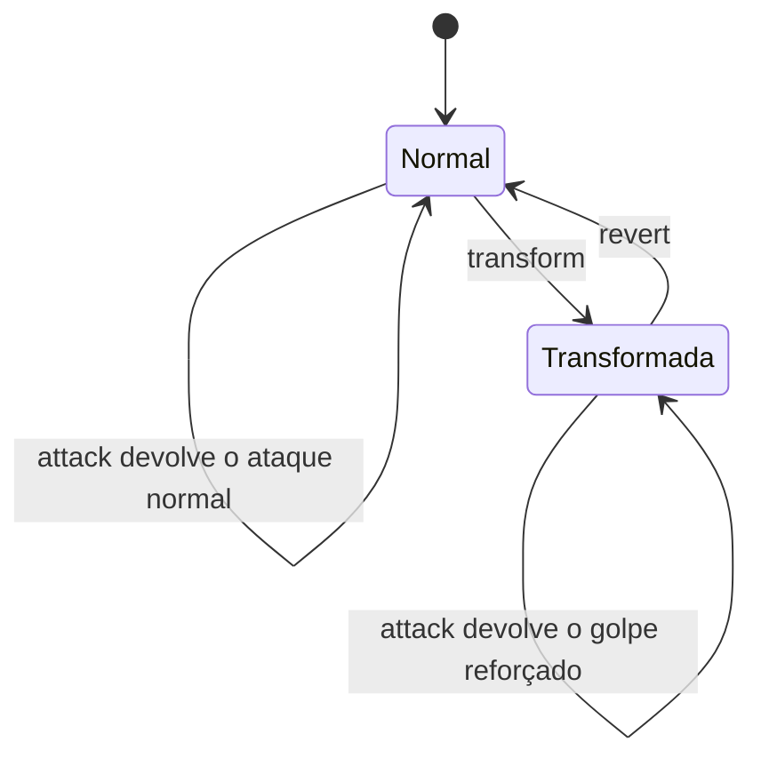

# As criaturas que se transformam

`Shiftling` e `Morphagon` formam a família que se transforma. O ataque delas depende do estado:
normal antes do `transform`, reforçado depois, e normal de novo depois do `revert`. Acrescente as
duas classes no fim de `ex1/creature.py`, depois de `Bloomelle`, com duas linhas em branco antes
de cada `class`:

```python
class Shiftling(Creature, TransformCapability):
    def __init__(self) -> None:
        Creature.__init__(self, "Shiftling", "Normal")
        TransformCapability.__init__(self)

    def attack(self) -> str:
        if self.transformed:
            return f"{self.name} performs a boosted strike!"
        return f"{self.name} attacks normally."

    def transform(self) -> str:
        self.transformed = True
        return f"{self.name} shifts into a sharper form!"

    def revert(self) -> str:
        self.transformed = False
        return f"{self.name} returns to normal."


class Morphagon(Creature, TransformCapability):
    def __init__(self) -> None:
        Creature.__init__(self, "Morphagon", "Normal/Dragon")
        TransformCapability.__init__(self)

    def attack(self) -> str:
        if self.transformed:
            return f"{self.name} unleashes a devastating morph strike!"
        return f"{self.name} attacks normally."

    def transform(self) -> str:
        self.transformed = True
        return f"{self.name} morphs into a dragonic battle form!"

    def revert(self) -> str:
        self.transformed = False
        return f"{self.name} stabilizes its form."
```

## Os dois construtores

Aqui as **duas** mães têm `__init__`: o de `Creature` guarda nome e tipo, e o de
`TransformCapability` cria o `transformed`. Um `super().__init__(...)` rodaria só o de
`Creature`, o primeiro da ordem de busca, e o `transformed` nunca seria criado: o primeiro
`attack` quebraria com `AttributeError`, como o anfíbio de
[Herança múltipla](../02-conceitos/03-heranca-multipla.md#a-ordem-de-busca). Por isso o
`__init__` chama cada mãe pelo nome, passando o próprio objeto: `Creature.__init__(self, ...)` e
`TransformCapability.__init__(self)`.

## O estado e o ataque

- `transform` põe `self.transformed = True` e devolve a frase da transformação;
- `revert` põe `self.transformed = False` e devolve a frase da volta ao normal;
- `attack` lê o atributo: se a criatura está transformada, devolve o golpe reforçado; se não, o
  ataque normal. O `return` dentro do `if` encerra o método, e a última linha só roda quando a
  condição é falsa.



Cada criatura começa no estado normal. O estado é do **objeto**: transformar um `Shiftling` não
transforma outro `Shiftling` criado pela mesma fábrica.

O enunciado mostra a mesma frase de ataque normal para as duas, `attacks normally.`, e frases
próprias para o resto. As duas classes repetem a estrutura dos três métodos; o que muda são só os
textos. Uma classe intermediária com os textos como atributos evitaria a repetição, mas é uma
peça a mais que o enunciado não pede; o tutorial mantém as duas classes completas, como as
criaturas do `ex0`.
