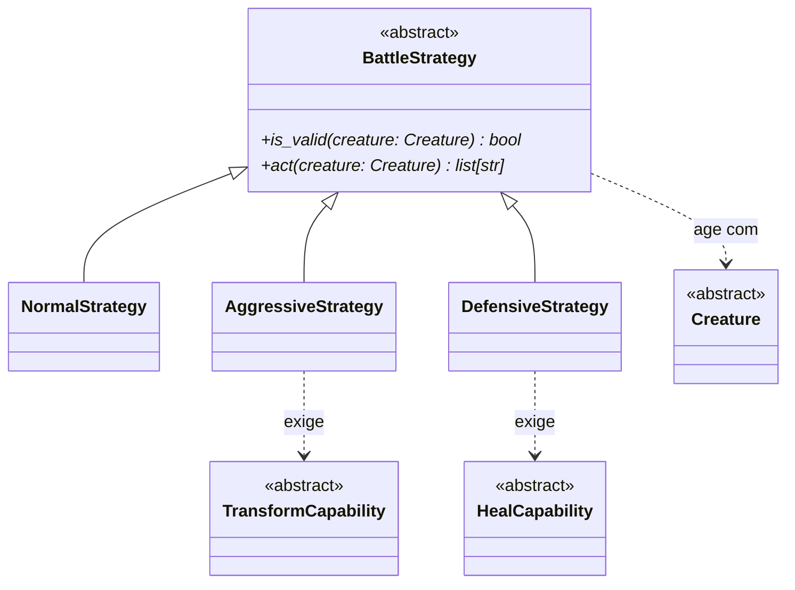

# O padrão estratégia

## Sem estratégia

Um torneio que conhece cada capacidade teria uma função de luta assim:

```python
def act(creature: Creature) -> None:
    if isinstance(creature, TransformCapability):
        print(creature.transform())
        print(creature.attack())
        print(creature.revert())
    elif isinstance(creature, HealCapability):
        print(creature.attack())
        print(creature.heal())
    else:
        print(creature.attack())
```

Funciona, mas o torneio passa a saber de tudo: quais capacidades existem e em que ordem cada uma
age. Uma capacidade nova é mais um `elif`. E o comportamento fica preso à capacidade: não dá para
mandar uma criatura que cura lutar só atacando, sem curar.

## Uma estratégia por jeito de lutar

Uma **estratégia** é um objeto que guarda **um jeito de fazer** uma tarefa. O **padrão
estratégia** separa a tarefa (lutar) das formas de fazê-la (normal, agressiva, defensiva):

- uma classe abstrata, `BattleStrategy`, declara o que toda estratégia sabe fazer: `act`, agir
  com uma criatura, e `is_valid`, dizer se a criatura serve;
- cada jeito de lutar é uma classe concreta, filha dela;
- o torneio recebe, para cada oponente, a criatura (pela fábrica) e a estratégia, e na hora da
  luta só chama `strategy.act(creature)`.

O torneio não tem nenhum `if` sobre capacidades. Quem sabe que a estratégia agressiva transforma,
ataca e volta ao normal é só a `AggressiveStrategy`. Uma estratégia nova é uma classe nova, e a
mesma criatura pode lutar com estratégias diferentes em torneios diferentes: o `Sproutling` pode
entrar com a `DefensiveStrategy` num torneio e com a `NormalStrategy` em outro.

## O desenho



Cada estratégia recebe uma `Creature`. As duas que dependem de uma capacidade a exigem: conferem
com `isinstance` antes de usá-la ([As três estratégias](./04-as-tres-estrategias.md)).

## O que `act` devolve

O enunciado diz que `act` é chamado pelo torneio, sem fixar o retorno. A escolha do tutorial é
devolver uma **lista de textos**, `list[str]`, um por ação, no mesmo espírito do `attack`, que
devolve o texto em vez de imprimir: a estratégia decide **o que** a criatura faz, e o torneio
decide como mostrar. Imprimir direto dentro do `act` também cumpriria o enunciado.

## Os arquivos do pacote

O pacote tem dois arquivos, escolha do tutorial: `ex2/strategy.py`, com a exceção e as quatro
classes de estratégia, e `ex2/__init__.py`. O `tournament.py`, com a função `battle` e o
cenário, fica na raiz.
