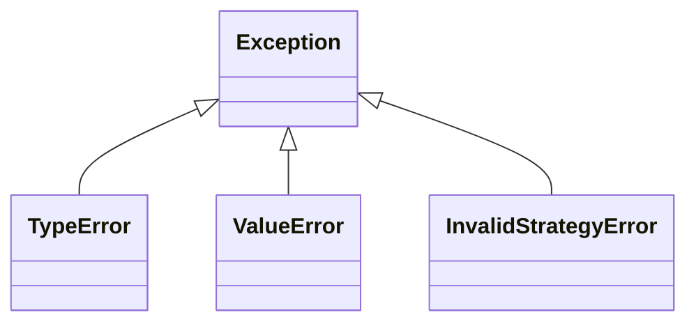

# A exceção dedicada

Quando `act` recebe uma criatura que não serve para a estratégia, ele não tem como agir: a
estratégia agressiva não consegue transformar uma criatura que não se transforma. O enunciado
pede uma **exceção dedicada**: um tipo de exceção próprio, que diga exatamente o que aconteceu.

## Uma classe de exceção

Os tipos de exceção do Python (`ValueError`, `TypeError`...) são classes, todas filhas de
`Exception`. Uma classe filha de `Exception` vira um tipo de exceção novo, que se lança com
`raise` e se captura com `except` como qualquer outro.

Crie o arquivo `ex2/strategy.py`, começando pelos imports e pela exceção:

```python
from abc import ABC, abstractmethod

from ex0.creature import Creature
from ex1.capability import HealCapability, TransformCapability


class InvalidStrategyError(Exception):
    pass
```

- `Creature` vem do módulo do `ex0`, e as duas capacidades, do módulo do `ex1`: as estratégias
  recebem criaturas e conferem as capacidades delas;
- `InvalidStrategyError` ("erro de estratégia inválida") herda tudo de `Exception`, inclusive a
  mensagem: `InvalidStrategyError("texto")` cria a exceção com aquele texto, e `str(error)` (ou
  `{error}` numa f-string) devolve o texto. O corpo `pass` diz que a classe não acrescenta nada; o
  que ela traz de novo é o **nome**. O nome é escolha do tutorial; o sufixo `Error` é o costume do
  Python para classes de exceção.

## Por que um tipo próprio

O torneio precisa capturar **só** o erro de estratégia inválida e deixar passar qualquer outro
erro, que seria um defeito do programa e deve aparecer. Com um tipo próprio,
`except InvalidStrategyError` captura exatamente esse caso. Com um tipo genérico, como
`except Exception`, o torneio esconderia também os defeitos.



## A mensagem

A mensagem vem da saída do enunciado:

```text
Invalid Creature 'Flameling' for this aggressive strategy
```

O nome da criatura vai entre aspas simples, e a estratégia é citada em minúsculas. Cada
estratégia monta a mensagem com o próprio nome na hora do `raise`
([As três estratégias](./04-as-tres-estrategias.md)), e o torneio a imprime depois de
`Battle error, aborting tournament: ` ([A função battle](./05-a-funcao-battle.md)).
