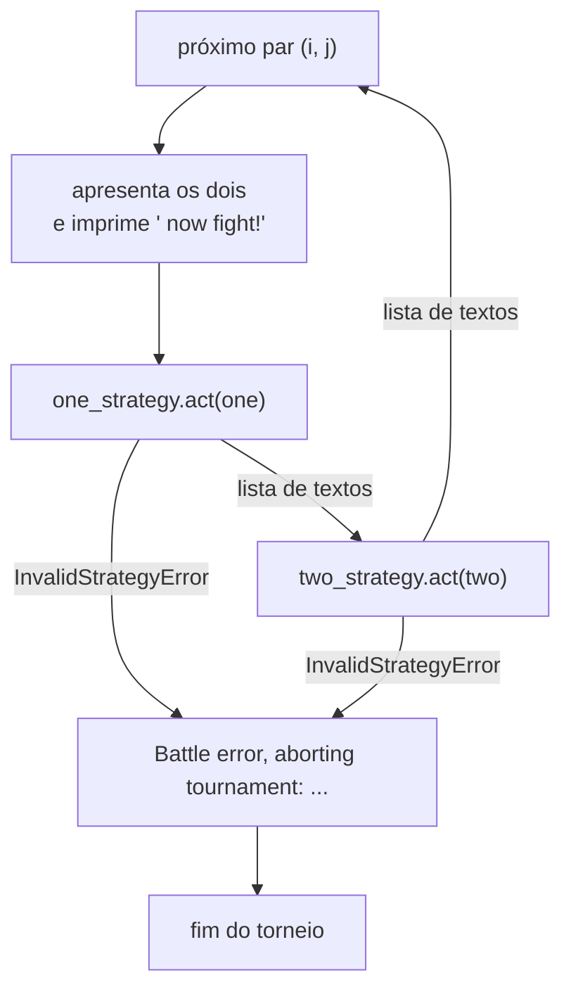

# A função battle

A função `battle` é o torneio inteiro: recebe os oponentes, organiza as lutas, faz cada criatura
agir com a sua estratégia e trata a combinação inválida. O enunciado pede uma **única** função
para isso, a mesma para todos os torneios.

Crie `tournament.py` na pasta `datadeck`, com os imports:

```python
from ex0 import AquaFactory, CreatureFactory, FlameFactory
from ex1 import HealingCreatureFactory, TransformCreatureFactory
from ex2 import (
    AggressiveStrategy,
    BattleStrategy,
    DefensiveStrategy,
    InvalidStrategyError,
    NormalStrategy,
)
```

Tudo vem dos pacotes: as fábricas do `ex0` e do `ex1`, as estratégias e a exceção do `ex2`.

## A função

```python
def battle(opponents: list[tuple[CreatureFactory, BattleStrategy]]) -> None:
    print("*** Tournament ***")
    print(f"{len(opponents)} opponents involved")
    fighters = []
    for factory, strategy in opponents:
        fighters.append((factory.create_base(), strategy))
    try:
        for i in range(len(fighters)):
            for j in range(i + 1, len(fighters)):
                one, one_strategy = fighters[i]
                two, two_strategy = fighters[j]
                print()
                print("* Battle *")
                print(one.describe())
                print(" vs.")
                print(two.describe())
                print(" now fight!")
                for line in one_strategy.act(one):
                    print(line)
                for line in two_strategy.act(two):
                    print(line)
    except InvalidStrategyError as error:
        print(f"Battle error, aborting tournament: {error}")
```

## Os oponentes

O parâmetro é uma lista de tuplas `(fábrica, estratégia)`, como pede o enunciado. O type hint
diz isso com as duas classes abstratas: `list[tuple[CreatureFactory, BattleStrategy]]`. A
função não conhece nenhuma família nem nenhuma estratégia concreta.

O cabeçalho do torneio sai antes de tudo: `*** Tournament ***` e o número de oponentes, com
`len(opponents)`.

## Uma criatura por oponente

O primeiro laço cria a criatura base de cada fábrica e a guarda com a estratégia do oponente, na
lista `fighters` ("lutadores"). O mypy deduz o tipo da lista pelo primeiro `append`: uma lista de
tuplas `(Creature, BattleStrategy)`.

Cada oponente é **uma** criatura durante o torneio todo, escolha do tutorial: a saída do
enunciado não distingue isso de criar uma criatura nova a cada luta, porque a estratégia
agressiva sempre volta ao normal no fim (`revert`) e a cura não muda nada na criatura.

## Todos contra todos

Os dois laços de índices formam cada par uma vez só. `i` percorre as posições da lista, e `j`
percorre só as posições **depois** de `i` (`range(i + 1, len(fighters))`). Com três oponentes:

| `i` | `j` | Luta no torneio 2 |
|---|---|---|
| 0 | 1 | `Aquabub` contra `Sproutling` |
| 0 | 2 | `Aquabub` contra `Shiftling` |
| 1 | 2 | `Sproutling` contra `Shiftling` |

Começar `j` em `i + 1` evita que um oponente lute contra si mesmo (`j` igual a `i`) e que um par
se repita invertido (2 contra 1 depois de 1 contra 2). Com `n` oponentes, são
`n × (n − 1) ÷ 2` lutas: 1 com dois oponentes, 3 com três.

## Cada luta

`fighters[i]` é uma tupla, desempacotada na criatura (`one`) e na estratégia dela
(`one_strategy`). Cada luta imprime uma linha vazia, o título `* Battle *`, a apresentação dos
dois e ` now fight!`. Depois, cada criatura age com a **sua** estratégia: `one_strategy.act(one)`
devolve a lista de textos das ações, e o `for` imprime um por linha.

Esse é o ponto do padrão: a função só chama `act`. Se a estratégia é normal, agressiva ou
defensiva, e se a criatura cura ou se transforma, quem sabe é a estratégia.

## A combinação inválida

O `try` envolve as lutas. Quando um `act` recebe uma criatura que não serve, ele lança
`InvalidStrategyError`; a exceção interrompe o `act`, sai dos dois laços e cai no `except`, que
imprime `Battle error, aborting tournament: ` seguido da mensagem da exceção. As lutas que
faltavam não acontecem: o torneio foi abortado. A função termina normalmente, e o programa segue.



O enunciado diz "trata corretamente as tuplas inválidas", sem dizer como. A saída do torneio 1
mostra o comportamento: a apresentação da luta sai, o erro aparece quando a estratégia tenta
agir, e o torneio para. Por isso o torneio não confere `is_valid` antes de começar: conferir antes
mudaria a saída.

Só `InvalidStrategyError` é capturada. Qualquer outro erro dentro das lutas seria um defeito do
programa e apareceria com o traceback completo
([Por que um tipo próprio](./03-a-excecao-dedicada.md#por-que-um-tipo-próprio)).
