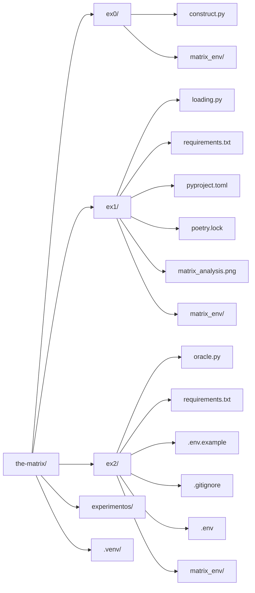

# A pasta do projeto

O enunciado pede cada exercício numa pasta com o número dele: `ex0/`, `ex1/` e `ex2/`. Crie uma
pasta para o projeto, entre nela e crie as três pastas e mais uma, `experimentos`, para os
programas pequenos que a parte
[Pacotes, venvs e variáveis](../02-conceitos/01-pacotes-e-o-pip.md) usa para mostrar cada ideia
(eles não fazem parte da entrega):

```bash
mkdir the-matrix
cd the-matrix
mkdir ex0 ex1 ex2 experimentos
```

`mkdir` cria uma pasta (ou várias, com os nomes em sequência). O nome `the-matrix` é só uma
sugestão; o que o enunciado fixa são as pastas `ex0` a `ex2` e os nomes dos arquivos.

Os comandos são rodados a partir desta pasta, a `the-matrix`, e os arquivos dos exercícios são
criados a partir dela, com o caminho da pasta do exercício (`ex0/construct.py`). A exceção são as
páginas que rodam os programas de cada exercício: elas rodam os comandos **dentro da pasta do
exercício**, como nos exemplos do enunciado, começando com um `cd ex0` (ou `ex1`, `ex2`) e
terminando com `cd ..`, que volta para a `the-matrix`.

Ao fim do projeto, a pasta fica assim (as pastas aparecem com `/` no fim):



Só estes arquivos são entregues: `construct.py`; `loading.py`, `requirements.txt` e
`pyproject.toml`; `oracle.py`, `requirements.txt`, `.env.example` e `.gitignore`. O resto é criado
pelos próprios comandos do tutorial:

- `.venv/`: o ambiente das ferramentas que conferem o código
  ([próxima página](./03-as-ferramentas.md));
- `matrix_env/`: o ambiente virtual de cada exercício, onde o programa roda;
- `poetry.lock` e `matrix_analysis.png`: criados no exercício 1, pelo Poetry e pelo programa;
- `.env`: a configuração de verdade do exercício 2, que guarda um segredo e por isso nunca vai
  para o repositório;
- `.mypy_cache/` (fora do desenho): criada pelo mypy em cada pasta onde ele roda, para guardar
  resultados e conferir mais rápido da próxima vez.

Um nome que começa com ponto, como `.venv` e `.env`, é um nome **oculto**: o `ls` comum não o
mostra, e `ls -a` (de *all*, "todos") mostra.
