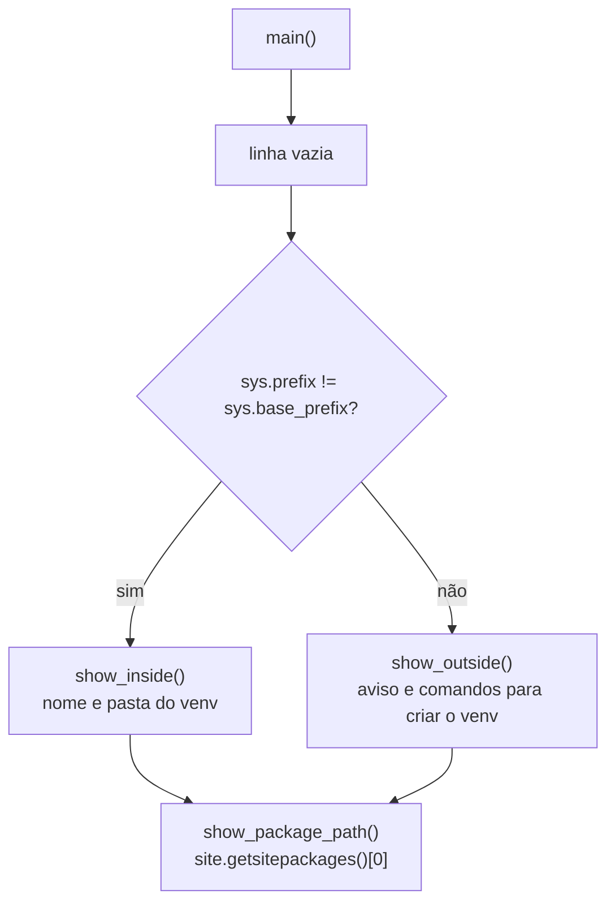

# Onde ficam os pacotes

A quarta exigência do enunciado é mostrar a diferença entre o lugar onde os pacotes são
instalados no Python global e num ambiente virtual. A pasta onde o pip instala é a primeira da
lista de `site.getsitepackages()`
([O Python sabe onde está](../02-conceitos/02-o-ambiente-virtual-por-dentro.md#o-python-sabe-onde-está)).

## Nos dois casos

A saída do enunciado mostra o `Package installation path` só dentro do venv. A **escolha do
tutorial** é mostrá-lo nos dois casos, no fim da saída: dentro do venv, a pasta do ambiente;
fora, a pasta do Python global. Assim, rodar o programa fora e dentro mostra lado a lado os dois
lugares que a exigência pede para comparar, com uma função só:

```python
def show_package_path() -> None:
    print()
    print("Package installation path:")
    print(site.getsitepackages()[0])
```

Fora do venv, a saída ganha três linhas depois de `Then run this program again.`: a linha vazia,
o título e a pasta global. Dentro, a saída fica igual à do enunciado. Outra forma possível seria
mostrar as duas pastas na saída de dentro do venv (a global vem de
`site.getsitepackages([sys.base_prefix])`); ela muda a saída do caso de dentro, em vez da do caso
de fora.

## O main

```python
def main() -> None:
    print()
    if inside_virtual_env():
        show_inside()
    else:
        show_outside()
    show_package_path()


if __name__ == "__main__":
    main()
```

- o primeiro `print()` é a linha vazia com que as saídas do enunciado começam;
- o `if` escolhe a mensagem, e o caminho dos pacotes sai nos dois casos;
- `if __name__ == "__main__":` roda o `main` só quando o arquivo é executado com `python3`, e não
  quando outro arquivo o importa: `__name__` é uma variável que o Python preenche com
  `"__main__"` no arquivo que foi rodado.


