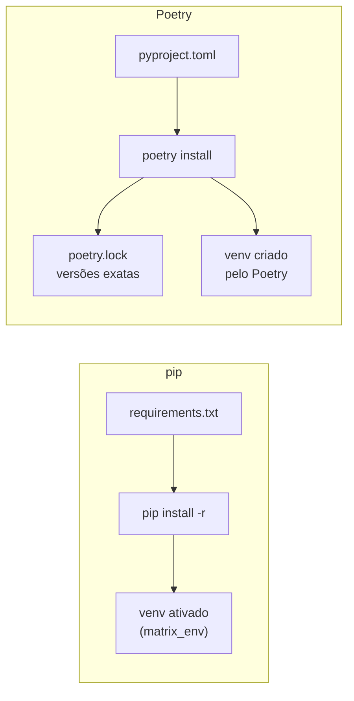

# pip e Poetry

As duas ferramentas instalam as bibliotecas de um projeto, mas fazem trabalhos de tamanhos
diferentes.

## O pip: um instalador

O pip ([Pacotes e o pip](../02-conceitos/01-pacotes-e-o-pip.md)) recebe nomes de pacotes, na linha
de comando ou num arquivo `requirements.txt`, e instala cada um, com as dependências, no
`site-packages` do Python que o está rodando. É só isso:

- ele não cria ambientes: quem cria é o `python3 -m venv`, e quem escolhe em qual ambiente o pip
  instala é você, ativando o ambiente certo antes (ou chamando o pip pelo caminho, como em
  `.venv/bin/python -m pip`);
- ele não guarda as versões que escolheu. Com `numpy>=1.25.0`, quem instalar hoje recebe a versão
  mais nova de hoje; quem instalar daqui a um ano recebe a de daqui a um ano. O comando
  `pip freeze` lista as versões exatas instaladas, mas é preciso rodá-lo e guardar a lista à mão.

## O Poetry: um gerenciador de projetos

O Poetry cuida do projeto inteiro, a partir de um arquivo de descrição, o `pyproject.toml`:

- **resolve** as versões de todas as dependências juntas, inclusive as dependências das
  dependências, para todas as versões de Python que o projeto aceita;
- **trava** o resultado num arquivo `poetry.lock` (*lock*, "tranca"), com a versão exata de cada
  pacote. Enquanto o `poetry.lock` existir, todo `poetry install` instala exatamente aquelas
  versões, em qualquer máquina, hoje ou daqui a um ano;
- **cria e gerencia** um ambiente virtual só do projeto, sem que você precise criar nem ativar
  nada;
- **roda** comandos dentro desse ambiente com `poetry run`.

O Poetry não vem com o Python: ele foi instalado no `.venv` das ferramentas
([As ferramentas](../01-ambiente/03-as-ferramentas.md)), e é chamado como `../.venv/bin/poetry` de
dentro da pasta `ex1`. Os comandos que o enunciado escreve como `poetry install` e
`poetry run python loading.py` são os mesmos, com o caminho na frente.

Se houver um ambiente virtual **ativado** quando o Poetry roda, ele usa esse ambiente em vez de
criar o seu, e instala as bibliotecas nele. Por isso, nenhum ambiente fica ativado nos comandos do
Poetry.

## Lado a lado

| | pip | Poetry |
|---|---|---|
| vem com o Python | sim | não; instalado à parte |
| arquivo de dependências | `requirements.txt` | `pyproject.toml` |
| versões exatas registradas | não (só com `pip freeze`, à mão) | sim, no `poetry.lock` |
| ambiente virtual | criado por você, com `python3 -m venv`, e ativado por você | criado e escolhido pelo Poetry |
| instalar | `pip install -r requirements.txt` | `poetry install` |
| rodar o programa | `python3 loading.py`, com o venv ativado | `poetry run python loading.py` |

O exercício 1 usa os dois caminhos para o mesmo programa: as páginas
[Rodar com o pip](./10-rodar-com-pip.md) e [Rodar com o Poetry](./11-rodar-com-poetry.md) instalam
as bibliotecas de cada jeito e rodam o `loading.py` nos dois ambientes.
