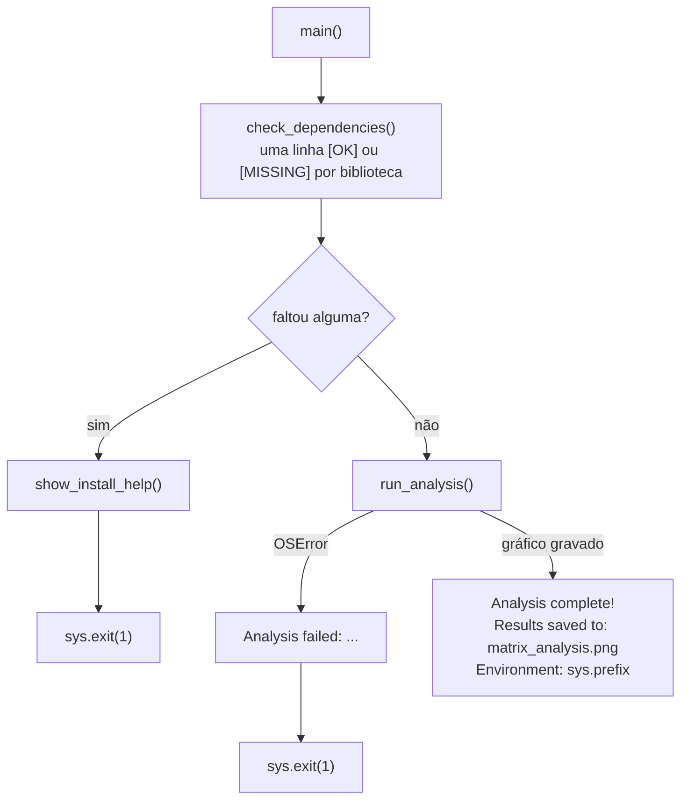

# O main

O `main` junta as peças na ordem da saída do enunciado e decide o que acontece em cada caso. Ele
entra no fim do arquivo:

```python
def main() -> None:
    print()
    print("LOADING STATUS: Loading programs...")
    print()
    print("Checking dependencies:")
    missing = check_dependencies()
    print()
    if missing:
        show_install_help(missing)
        sys.exit(1)
    try:
        run_analysis()
    except OSError as error:
        print(f"Analysis failed: {error}")
        sys.exit(1)
    print()
    print("Analysis complete!")
    print(f"Results saved to: {OUTPUT}")
    print()
    print(f"Environment: {sys.prefix}")


if __name__ == "__main__":
    main()
```



## Faltou biblioteca

`if missing:` é verdadeiro quando a lista devolvida por `check_dependencies` não está vazia. O
programa mostra as instruções e termina com `sys.exit(1)`: o código de saída `1` diz ao terminal
que o programa não fez o seu trabalho
([O código de saída](../00-introducao/03-pre-requisitos.md#o-código-de-saída)). A análise nem é
tentada: sem as bibliotecas, ela quebraria no primeiro uso.

## Não deu para gravar o gráfico

Gravar um arquivo pode falhar por motivos que o programa não controla: falta de permissão na
pasta, disco cheio, um nome já ocupado por uma pasta. Esses erros do sistema de arquivos chegam
como `OSError` (ou um tipo filho dele, como `PermissionError`). O `try` em volta de
`run_analysis` captura qualquer um deles e troca o traceback por uma linha que diz o que houve,
com a mensagem do próprio erro, e o programa termina com o código `1`. A página
[Rodar e conferir](./12-rodar-e-conferir.md) provoca esse erro.

## Deu tudo certo

As linhas seguintes são as do enunciado: uma linha vazia, `Analysis complete!` e o nome do
arquivo gravado, tirado da mesma constante `OUTPUT` que o `savefig` usou.

Depois delas vem a única linha que não está na saída do enunciado, separada por uma linha vazia:
`Environment:` e o valor de `sys.prefix`, a pasta do ambiente em uso
([O Python sabe onde está](../02-conceitos/02-o-ambiente-virtual-por-dentro.md#o-python-sabe-onde-está)).
É ela que mostra, na saída de sucesso, a diferença entre os dois caminhos que o enunciado pede:

- pelo pip, o ambiente é o `matrix_env`, criado e ativado à mão dentro da pasta `ex1`;
- pelo Poetry, é o ambiente que ele mesmo criou, na pasta de dados dele, com o nome do projeto no
  nome (`…/pypoetry/virtualenvs/loading-…`).

As duas saídas estão em [Rodar com o pip](./10-rodar-com-pip.md#todas-as-bibliotecas)
e [Rodar com o Poetry](./11-rodar-com-poetry.md#rodar). O programa termina sem `sys.exit`, com o
código `0`.
