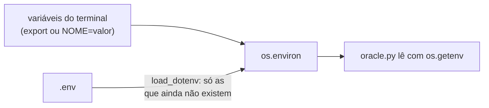

# O arquivo .env

Cinco variáveis definidas com `export` a cada terminal novo seriam trabalhosas e fáceis de
esquecer ([Variáveis de ambiente](../02-conceitos/04-variaveis-de-ambiente.md)). O arquivo
**`.env`** guarda essas definições na pasta do projeto, e o programa as carrega ao iniciar.

## O formato

Um `.env` tem uma variável por linha, no formato `NOME=valor`:

```ini
# Copy to .env and fill in the values. Never commit .env.
MATRIX_MODE=development
DATABASE_URL=sqlite:///matrix.db
API_KEY=dev-key-zion-0042
LOG_LEVEL=DEBUG
ZION_ENDPOINT=http://localhost:8080/zion
```

- uma linha que começa com `#` é um comentário, e é ignorada;
- o valor vem logo depois do `=`, sem aspas (o python-dotenv também aceita o valor entre aspas,
  útil quando ele tem espaços);
- `NOME=` sem nada depois define a variável com um valor vazio.

O `.env` não é código Python: é só um arquivo de texto. Quem o lê é a biblioteca
**python-dotenv**.

## As duas funções do python-dotenv

O pacote se chama `python-dotenv`, mas o módulo que se importa é `dotenv`:

```python
from dotenv import dotenv_values, load_dotenv
```

- `load_dotenv(".env")` lê o arquivo e cria cada variável no ambiente do programa, em
  `os.environ`, **menos as que já existem**: uma variável que já veio do terminal fica com o valor
  do terminal. Depois dela, o programa lê tudo com `os.getenv`, venha de onde vier;
- `dotenv_values(".env")` lê o arquivo e devolve um dicionário com os valores dele, sem mexer no
  ambiente.

As duas aceitam um arquivo que não existe: `load_dotenv` não carrega nada, e `dotenv_values`
devolve um dicionário vazio.

## Quem vale mais

A regra do `load_dotenv` é a que o enunciado pede no teste
`MATRIX_MODE=production API_KEY=secret123 python3 oracle.py`: as variáveis escritas na linha de
comando já estão no ambiente quando o programa começa, e o `.env` não as substitui.



É assim que a produção funciona: no servidor, a configuração vem do ambiente (posta lá pelo
sistema que roda o programa), e um `.env` esquecido não consegue mudá-la.

## O nome do arquivo

O tutorial passa o nome `".env"` explicitamente. Sem argumento, `load_dotenv()` procura um `.env`
a partir da pasta do programa e, se não acha, sobe para as pastas de cima, até a raiz: poderia
carregar sem aviso o `.env` de outro projeto. Com `".env"`, o arquivo é o da **pasta atual**, a
pasta onde o programa é rodado, como nos exemplos do enunciado (`cp .env.example .env` e
`python3 oracle.py`, na mesma pasta).

## O .env e o .env.example

O `.env` guarda a configuração de verdade, segredos inclusive, e por isso **nunca** vai para o
repositório: ele fica listado no `.gitignore`. Mas quem baixa o projeto precisa saber quais
variáveis criar. Para isso existe o `.env.example`: o mesmo arquivo, com as mesmas variáveis, sem
os segredos. Ele vai para o repositório, e cada pessoa faz a sua cópia:

```console
$> cp .env.example .env
$> # Edit .env with your values
```

A [próxima página](./03-os-arquivos-de-apoio.md) escreve o `.env.example`, o `.gitignore` e o
`requirements.txt`.
