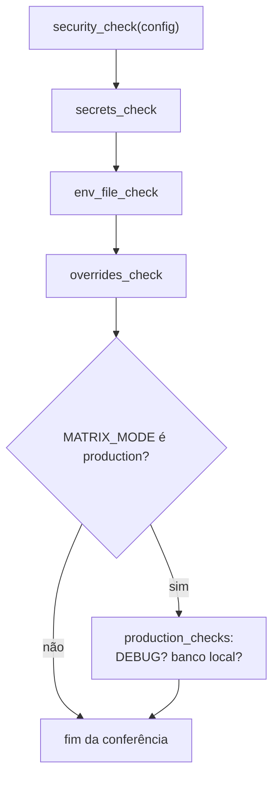

# Desenvolvimento e produção

**Desenvolvimento** é o computador de quem escreve o programa: banco de dados local, logs
detalhados para entender cada passo. **Produção** é o servidor onde o programa roda para valer:
banco de dados de verdade, logs só do que importa. O enunciado pede que o programa mostre
configurações diferentes para os dois modos, de um jeito visível na saída, e deixa o como a
critério de quem implementa.

## Produção é mais exigente

A **escolha do tutorial**: em modo de produção, a conferência de segurança ganha uma etapa a mais,
que recusa duas configurações que só fazem sentido em desenvolvimento:

- `LOG_LEVEL=DEBUG`: o nível mais detalhado registra tudo o que o programa faz, inclusive dados
  dos usuários, e enche o disco do servidor;
- um banco de dados local: em produção, o banco é um servidor próprio, e não um arquivo na
  máquina do programa.

```python
def production_checks(config: dict[str, str]) -> list[str]:
    warnings = []
    if config["LOG_LEVEL"] == "DEBUG":
        warnings.append("[WARNING] DEBUG log level in production")
    if is_local(config["DATABASE_URL"]):
        warnings.append("[WARNING] Local database in production")
    if not warnings:
        return ["[OK] Production settings verified"]
    return warnings
```

A função devolve uma lista de linhas: os avisos, ou uma única linha `[OK]` quando não há nenhum.
Ela entra depois de `overrides_check`.

## A conferência completa

A última função da conferência junta as linhas e decide se a etapa de produção roda. Ela entra
depois de `production_checks`:

```python
def security_check(config: dict[str, str]) -> None:
    print("Environment security check:")
    print(secrets_check(config["API_KEY"]))
    print(env_file_check())
    print(overrides_check())
    if config["MATRIX_MODE"] == "production":
        for line in production_checks(config):
            print(line)
```

Em desenvolvimento, a conferência tem as três linhas do enunciado; em produção, uma ou duas a
mais.

## Como cada modo aparece na saída

| | development (o `.env`) | production com o `.env` e duas variáveis sobrepostas | production completa |
|---|---|---|---|
| `Mode` | `development` | `production` | `production` |
| `Database` | `local instance` | `local instance` | `remote instance` |
| `Log Level` | `DEBUG` | `DEBUG` | `WARNING` |
| linhas a mais na conferência | nenhuma | `[WARNING] DEBUG log level in production` e `[WARNING] Local database in production` | `[OK] Production settings verified` |

A coluna do meio é o exemplo do enunciado, `MATRIX_MODE=production API_KEY=secret123 python3
oracle.py`: o modo e a chave vêm da linha de comando, e o resto, do `.env` de desenvolvimento. O
programa avisa que essa mistura não serve para produção. A página
[Rodar e conferir](./10-rodar-e-conferir.md#produção) roda as três colunas.


