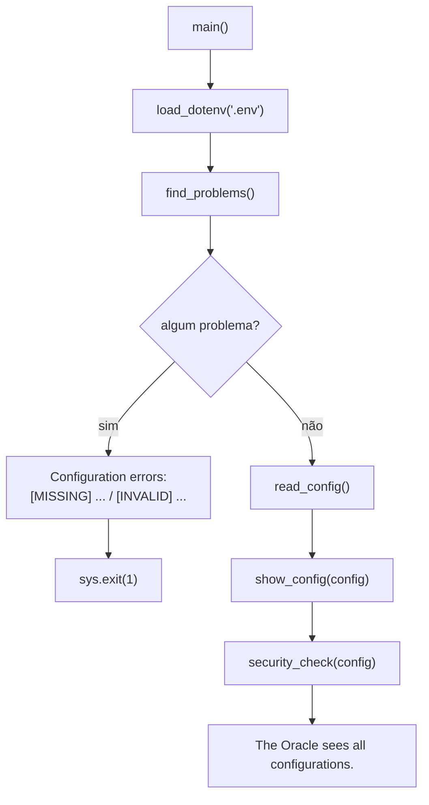

# O main

O `main` carrega o `.env`, para se a configuração estiver incompleta e, se estiver completa,
mostra os dois blocos da saída. Ele entra no fim do arquivo:

```python
def main() -> None:
    print()
    print("ORACLE STATUS: Reading the Matrix...")
    print()
    load_dotenv(ENV_FILE)
    problems = find_problems()
    if problems:
        print("Configuration errors:")
        for problem in problems:
            print(problem)
        print()
        print("Copy .env.example to .env and fill in the values,")
        print("or set the variables in the environment.")
        sys.exit(1)
    config = read_config()
    show_config(config)
    print()
    security_check(config)
    print()
    print("The Oracle sees all configurations.")


if __name__ == "__main__":
    main()
```

- `load_dotenv(ENV_FILE)` vem antes de qualquer leitura: depois dele, as variáveis do `.env` que
  ainda não existiam estão no ambiente ([O arquivo .env](./02-o-arquivo-env.md));
- com algum problema, o programa lista todos, diz como resolver e termina com `sys.exit(1)`. A
  configuração não é mostrada pela metade;
- sem problemas, `read_config` monta o dicionário, e as duas funções de exibição o recebem;
- as linhas vazias e as mensagens de cabeçalho e de fim são as da saída do enunciado.



Sem nenhuma configuração, a saída é:

```text

ORACLE STATUS: Reading the Matrix...

Configuration errors:
[MISSING] MATRIX_MODE is not set
[MISSING] DATABASE_URL is not set
[MISSING] API_KEY is not set
[MISSING] LOG_LEVEL is not set
[MISSING] ZION_ENDPOINT is not set

Copy .env.example to .env and fill in the values,
or set the variables in the environment.
```

São os "avisos de configuração ausente" do primeiro teste do enunciado: cada variável que falta,
pelo nome, e o caminho para resolver.
