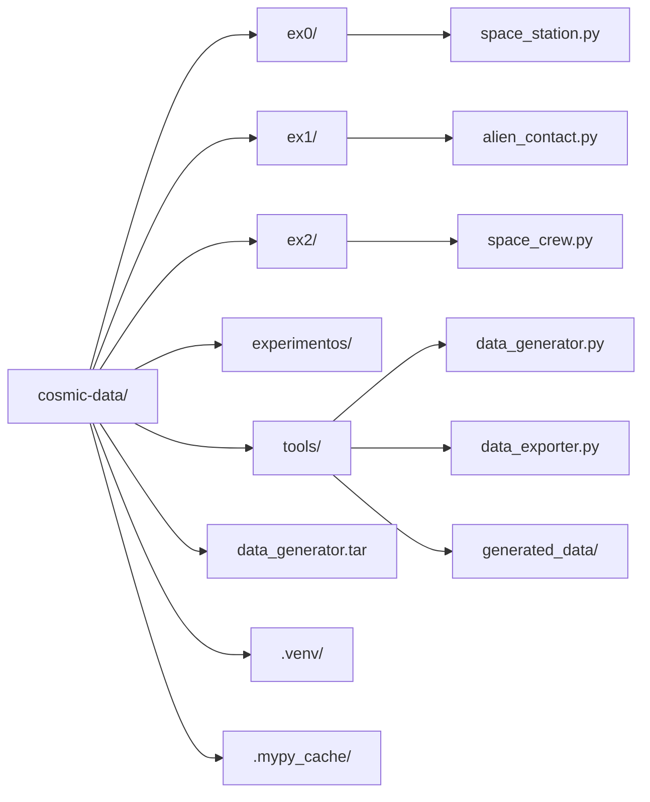

# A pasta do projeto

O enunciado pede cada exercício num arquivo próprio, dentro de uma pasta com o número do
exercício: `ex0/`, `ex1/` e `ex2/`. Crie uma pasta para o projeto, entre nela e crie as três
pastas:

```bash
mkdir cosmic-data
cd cosmic-data
mkdir ex0 ex1 ex2
```

`mkdir` cria uma pasta (ou várias, com os nomes em sequência). O nome `cosmic-data` é só uma
sugestão; o que o enunciado fixa são as pastas `ex0` a `ex2` e os nomes dos arquivos. **Todos os
comandos do tutorial são rodados a partir desta pasta**, a `cosmic-data`.

Crie também uma pasta `experimentos`, para os programas pequenos que a parte
[Pydantic](../02-conceitos/01-o-primeiro-modelo.md) usa para mostrar cada ideia e para os testes
de cada exercício. Eles não fazem parte da entrega:

```bash
mkdir experimentos
```

Ao fim do projeto, a pasta fica assim:



- `.venv/` é o ambiente virtual, criado na [próxima página](./03-o-ambiente-virtual.md);
- `.mypy_cache/` é criada pelo mypy na primeira vez que ele roda, para guardar resultados e
  conferir mais rápido da próxima vez;
- `tools/` e `data_generator.tar` são as ferramentas de dados que vêm com o enunciado, usadas na
  parte [Os dados do gerador](../06-dados-do-gerador/01-as-ferramentas.md).

Só os três arquivos `.py` das pastas `ex0` a `ex2` são entregues.
