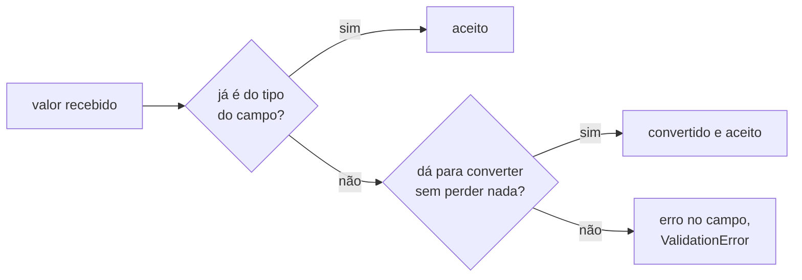

# Conversão de tipos

Dados de fora raramente chegam com o tipo exato: um arquivo JSON não tem tipo de data, e a data
vem como texto; um formulário manda tudo como texto, até os números. O Pydantic não recusa esses
valores de cara: quando um valor pode ser **convertido** sem perder nada para o tipo do campo, ele
converte. Só recusa o que não tem conversão segura.

## datetime

O tipo de data e hora do Python é o **`datetime`**, do módulo `datetime` da biblioteca padrão.
`datetime(2024, 1, 15, 10, 30)` é o dia 15 de janeiro de 2024, às 10h30. O texto
`"2024-01-15T10:30:00"` escreve a mesma data no formato **ISO 8601**, o padrão internacional:
ano, mês e dia separados por `-`, um `T` e a hora com `:`.

## O experimento

Crie `experimentos/conversao.py`:

```python title="experimentos/conversao.py"
from datetime import datetime
from typing import Any

from pydantic import BaseModel, ValidationError


class Reading(BaseModel):
    value: float
    count: int
    taken_at: datetime
    ok: bool


def attempt(data: dict[str, Any]) -> None:
    try:
        print(repr(Reading.model_validate(data)))
    except ValidationError as error:
        for detail in error.errors():
            print(f"{detail['loc'][0]}: {detail['msg']}")


attempt({"value": "85.5", "count": "6",
         "taken_at": "2024-01-15T10:30:00", "ok": "yes"})
attempt({"value": 85, "count": 6.0, "taken_at": "2024-01-15", "ok": 1})
attempt({"value": "high", "count": 6.5, "taken_at": "tomorrow",
         "ok": "maybe"})
```

```bash
.venv/bin/python experimentos/conversao.py
```

```text
Reading(value=85.5, count=6, taken_at=datetime.datetime(2024, 1, 15, 10, 30), ok=True)
Reading(value=85.0, count=6, taken_at=datetime.datetime(2024, 1, 15, 0, 0), ok=True)
value: Input should be a valid number, unable to parse string as a number
count: Input should be a valid integer, got a number with a fractional part
taken_at: Input should be a valid datetime or date, input is too short
ok: Input should be a valid boolean, unable to interpret input
```

## O que aconteceu

Nos dois primeiros dicionários, nenhum valor tinha o tipo do campo, e os dois objetos foram
criados:

| Campo | Recebeu | Virou |
|---|---|---|
| `value: float` | o texto `"85.5"`; o inteiro `85` | `85.5`; `85.0` |
| `count: int` | o texto `"6"`; o número `6.0` | `6`; `6` |
| `taken_at: datetime` | o texto `"2024-01-15T10:30:00"`; o texto `"2024-01-15"` | a data com hora; a data à meia-noite |
| `ok: bool` | o texto `"yes"`; o inteiro `1` | `True`; `True` |

No terceiro, nenhuma conversão era segura: `"high"` não é número; `6.5` viraria `6` perdendo o
`.5`, e o Pydantic recusa ("um número com parte fracionária"); `"tomorrow"` não está no formato
de data; `"maybe"` não é um jeito conhecido de escrever verdadeiro ou falso.



Esse comportamento é o modo **leniente** (*lax mode*), o padrão do Pydantic. Existe também um
modo **estrito** (*strict mode*), que recusa qualquer valor fora do tipo exato; o projeto não o
usa.

## E pelo construtor?

O construtor também converte. Crie `experimentos/construtor.py`, que passa a data como texto
direto para `Reading`:

```python title="experimentos/construtor.py"
from datetime import datetime

from pydantic import BaseModel


class Reading(BaseModel):
    taken_at: datetime


reading = Reading(taken_at="2024-01-15T10:30:00")
print(repr(reading))
```

```bash
.venv/bin/python experimentos/construtor.py
```

```text
Reading(taken_at=datetime.datetime(2024, 1, 15, 10, 30))
```

O programa roda e a conversão acontece. Mas o mypy recusa a chamada:

```bash
.venv/bin/mypy --disallow-untyped-defs experimentos/construtor.py
```

```text
experimentos/construtor.py:10: error: Argument "taken_at" to "Reading" has incompatible type "str"; expected "datetime"  [arg-type]
Found 1 error in 1 file (checked 1 source file)
```

("o argumento `taken_at` de `Reading` tem o tipo incompatível `str`; o esperado era
`datetime`"). O mypy confere o construtor de um modelo como confere qualquer função: cada
argumento precisa ter o tipo do campo. Ele não sabe que o Pydantic converteria o texto.

As duas situações têm, cada uma, o seu caminho:

- **valores escritos no próprio código**: use o tipo certo no construtor,
  `datetime(2024, 1, 15, 10, 30)`. O mypy confere, e não há nada a converter;
- **dados de fora**, que só se conhece enquanto o programa roda: use `model_validate`. Ele recebe
  um dicionário com valores de qualquer tipo, e quem confere é o Pydantic.

Corrija `experimentos/construtor.py` usando os dois caminhos:

```python title="experimentos/construtor.py"
from datetime import datetime

from pydantic import BaseModel


class Reading(BaseModel):
    taken_at: datetime


from_code = Reading(taken_at=datetime(2024, 1, 15, 10, 30))
from_text = Reading.model_validate({"taken_at": "2024-01-15T10:30:00"})
print(repr(from_code))
print(repr(from_text))
print(from_code == from_text)
```

```bash
.venv/bin/python experimentos/construtor.py
.venv/bin/mypy --disallow-untyped-defs experimentos/construtor.py
```

```text
Reading(taken_at=datetime.datetime(2024, 1, 15, 10, 30))
Reading(taken_at=datetime.datetime(2024, 1, 15, 10, 30))
True
Success: no issues found in 1 source file
```

Os dois objetos são iguais: `==` entre dois modelos compara os campos. As demonstrações dos três
exercícios criam os objetos pelo construtor, com valores do tipo certo, e o mypy não acusa nada
nelas. Os testes de cada exercício e a parte [Os dados do gerador](../06-dados-do-gerador/01-as-ferramentas.md)
usam `model_validate`, com dados no formato em que chegam de fora.

```bash
.venv/bin/flake8 experimentos/conversao.py experimentos/construtor.py
.venv/bin/mypy --disallow-untyped-defs experimentos/conversao.py
```

```text
Success: no issues found in 1 source file
```
