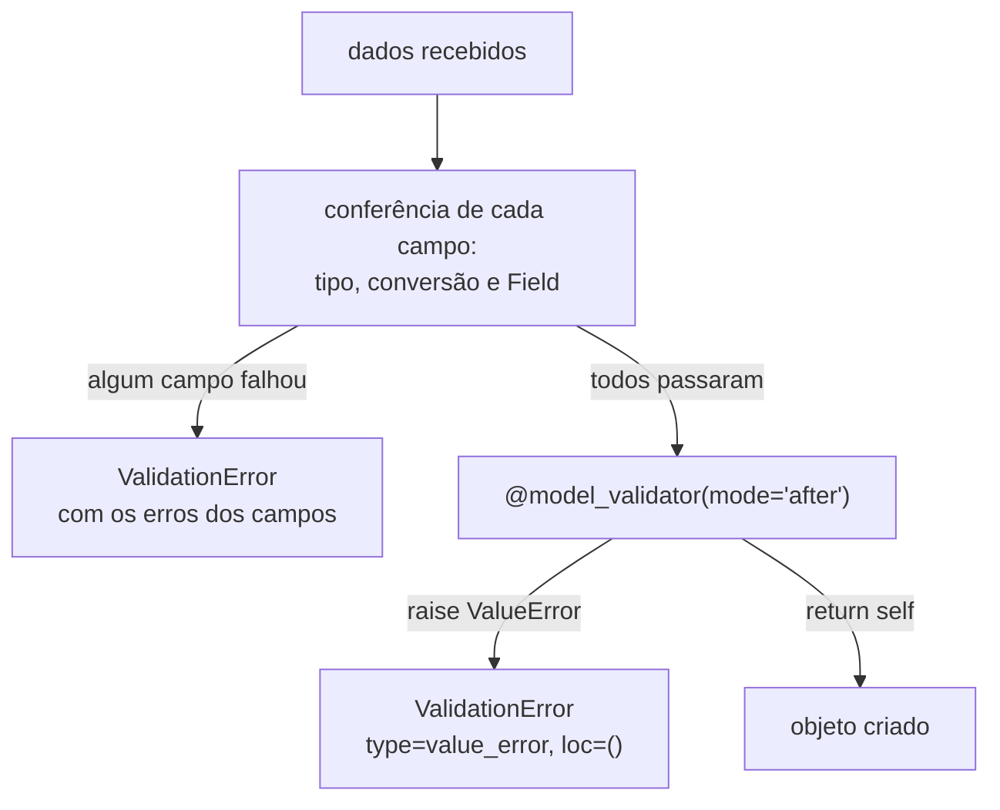

# model_validator

As restrições de `Field` olham um campo de cada vez. Algumas regras dependem de **vários**
campos juntos: um foguete não pode levar mais tripulantes do que assentos; um contato telepático
precisa de pelo menos 3 testemunhas, mas um contato por rádio não. Essas regras ficam num método
do modelo marcado com **`@model_validator(mode="after")`**.

## Decorador

Uma linha que começa com `@` em cima de um `def` é um **decorador**: ela modifica a função logo
abaixo. `@model_validator(mode="after")` registra o método como uma regra do modelo, que o
Pydantic chama sozinho a cada objeto criado. `mode="after"` ("depois") quer dizer que o método
roda **depois** da conferência de todos os campos: quando ele começa, cada campo já tem o tipo
certo e passou nos seus limites.

O enunciado escreve `mode='after'`, com aspas simples; no Python, aspas simples e duplas dão o
mesmo texto. O tutorial usa aspas duplas em todo o código.

## O experimento

Crie `experimentos/validador.py`:

```python title="experimentos/validador.py"
from pydantic import BaseModel, Field, ValidationError, model_validator


class Launch(BaseModel):
    rocket: str = Field(min_length=2)
    crew: int = Field(ge=0)
    seats: int = Field(ge=1)

    @model_validator(mode="after")
    def check_seats(self) -> "Launch":
        if self.crew > self.seats:
            raise ValueError("More crew than seats")
        return self


def attempt(rocket: str, crew: int, seats: int) -> None:
    try:
        launch = Launch(rocket=rocket, crew=crew, seats=seats)
        print(f"OK: {launch}")
    except ValidationError as error:
        detail = error.errors()[0]
        print(f"loc={detail['loc']} type={detail['type']}")
        print(f"  msg: {detail['msg']}")
        if detail["type"] == "value_error":
            print(f"  ctx error: {detail['ctx']['error']}")


attempt("Falcon", 4, 7)
attempt("Falcon", 9, 7)
attempt("F", 9, 7)
print(Launch.model_validate({"rocket": "Soyuz", "crew": 3, "seats": 3}))
```

O método `check_seats`:

- recebe `self`, o objeto já com todos os campos preenchidos e conferidos;
- quando a regra falha, lança `ValueError` com a mensagem da regra;
- quando a regra passa, devolve o próprio objeto: `return self`;
- o tipo de retorno é `"Launch"`, o nome da classe **entre aspas**: dentro do corpo da classe, o
  nome `Launch` ainda não existe para o Python, e as aspas adiam a leitura do tipo. No Python 3.11
  existe o tipo `Self` para isso, mas o projeto precisa rodar no 3.10.

```bash
.venv/bin/python experimentos/validador.py
```

```text
OK: rocket='Falcon' crew=4 seats=7
loc=() type=value_error
  msg: Value error, More crew than seats
  ctx error: More crew than seats
loc=('rocket',) type=string_too_short
  msg: String should have at least 2 characters
rocket='Soyuz' crew=3 seats=3
```

## O que aconteceu

- **4 tripulantes e 7 assentos**: os campos passam, a regra passa, o objeto é criado;
- **9 tripulantes e 7 assentos**: os campos passam, mas o `ValueError` da regra vira uma
  `ValidationError`. O erro tem o tipo `value_error` e o `loc` vazio, `()`: ele é do modelo
  inteiro, e não de um campo;
- **foguete `"F"`, 9 tripulantes e 7 assentos**: o nome tem menos de 2 caracteres, e o único erro
  é o do campo. A regra dos assentos **nem rodou**: com um campo inválido, o `mode="after"` não
  chega a ser chamado;
- `model_validate` passa pelas mesmas regras que o construtor.



## A mensagem da regra

O `msg` do erro não é só a mensagem do `ValueError`: o Pydantic acrescenta `Value error, ` na
frente. A mensagem original, sem o acréscimo, fica guardada na chave `ctx` (de *context*,
"contexto") do dicionário do erro: `detail["ctx"]["error"]` é o próprio `ValueError` lançado, e
imprimi-lo mostra só a mensagem. Os erros de campo também têm `ctx`, mas com outro conteúdo (num
erro de `le=20`, por exemplo, `{'le': 20}`), e alguns erros não têm `ctx`; por isso o experimento
só lê `ctx["error"]` quando o tipo é `value_error`.

A saída dos exercícios 1 e 2 mostra a mensagem da regra sem o `Value error, `
([A mensagem do erro](../04-ex1/04-a-mensagem-do-erro.md)).

## Esquecer o return self

O enunciado lembra: o método precisa terminar com `return self`. Apague a linha `return self` de
`experimentos/validador.py` e rode de novo. A saída começa com um aviso:

```bash
.venv/bin/python experimentos/validador.py
```

```text
.../cosmic-data/experimentos/validador.py:17: UserWarning: A custom validator is returning a value other than `self`.
Returning anything other than `self` from a top level model validator isn't supported when validating via `__init__`.
See the `model_validator` docs (https://pydantic.dev/docs/validation/2.14/concepts/validators/#model-validators) for more details.
  launch = Launch(rocket=rocket, crew=crew, seats=seats)
OK: rocket='Falcon' crew=4 seats=7
loc=() type=value_error
  msg: Value error, More crew than seats
  ctx error: More crew than seats
loc=('rocket',) type=string_too_short
  msg: String should have at least 2 characters
None
```

- O `UserWarning` (um **aviso**: o programa continua) diz que o validador devolveu algo que não é
  `self`. Sem `return`, uma função devolve `None`. O começo da primeira linha é o caminho
  completo do arquivo na sua máquina, aqui abreviado com `...`;
- a última linha mostra o estrago: o `model_validate` devolveu `None` no lugar do objeto. O
  construtor ainda devolveu o objeto, mas só depois do aviso.

O mypy acusa o esquecimento antes de rodar, porque o método promete devolver um `Launch`:

```bash
.venv/bin/mypy --disallow-untyped-defs experimentos/validador.py
```

```text
experimentos/validador.py:10: error: Missing return statement  [return]
Found 1 error in 1 file (checked 1 source file)
```

Ponha a linha `return self` de volta, no fim do método, com 8 espaços de recuo, como estava. O
arquivo volta a passar:

```bash
.venv/bin/flake8 experimentos/validador.py
.venv/bin/mypy --disallow-untyped-defs experimentos/validador.py
```

```text
Success: no issues found in 1 source file
```

## O @validator antigo

No Pydantic 1, as regras eram escritas com o decorador `@validator`. Ele ainda existe no
Pydantic 2, mas está **obsoleto** (*deprecated*): marcado para sair numa versão futura, e quem o
usa recebe um aviso. O enunciado manda evitar o `@validator`, obsoleto, e usar o
`@model_validator`.
