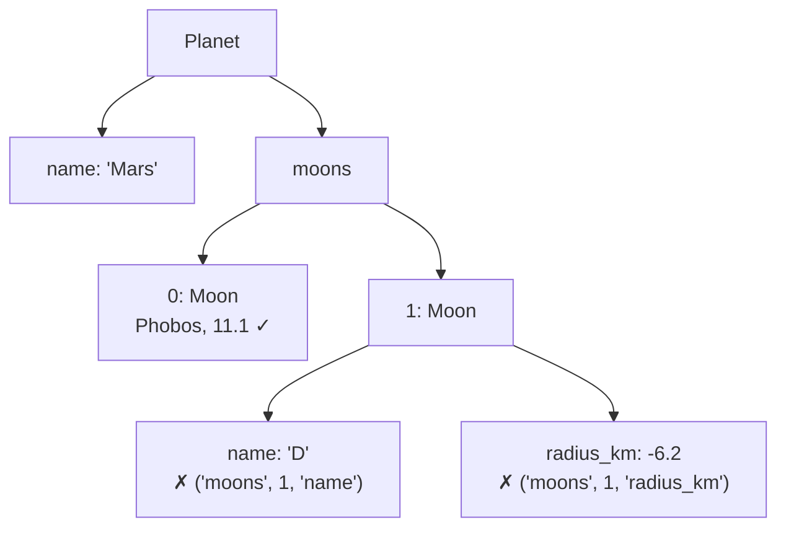

# Modelos aninhados

Um dado costuma ter outros dados dentro: um planeta tem luas, uma missão tem tripulantes. Cada
lua e cada tripulante têm os seus próprios campos e as suas próprias regras. No Pydantic, um
modelo pode ser o **tipo de um campo** de outro modelo: é o modelo **aninhado** (*nested*).

## O experimento

Crie `experimentos/aninhados.py`. O campo `moons` de `Planet` é uma lista de `Moon`:

```python title="experimentos/aninhados.py"
from typing import Any

from pydantic import BaseModel, Field, ValidationError


class Moon(BaseModel):
    name: str = Field(min_length=2)
    radius_km: float = Field(gt=0)


class Planet(BaseModel):
    name: str
    moons: list[Moon] = Field(min_length=1, max_length=3)


def attempt(data: dict[str, Any]) -> None:
    try:
        planet = Planet.model_validate(data)
        print(repr(planet))
        print(type(planet.moons[0]).__name__, planet.moons[0].name)
    except ValidationError as error:
        print(f"error_count: {error.error_count()}")
        for detail in error.errors():
            print(f"  {detail['loc']}: {detail['msg']}")


attempt({"name": "Mars", "moons": [{"name": "Phobos", "radius_km": 11.1},
                                   {"name": "Deimos", "radius_km": 6.2}]})
attempt({"name": "Mars", "moons": [{"name": "Phobos", "radius_km": 11.1},
                                   {"name": "D", "radius_km": -6.2}]})
attempt({"name": "Venus", "moons": []})
try:
    Planet(name="Mars", moons=[Moon(name="D", radius_km=6.2)])
except ValidationError as error:
    print(error.title, error.errors()[0]["msg"])
```

- `list[Moon]` é o type hint de "uma lista de `Moon`". Nesse campo, `min_length` e `max_length`
  contam **itens** da lista: de 1 a 3 luas;
- `gt=0` quer dizer "maior que 0" (*greater than*): o raio não pode ser 0;
- `type(...).__name__` dá o nome da classe de um objeto;
- `error.title` é o nome do modelo em que a validação falhou.

```bash
.venv/bin/python experimentos/aninhados.py
```

```text
Planet(name='Mars', moons=[Moon(name='Phobos', radius_km=11.1), Moon(name='Deimos', radius_km=6.2)])
Moon Phobos
error_count: 2
  ('moons', 1, 'name'): String should have at least 2 characters
  ('moons', 1, 'radius_km'): Input should be greater than 0
error_count: 1
  ('moons',): List should have at least 1 item after validation, not 0
Moon String should have at least 2 characters
```

## O que aconteceu

**As luas chegaram como dicionários e viraram objetos `Moon`.** O Pydantic valida cada item da
lista com o modelo `Moon`, com todas as restrições dele, e guarda o objeto pronto:
`planet.moons[0]` é um `Moon`, e não um dicionário.

**Um erro dentro de uma lua aparece no planeta, com o caminho completo.** A segunda lua do
segundo planeta tem dois problemas, e os dois aparecem na `ValidationError` de `Planet`. O `loc`
mostra o caminho até cada um: `('moons', 1, 'name')` é "campo `moons`, item de posição 1 (o
segundo, porque a contagem começa em 0), campo `name`". Um único erro numa lua recusa o planeta
inteiro.



**A lista vazia falhou no próprio campo.** `min_length=1` vale para a lista, e o `loc` é só
`('moons',)`.

**Um `Moon` criado pelo construtor falha antes do planeta.** Na última tentativa, as luas foram
criadas com `Moon(...)` dentro da chamada de `Planet(...)`. O Python cria os argumentos antes de
chamar a função, então `Moon(name="D", ...)` lança a sua própria `ValidationError` antes de o
`Planet` existir: o `title` do erro é `Moon`, e não `Planet`.

## No projeto

No exercício 2, `SpaceMission` tem o campo `crew: list[CrewMember]`
([SpaceMission](../05-ex2/03-spacemission.md)): cada tripulante é validado como `CrewMember`, e um
tripulante inválido recusa a missão inteira.

```bash
.venv/bin/flake8 experimentos/aninhados.py
.venv/bin/mypy --disallow-untyped-defs experimentos/aninhados.py
```

```text
Success: no issues found in 1 source file
```
