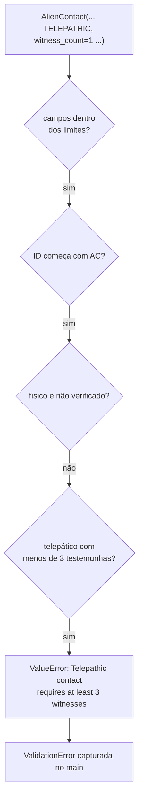

# A demonstração

A demonstração segue o formato do exercício 0: uma função que mostra um relato e o `main`, no
fim do arquivo, depois de `validation_message`.

## Mostrar o relato

```python
def show_contact(contact: AlienContact) -> None:
    print(f"ID: {contact.contact_id}")
    print(f"Type: {contact.contact_type.value}")
    print(f"Location: {contact.location}")
    print(f"Signal: {contact.signal_strength}/10")
    print(f"Duration: {contact.duration_minutes} minutes")
    print(f"Witnesses: {contact.witness_count}")
    if contact.message_received is not None:
        print(f"Message: '{contact.message_received}'")
```

- `contact.contact_type.value` é o texto do membro, `radio`. Sem o `.value`, a linha sairia
  `Type: ContactType.RADIO` ([Enum](../02-conceitos/05-enum.md#o-que-aconteceu));
- `Signal: 8.5/10` é a força do sinal seguida da escala;
- a mensagem vai entre aspas simples, escritas dentro da f-string;
- a linha `Message:` só sai quando há mensagem. O enunciado só mostra um relato com mensagem; não
  imprimir a linha quando o campo é `None` é escolha do tutorial.

## O main

```python
def main() -> None:
    print("Alien Contact Log Validation")
    print("=" * 38)
    contact = AlienContact(
        contact_id="AC_2024_001",
        timestamp=datetime(2024, 1, 15, 14, 30),
        location="Area 51, Nevada",
        contact_type=ContactType.RADIO,
        signal_strength=8.5,
        duration_minutes=45,
        witness_count=5,
        message_received="Greetings from Zeta Reticuli",
    )
    print("Valid contact report:")
    show_contact(contact)
    print()
    print("=" * 38)
    try:
        AlienContact(
            contact_id="AC_2024_002",
            timestamp=datetime(2024, 1, 16, 9, 15),
            location="Roswell, New Mexico",
            contact_type=ContactType.TELEPATHIC,
            signal_strength=6.2,
            duration_minutes=30,
            witness_count=1,
        )
    except ValidationError as error:
        print("Expected validation error:")
        print(validation_message(error))


if __name__ == "__main__":
    main()
```

- o relato válido tem os dados da saída do enunciado. O tipo vai como o membro
  `ContactType.RADIO`, e a data como `datetime(...)`: com os tipos certos no construtor, o mypy
  aceita a chamada ([E pelo construtor?](../02-conceitos/04-conversao-de-tipos.md#e-pelo-construtor)).
  A data não aparece na saída, e o valor é escolha do tutorial;
- o relato inválido é um contato telepático com uma testemunha. Todos os campos estão dentro dos
  limites, o ID começa com `AC`, o contato não é físico e o sinal, 6.2, não é forte: a primeira
  regra a falhar é a terceira, a da saída esperada. Os dados seguem um dos relatos inválidos que
  as ferramentas de dados do enunciado geram ([Gerar os dados](../06-dados-do-gerador/02-gerar-os-dados.md#os-casos-inválidos));
- `validation_message(error)` imprime a mensagem sem o `Value error, ` do Pydantic.


