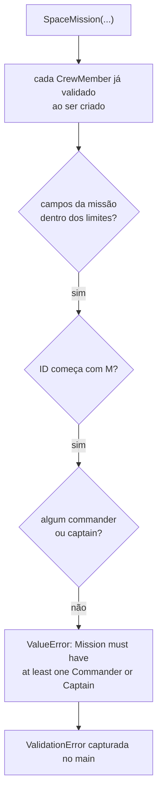

# A demonstração

A demonstração entra no fim do arquivo, depois de `validation_message`: uma função que mostra a
missão e o `main`.

## Mostrar a missão

```python
def show_mission(mission: SpaceMission) -> None:
    print(f"Mission: {mission.mission_name}")
    print(f"ID: {mission.mission_id}")
    print(f"Destination: {mission.destination}")
    print(f"Duration: {mission.duration_days} days")
    print(f"Budget: ${mission.budget_millions}M")
    print(f"Crew size: {len(mission.crew)}")
    print("Crew members:")
    for member in mission.crew:
        print(f"- {member.name} ({member.rank.value}) - "
              f"{member.specialization}")
```

- `${mission.budget_millions}M`: o `$` fora das chaves é só um caractere do texto; dentro das
  chaves vem o `float`, que o Python escreve como `2500.0`;
- `len(mission.crew)` é o número de tripulantes;
- cada tripulante sai numa linha com o nome, a patente (`.value`, o texto do Enum) e a
  especialidade. A f-string foi dividida em duas partes para caber nos 79 caracteres; o Python
  junta textos escritos lado a lado num só, e cada parte tem o seu `f`.

## O main

```python
def main() -> None:
    print("Space Mission Crew Validation")
    print("=" * 41)
    mission = SpaceMission(
        mission_id="M2024_MARS",
        mission_name="Mars Colony Establishment",
        destination="Mars",
        launch_date=datetime(2024, 9, 1),
        duration_days=900,
        crew=[
            CrewMember(member_id="CM001", name="Sarah Connor",
                       rank=Rank.COMMANDER, age=45,
                       specialization="Mission Command",
                       years_experience=20),
            CrewMember(member_id="CM002", name="John Smith",
                       rank=Rank.LIEUTENANT, age=36,
                       specialization="Navigation", years_experience=12),
            CrewMember(member_id="CM003", name="Alice Johnson",
                       rank=Rank.OFFICER, age=29,
                       specialization="Engineering", years_experience=4),
        ],
        budget_millions=2500.0,
    )
    print("Valid mission created:")
    show_mission(mission)
    print()
    print("=" * 41)
    try:
        SpaceMission(
            mission_id="M2024_LUNA",
            mission_name="Lunar Survey",
            destination="Moon",
            launch_date=datetime(2024, 11, 1),
            duration_days=30,
            crew=[
                CrewMember(member_id="CM004", name="Maria Garcia",
                           rank=Rank.LIEUTENANT, age=33,
                           specialization="Pilot", years_experience=9),
                CrewMember(member_id="CM005", name="David Brown",
                           rank=Rank.CADET, age=22,
                           specialization="Research", years_experience=1),
            ],
            budget_millions=150.0,
        )
    except ValidationError as error:
        print("Expected validation error:")
        print(validation_message(error))


if __name__ == "__main__":
    main()
```

### A missão válida

Nome, ID, destino, duração, orçamento e os três tripulantes (nome, patente e especialidade) são
os da saída do enunciado. O que a saída não mostra é escolha do tutorial: a data de lançamento,
os IDs, as idades e os anos de experiência dos tripulantes.

Os anos de experiência foram escolhidos para a missão passar na regra 3: ela dura 900 dias, e
Sarah Connor (20 anos) e John Smith (12) são experientes; Alice Johnson (4) não é. São 2 de 3,
mais da metade. Com Alice incluída, a demonstração mostra que a regra aceita tripulantes sem
experiência, desde que pelo menos metade tenha.

Os tripulantes são criados com o construtor de `CrewMember`, com a patente como membro de `Rank`:
tipos certos, e o mypy aceita a chamada. `mission_status` fica de fora e recebe `"planned"`.

### A missão inválida

A segunda missão tem um tenente e um cadete: ninguém no comando. O ID começa com `M`, e a missão
dura 30 dias, então a regra 3 não se aplica: a primeira regra a falhar é a 2, a da saída
esperada.



Os dois `CrewMember` da missão inválida são válidos: são criados antes de `SpaceMission` ser
chamada, e um tripulante inválido lançaria a sua própria `ValidationError` ali, antes da missão
existir ([Modelos aninhados](../02-conceitos/07-modelos-aninhados.md#o-que-aconteceu)).
