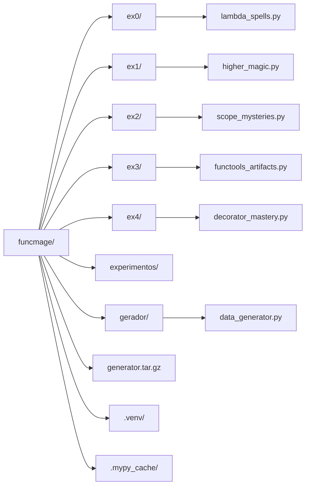

# A pasta do projeto

O enunciado pede cada exercício num arquivo próprio, dentro de uma pasta com o número do
exercício: `ex0/` a `ex4/`. Crie uma pasta para o projeto, entre nela e crie as cinco pastas:

```bash
mkdir funcmage
cd funcmage
mkdir ex0 ex1 ex2 ex3 ex4
```

`mkdir` cria uma pasta (ou várias, com os nomes em sequência). O nome `funcmage` é só uma
sugestão; o que o enunciado fixa são as pastas `ex0` a `ex4` e os nomes dos arquivos. **Todos os
comandos do tutorial são rodados a partir desta pasta**, a `funcmage`.

Crie também uma pasta `experimentos`, para os programas pequenos que a parte
[Funções como valores](../02-conceitos/01-funcoes-sao-valores.md) usa para mostrar cada ideia.
Eles não fazem parte da entrega:

```bash
mkdir experimentos
```

Ao fim do projeto, a pasta fica assim:



A pasta `.venv/` é criada na [próxima página](./03-o-ambiente-virtual.md); a `.mypy_cache/` é
criada pelo mypy na primeira vez que ele roda, para guardar resultados e conferir mais rápido da
próxima vez; o `generator.tar.gz` e a pasta `gerador/` são o anexo do enunciado
([O gerador de dados](./05-o-gerador-de-dados.md)). Só os cinco arquivos `.py` das pastas `ex0` a
`ex4` são entregues.
