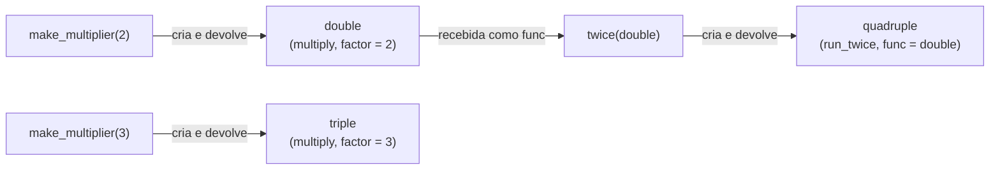

# Funções que devolvem funções

Um `def` pode ficar **dentro** de outro `def`. A função de dentro é criada cada vez que a de fora
roda, e a de fora pode devolvê-la como qualquer outro valor. É assim que se escreve uma
**fábrica de funções**: uma função que monta e devolve uma função nova, configurada pelos
argumentos recebidos. As quatro funções do exercício 1, as quatro do exercício 2, a
`spell_dispatcher` do exercício 3 e os três decoradores do exercício 4 são feitos desse jeito.

## O experimento

Crie `experimentos/fabrica.py`:

```python title="experimentos/fabrica.py"
from collections.abc import Callable


def make_multiplier(factor: int) -> Callable[[int], int]:
    def multiply(number: int) -> int:
        return number * factor

    return multiply


def twice(func: Callable[[int], int]) -> Callable[[int], int]:
    def run_twice(number: int) -> int:
        return func(func(number))

    return run_twice


double = make_multiplier(2)
triple = make_multiplier(3)
print(double(5), triple(5))
print(double.__name__, double is triple)
quadruple = twice(double)
print(quadruple(5))
print(twice(triple)(1))
```

```bash
python3 experimentos/fabrica.py
```

```text
10 15
multiply False
20
9
```

## O que aconteceu

**A fábrica.** `make_multiplier(2)` roda o corpo de `make_multiplier`: o `def multiply` cria uma
função nova, e o `return multiply` a devolve, **sem chamá-la** (sem parênteses). A variável
`double` recebe essa função. `make_multiplier(3)` roda o corpo de novo e cria **outra** função
`multiply`: as duas têm o mesmo nome (`double.__name__` é `multiply`), mas são objetos
diferentes (`double is triple` é `False`).

**Cada função lembra o seu `factor`.** `double(5)` dá 10 e `triple(5)` dá 15, embora o
`make_multiplier` já tenha terminado nas duas vezes. A função de dentro usa `factor`, um parâmetro
da função de fora, e cada uma guardou o valor que `factor` tinha quando ela foi criada. Esse
"lembrar" se chama **closure**, e é o assunto da [próxima página](./04-escopo-e-closures.md).

**Recebe e devolve função.** `twice` recebe uma função (`func`) e devolve outra (`run_twice`), que
aplica `func` duas vezes. `twice(double)` é uma função que dobra duas vezes: `quadruple(5)` dá 20.
`twice(triple)(1)` cria a função e a chama na mesma linha: triplicar duas vezes o 1 dá 9.



## A linha em branco antes do def de dentro

O flake8 pede uma linha em branco antes de um `def` de dentro quando há código antes dele no mesmo
bloco (aviso `E306`), e o costume é deixar outra entre o fim do `def` de dentro e o `return`. Os
exercícios seguem esse formato.

## Os type hints

As funções de dentro também levam type hints: `multiply(number: int) -> int`. O retorno de
`make_multiplier` é `Callable[[int], int]`, o tipo da função devolvida. Nos exercícios, as
assinaturas do enunciado usam só `Callable`, sem colchetes
([O type hint Callable](./01-funcoes-sao-valores.md#o-type-hint-callable)).
