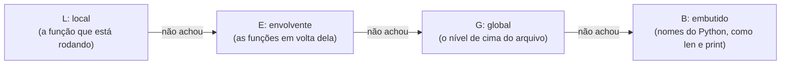
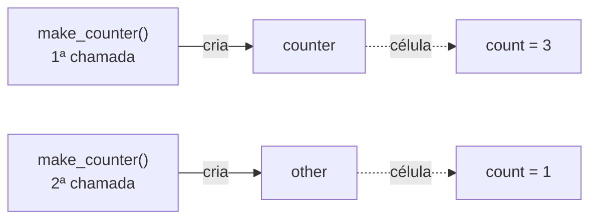

# Escopo e closures

Um contador precisa lembrar quantas vezes já foi chamado. As variáveis de dentro de uma função
somem quando ela termina, então a contagem tem de ficar em outro lugar. Uma variável global, no
nível de cima do arquivo, resolveria, mas o enunciado proíbe variáveis globais. A saída é a
**closure**: uma função que carrega consigo as variáveis do lugar onde foi criada.

## Escopo: onde um nome vale

O **escopo** de uma variável é a parte do código em que o nome dela existe. Quando o código usa um
nome, o Python o procura em quatro escopos, nesta ordem (a regra **LEGB**):



Se o nome não está em nenhum dos quatro, o Python lança `NameError`. O escopo envolvente é o das
funções **escritas** em volta, e não o de quem chamou a função: o Python decide onde procurar
olhando para o texto do código. Por isso essa regra se chama **escopo léxico** (*lexical
scoping*; "léxico" = "do texto").

Na página anterior, `multiply` usava `factor`: o nome não é local de `multiply`, e o Python o
achou no escopo envolvente, o de `make_multiplier`.

## Um contador que não funciona

Crie `experimentos/contador.py`:

```python title="experimentos/contador.py"
from collections.abc import Callable


def make_counter() -> Callable[[], int]:
    count = 0

    def counter() -> int:
        count += 1
        return count

    return counter


counter = make_counter()
print(counter())
```

```bash
python3 experimentos/contador.py
```

A última linha da saída é:

```text
UnboundLocalError: cannot access local variable 'count' where it is not associated with a value
```

("não é possível acessar a variável local `count`, que não está associada a um valor"). No Python
3.10, a mensagem é `local variable 'count' referenced before assignment`, com o mesmo sentido.

`count += 1` é uma **atribuição**: quer dizer `count = count + 1`. Uma atribuição em qualquer
ponto de uma função torna o nome **local** a ela, no corpo inteiro. Então, dentro de `counter`,
`count` é uma variável local nova, ainda sem valor, e o `count + 1` tenta lê-la antes de ela
existir. O `count = 0` de `make_counter` nem chega a ser procurado.

O flake8 acha o problema sem rodar o programa:

```bash
.venv/bin/flake8 experimentos/contador.py
```

```text
experimentos/contador.py:8:9: F823 local variable 'count' defined in enclosing scope on line 5 referenced before assignment
```

## nonlocal

A instrução `nonlocal count` avisa: "`count` não é local; é a variável do escopo envolvente, e as
atribuições daqui mudam aquela". Corrija o arquivo e acrescente mais testes:

```python title="experimentos/contador.py"
from collections.abc import Callable


def make_counter() -> Callable[[], int]:
    count = 0

    def counter() -> int:
        nonlocal count
        count += 1
        return count

    return counter


counter = make_counter()
print(counter())
other = make_counter()
print(counter(), counter(), other())
print(counter.__code__.co_freevars)
cells = counter.__closure__ or ()
print([cell.cell_contents for cell in cells])
```

```bash
python3 experimentos/contador.py
.venv/bin/flake8 experimentos/contador.py
```

```text
1
2 3 1
('count',)
[3]
```

- `counter()` devolve 1, depois 2 e 3: o `count` sobrevive entre as chamadas, embora
  `make_counter` tenha terminado lá atrás;
- `other`, criado por outra chamada de `make_counter`, começa do 1: cada chamada de
  `make_counter` cria um `count` novo, e cada contador tem o seu;
- `counter.__code__` é o código da função, já traduzido pelo Python, e `co_freevars` lista as
  **variáveis livres** dela: os nomes que ela usa e que pertencem a um escopo envolvente. Aqui,
  só `count`;
- `counter.__closure__` guarda essas variáveis, cada uma numa **célula**; `cell_contents` é o
  valor guardado agora, 3. Uma função sem variáveis livres tem `__closure__` igual a `None`; o
  `or ()` troca o `None` por uma tupla vazia, e o mypy aceita o laço nos dois casos.

Uma **closure** é isso: a função mais as células das variáveis livres. A função lembra o ambiente
onde foi criada porque leva esse ambiente junto.



## Mudar um objeto não precisa de nonlocal

`nonlocal` só é necessário para **atribuir** um valor novo ao nome. Mudar o conteúdo de um objeto
(acrescentar numa lista, gravar uma chave num dicionário) não é atribuição ao nome. Crie
`experimentos/caderno.py`:

```python title="experimentos/caderno.py"
from collections.abc import Callable


def make_notebook() -> Callable[[str], list[str]]:
    notes: list[str] = []

    def write(note: str) -> list[str]:
        notes.append(note)
        return notes

    return write


write = make_notebook()
write("fire")
print(write("ice"))
```

```bash
python3 experimentos/caderno.py
```

```text
['fire', 'ice']
```

`notes.append(note)` só **lê** o nome `notes` (achado no escopo envolvente) e muda a lista para a
qual ele aponta. A lista começa vazia, e o valor `[]` não diz o tipo dos itens. Sem a anotação, o
mypy deduz o tipo pelo primeiro uso da lista (aqui, o `append` de um `str`, que dá `list[str]`);
quando a lista é usada antes de receber um item, ele acusa `Need type annotation for "notes"`. A
anotação `list[str]` deixa o tipo escrito na própria criação.

## global e nonlocal

Existe também a instrução `global`, que faz uma função atribuir a uma variável do nível de cima do
arquivo. Crie `experimentos/global_nonlocal.py`, com um contador de cada tipo:

```python title="experimentos/global_nonlocal.py"
from collections.abc import Callable

calls = 0


def count_global() -> int:
    global calls
    calls += 1
    return calls


def make_counter() -> Callable[[], int]:
    count = 0

    def counter() -> int:
        nonlocal count
        count += 1
        return count

    return counter


print(count_global(), count_global())
calls = 100
print(count_global())
first = make_counter()
second = make_counter()
print(first(), first(), second())
```

```bash
python3 experimentos/global_nonlocal.py
```

```text
1 2
101
1 2 1
```

| | `global` | `nonlocal` |
|---|---|---|
| a variável fica | no nível de cima do arquivo | numa função envolvente |
| quantas existem | uma só, para o programa inteiro | uma por chamada da função de fora |
| quem pode mudar | qualquer código do arquivo (aqui, `calls = 100` mudou a contagem por fora) | só as funções criadas dentro daquela chamada |

O contador global não tem como ser independente: existe um único `calls`, e qualquer linha do
programa pode estragá-lo. Os contadores com `nonlocal` têm cada um o seu estado, privado. É por
isso que o enunciado proíbe variáveis globais e libera `nonlocal` no exercício 2
([Perguntas de revisão](../08-fechamento/03-perguntas-de-revisao.md#por-que-global-é-proibido-e-nonlocal-é-permitido-quais-as-diferenças)).
