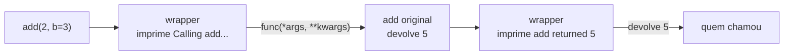

# Decoradores

Às vezes várias funções precisam do mesmo comportamento extra: imprimir uma mensagem antes de
rodar, medir o tempo, recusar argumentos ruins. Copiar esse código para dentro de cada função
mistura o extra com o trabalho principal dela. Um **decorador** separa os dois: é uma função que
recebe uma função e devolve outra, que faz o extra e chama a original.

## O experimento

Crie `experimentos/decoradores.py`:

```python title="experimentos/decoradores.py"
from collections.abc import Callable
from typing import Any


def announce(func: Callable) -> Callable:
    def wrapper(*args: Any, **kwargs: Any) -> Any:
        print(f"Calling {func.__name__} with {args} {kwargs}")
        result = func(*args, **kwargs)
        print(f"{func.__name__} returned {result}")
        return result

    return wrapper


def subtract(a: int, b: int) -> int:
    return a - b


subtract = announce(subtract)
print(subtract(10, 4))


@announce
def add(a: int, b: int) -> int:
    """Add two numbers."""
    return a + b


print(add(2, b=3))
print(add.__name__, add.__doc__)
```

```bash
python3 experimentos/decoradores.py
```

```text
Calling subtract with (10, 4) {}
subtract returned 6
6
Calling add with (2,) {'b': 3}
add returned 5
5
wrapper None
```

## O que aconteceu

**O decorador.** `announce` recebe uma função (`func`), cria a função `wrapper` ("embrulho") e a
devolve. `wrapper` aceita qualquer argumento ([\*args e \*\*kwargs](./05-args-e-kwargs.md)),
imprime a chamada, chama a função original com os mesmos argumentos, imprime o resultado e o
devolve. `wrapper` lembra `func` por closure ([Escopo e closures](./04-escopo-e-closures.md)).

**Decorar à mão.** `subtract = announce(subtract)` troca a função guardada no nome `subtract` pelo
embrulho. A partir daí, quem chama `subtract(10, 4)` chama `wrapper`, que imprime as duas linhas
em volta do resultado.

**A arroba.** Uma linha `@announce` logo acima de um `def` faz exatamente a mesma coisa, sem
repetir o nome: o Python cria `add` e, em seguida, faz `add = announce(add)`.



## O nome perdido

A última linha mostra um defeito: `add.__name__` é `wrapper`, e `add.__doc__` é `None`. O nome
`add` agora aponta para o embrulho, e o embrulho tem o nome e a documentação dele. O texto entre
aspas triplas logo abaixo do `def` é a **docstring**, a documentação da função, guardada em
`__doc__`; o embrulho não tem docstring. Ferramentas de depuração, mensagens de erro e a função
`help()` mostrariam informações do embrulho, e não da função decorada.

## functools.wraps

`wraps`, do módulo `functools`, conserta isso. Ele é ele mesmo um decorador, posto em cima do
`wrapper`: `@wraps(func)` copia para o embrulho o nome, a docstring e outras informações de
`func`. Corrija o arquivo:

```python title="experimentos/decoradores.py"
from collections.abc import Callable
from functools import wraps
from typing import Any


def announce(func: Callable) -> Callable:
    @wraps(func)
    def wrapper(*args: Any, **kwargs: Any) -> Any:
        print(f"Calling {func.__name__} with {args} {kwargs}")
        result = func(*args, **kwargs)
        print(f"{func.__name__} returned {result}")
        return result

    return wrapper


def subtract(a: int, b: int) -> int:
    return a - b


subtract = announce(subtract)
print(subtract(10, 4))


@announce
def add(a: int, b: int) -> int:
    """Add two numbers."""
    return a + b


print(add(2, b=3))
print(add.__name__, add.__doc__)
```

```bash
python3 experimentos/decoradores.py
```

```text
Calling subtract with (10, 4) {}
subtract returned 6
6
Calling add with (2,) {'b': 3}
add returned 5
5
add Add two numbers.
```

Agora o embrulho se apresenta como `add`, com a docstring de `add`. `wraps` também guarda a
função original no atributo `__wrapped__` do embrulho. Os decoradores do exercício 4 usam
`@wraps(func)`, como o enunciado pede.
