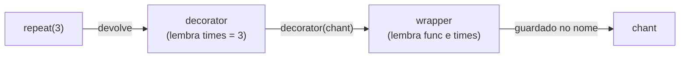

# Decoradores com parâmetros

Um decorador como `announce` não recebe configuração: faz sempre a mesma coisa. Muitas vezes o
extra depende de um número: quantas vezes repetir, qual o poder mínimo, quantas tentativas fazer.
O decorador precisa então de um parâmetro, como em `@repeat(3)`. Isso se resolve com mais uma
camada de função: uma **fábrica de decoradores**.

## O experimento

Crie `experimentos/repetir.py`:

```python title="experimentos/repetir.py"
from collections.abc import Callable
from functools import wraps
from typing import Any


def repeat(times: int) -> Callable:
    def decorator(func: Callable) -> Callable:
        @wraps(func)
        def wrapper(*args: Any, **kwargs: Any) -> list[Any]:
            return [func(*args, **kwargs) for _ in range(times)]

        return wrapper

    return decorator


@repeat(3)
def chant(word: str) -> str:
    return word.upper()


print(chant("om"))
print(chant.__name__)
twice = repeat(2)
print(twice(str.upper)("hey"))
```

```bash
python3 experimentos/repetir.py
```

```text
['OM', 'OM', 'OM']
chant
['HEY', 'HEY']
```

## O que aconteceu

São três funções, uma dentro da outra:

| Função | Recebe | Devolve |
|---|---|---|
| `repeat` | o parâmetro (`times`) | `decorator` |
| `decorator` | a função a decorar (`func`) | `wrapper` |
| `wrapper` | os argumentos da chamada (`*args`, `**kwargs`) | a lista de resultados |

`@repeat(3)` acima de `chant` é lido em dois passos:

1. `repeat(3)` roda primeiro e devolve `decorator`, que lembra `times = 3` por closure;
2. esse `decorator` é o decorador de verdade: o Python faz `chant = decorator(chant)`, e `chant`
   passa a ser o `wrapper`, que lembra `func` e `times`.

Ao chamar `chant("om")`, o `wrapper` chama a função original três vezes e devolve os três
resultados numa lista (com uma compreensão de lista; `_` é o nome de costume para a variável que
não é usada). O `@wraps(func)` manteve o nome `chant`.

As duas últimas linhas fazem os dois passos à mão: `repeat(2)` devolve um decorador, guardado em
`twice`; `twice(str.upper)` decora o método `upper` de `str`, e a chamada com `"hey"` o roda duas
vezes.



`repeat` sem parênteses (`@repeat`) não funcionaria: o Python faria `chant = repeat(chant)`,
`times` receberia a função, e `chant("om")` devolveria uma função (um `wrapper`) em vez da lista
de resultados. Um decorador com parâmetros é sempre usado com parênteses, mesmo que os valores
sejam passados por nome: `@repeat(times=3)`.

No exercício 4, `power_validator(min_power)` e `retry_spell(max_attempts)` seguem este formato de
três camadas, e `spell_timer(func)` segue o formato de duas camadas da
[página anterior](./06-decoradores.md).
