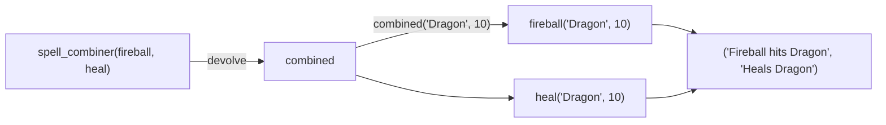

# spell_combiner

`spell_combiner` junta dois feitiços num só: o feitiço novo lança os dois com os mesmos
argumentos e devolve os dois resultados numa tupla. A função entra depois de `is_strong`:

```python
def spell_combiner(spell1: Callable, spell2: Callable) -> Callable:
    if not callable(spell1) or not callable(spell2):
        raise TypeError("spell_combiner needs two callable spells")

    def combined(target: str, power: int) -> tuple[str, str]:
        return spell1(target, power), spell2(target, power)

    return combined
```

## Conferir os argumentos

`callable(spell1)` responde se `spell1` pode ser chamado
([callable()](../02-conceitos/01-funcoes-sao-valores.md#callable)). Se um dos dois não pode (um
texto passado por engano, por exemplo), a função lança `TypeError` na hora, com uma mensagem que
diz o que faltou. Sem a conferência, o erro só apareceria depois, quando alguém lançasse o
feitiço combinado, com a mensagem genérica do Python `'str' object is not callable`, longe da
linha que causou o problema. Conferir com `callable()` e lançar `TypeError` é escolha do tutorial;
é o uso de `callable()` que o enunciado autoriza neste exercício, e as quatro funções fazem a
mesma conferência.

## O feitiço combinado

- `combined` tem a assinatura de um feitiço, `(target: str, power: int)`, e por isso pode ser
  usado em qualquer lugar onde um feitiço é esperado;
- `return spell1(target, power), spell2(target, power)` lança os dois, na ordem, e devolve uma
  **tupla** com os dois resultados: uma vírgula entre dois valores num `return` cria uma tupla;
- o tipo do retorno é `tuple[str, str]`, uma tupla de dois textos;
- `combined` lembra `spell1` e `spell2` por closure: `spell_combiner` termina, e os dois feitiços
  continuam guardados dentro de `combined`
  ([Escopo e closures](../02-conceitos/04-escopo-e-closures.md)).

O `return combined` devolve a função, sem chamá-la. A linha em branco antes do `def combined` é a
que o flake8 pede depois do `if`
([A linha em branco antes do def de dentro](../02-conceitos/03-funcoes-que-devolvem-funcoes.md#a-linha-em-branco-antes-do-def-de-dentro)).


